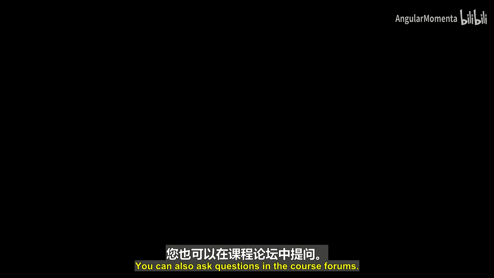

# 058：创建算法（黑客游戏版本5）


在本节课中，我们将学习如何在游戏创建过程中，为黑客游戏的第五个版本设计算法。我们将重点引入一种新的重复控制结构——**不定次重复**，以处理玩家拥有多次猜测机会的情况。

## 概述

在之前的版本中，我们使用了**定次重复**，这要求我们在执行循环前就知道需要重复的次数。然而，在版本5中，玩家最多有四次机会猜测密码，但我们无法预知玩家会在第几次猜中。因此，我们需要一种更灵活的重复结构。本节我们将学习**不定次重复**（也称为不定次迭代），它允许我们在某个条件为真时，重复执行某个步骤。

## 从定次重复到不定次重复

上一节我们介绍了定次重复。本节中我们来看看不定次重复。定次重复要求在执行前明确知道重复次数，例如“搅拌面糊20次”。但在许多情况下，我们无法预知次数，例如“搅拌面糊直到没有结块”。这时就需要使用不定次重复。

在算法构建器中，不定次重复由一个 **while** 图标表示。它由一个常规矩形（放置要重复的步骤）和一个条件判断图标（放置循环条件）通过箭头连接组成。

其核心逻辑可以用以下伪代码描述：
```
while (条件为真):
    执行步骤
```

这意味着，只要条件保持为真，步骤就会一直重复执行。如果初始条件就不为真，那么循环内的步骤一次也不会执行。

## 设计版本5的猜测逻辑

现在，我们将不定次重复应用到黑客游戏版本5的算法中。在之前的版本中，算法流程是：提示玩家猜测，然后根据猜测正确与否显示结果。在版本5中，对于**正确猜测**的行为保持不变。但对于**错误猜测**，我们需要处理一系列新的事情。

以下是错误猜测后需要发生的步骤列表：
*   显示剩余尝试次数并将其减1。
*   提示玩家进行新的猜测。
*   如果玩家只剩最后一次尝试，则显示警告信息。

我们需要让以上这一系列步骤，在玩家猜测错误且尚未用尽四次尝试的情况下，**重复执行**。

## 开始构建算法

要开始构建算法，请将原来的“提示输入猜测”步骤替换为一个名为“获取猜测”的步骤。然后，展开“获取猜测”的面板，在其中使用不定次重复结构来组织逻辑。

你需要在展开的面板中重新加入“提示输入猜测”的步骤。构建时，请始终参考你的游戏描述和功能测试计划。如果遇到困难，可以回顾课程资料或在课程论坛中提问。

## 总结




本节课中，我们一起学习了**不定次重复**控制结构。我们了解到，当重复次数无法预先确定，而是取决于某个运行时的条件时，就应该使用 `while` 循环。我们分析了黑客游戏版本5的需求，即玩家拥有最多四次猜测机会，并据此开始设计使用不定次重复来管理多次猜测流程的算法。掌握这一概念，将使你能够处理更复杂、更动态的程序逻辑。