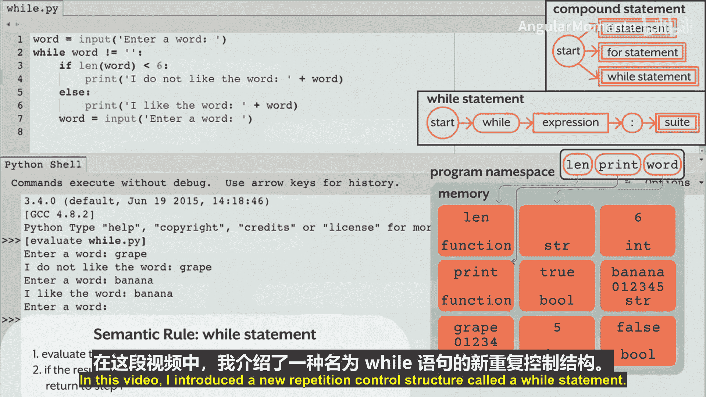

# 059：while语句详解 🔄


在本节课中，我们将学习一种新的控制结构——`while`语句。它是一种重复执行代码块的方式，但与之前学过的`for`语句不同，`while`语句的重复次数不是由序列长度决定的，而是由一个布尔表达式控制的。我们将通过一个具体的程序示例来理解其工作原理。

## 从`for`语句到`while`语句的过渡

上一节我们介绍了`for`语句，它可以遍历一个序列（如单词列表），并对每个元素执行一次操作。然而，有些场景下我们无法预先知道需要处理多少个元素。例如，我们希望程序能持续检查用户输入的单词并给出评价，直到用户主动要求停止。

`for`语句适用于已知序列的情况，而`while`语句则适用于这种“不确定重复次数”的场景。它通过检查一个条件表达式的真假来决定是否继续执行。

## `while`语句的语法结构

`while`语句是一种复合语句。其语法结构如下：

**语法图核心概念：**
```
while 表达式:
    语句组
```

*   **头部**：以关键字`while`开始，后跟一个表达式和一个冒号`:`。
*   **语句组**：与`if`和`for`语句类似，是一个缩进的代码块，包含需要重复执行的语句。

## 程序示例：交互式单词评价器

以下是一个使用`while`语句的程序。它会不断请求用户输入单词，并根据单词长度给出“喜欢”或“不喜欢”的评价，直到用户输入一个空字符串（直接按回车键）为止。

```python
word = input()
while word != "":
    if len(word) < 6:
        print("I do not like the word " + word)
    else:
        print("I like the word " + word)
    word = input()
```

**运行示例：**
*   输入 `grape`，输出：`I do not like the word grape`
*   输入 `banana`，输出：`I like the word banana`
*   输入 `（直接按回车）`，程序结束。

## `while`语句的执行语义（工作原理）

`while`语句的执行遵循一个明确的流程，我们称之为“不定重复控制结构”，因为无法提前预知其语句组会被执行多少次。

以下是其简化的执行步骤：

1.  **评估条件**：计算`while`头部表达式的值，得到一个结果对象。
2.  **判断与执行**：
    *   如果该结果对象被解释为 **`True`**，则执行`while`的语句组（代码块）。执行完毕后，**返回第1步**。
    *   如果该结果对象被解释为 **`False`**，则跳过整个`while`语句的语句组，继续执行程序后面的代码。

让我们将这个流程应用到上面的程序示例中，跟踪其执行过程：

*   **第一轮循环**：
    *   `word`初始值为`"grape"`。
    *   **步骤1**：条件 `word != ""` 评估为 `True`（因为`"grape"`不等于空字符串）。
    *   **步骤2**：条件为真，执行语句组。
        *   `len("grape")` 为5，小于6，执行`if`分支，打印 `"I do not like the word grape"`。
        *   执行 `word = input()`，等待用户输入。假设用户输入 `"banana"`。
    *   返回**步骤1**。
*   **第二轮循环**：
    *   `word`现在为`"banana"`。
    *   **步骤1**：条件 `"banana" != ""` 评估为 `True`。
    *   **步骤2**：执行语句组。
        *   `len("banana")` 为6，不小于6，执行`else`分支，打印 `"I like the word banana"`。
        *   执行 `word = input()`，等待用户输入。假设用户直接按回车，输入空字符串 `""`。
    *   返回**步骤1**。
*   **结束循环**：
    *   `word`现在为`""`。
    *   **步骤1**：条件 `"" != ""` 评估为 `False`（因为空字符串等于空字符串）。
    *   **步骤2**：条件为假，跳过整个`while`语句的语句组。循环结束，程序执行完毕。

## 总结

本节课中，我们一起学习了一种新的重复控制结构——**`while`语句**。

*   **核心作用**：它用于在**条件为真时**重复执行一段代码，适用于重复次数不确定的场景。
*   **关键区别**：与`for`语句遍历固定序列不同，`while`语句由一个布尔表达式控制循环。
*   **工作流程**：遵循“评估条件 -> 真则执行并返回 -> 假则跳出”的循环逻辑。
*   **重要应用**：常用于处理交互式输入、监控状态变化或执行需要满足特定条件才停止的任务。



通过理解`while`语句的语法和语义，你现在可以编写能够动态响应用户输入或程序状态变化的更灵活的程序了。