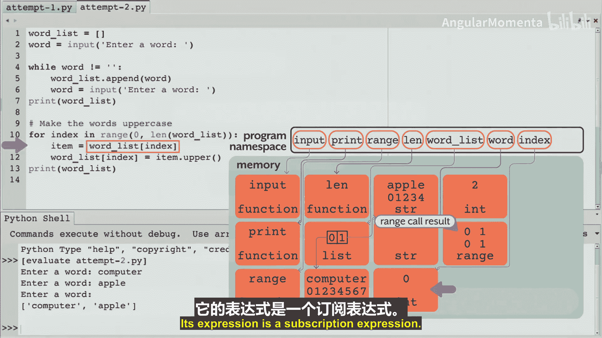

# 060：循环示例与range类型


在本节课中，我们将通过具体示例深入探讨`for`循环和`while`循环的应用，并介绍一种新的序列类型——`range`。我们将学习如何利用循环处理列表数据，以及如何使用`range`对象配合索引来修改列表中的元素。

## 循环语句示例回顾

上一节我们介绍了`for`循环和`while`循环的基本概念。本节中，我们来看看如何将它们应用于更实际的编程场景。

首先，回顾一个之前的程序。该程序会遍历一个单词列表，并根据每个单词的长度输出不同的评价。

```python
# 示例：基于单词长度的评价
words = ["computer", "apple", "python"]
for word in words:
    if len(word) > 6:
        print(f"I like the word '{word}'.")
    else:
        print(f"I do not like the word '{word}'.")
```

在关于`while`循环的课程中，我们看到了一个允许用户自行输入单词并进行评价的程序。

## 构建动态单词列表

以下是一个结合了之前两个程序功能的新程序。它允许用户输入任意数量的单词，将它们保存到一个列表中，然后使用`for`循环分析这个列表。

```python
# 动态构建列表并分析
word_list = []  # 创建一个空列表
word = input("Enter a word (or press Enter to finish): ")

while word != "":
    word_list.append(word)  # 使用append方法将单词添加到列表末尾
    word = input("Enter a word (or press Enter to finish): ")

print("Your word list is:", word_list)

for word in word_list:
    if len(word) > 6:
        print(f"I like the word '{word}'.")
    else:
        print(f"I do not like the word '{word}'.")
```

这个程序的关键新语句是第5行对列表方法`append`的调用。此外，第1行创建了一个空列表，而不是固定的单词列表。第8行是一个熟悉的`print`调用，用于显示列表内容。

运行程序时，它会提示输入单词。用户可以持续输入，直到输入一个空字符串为止。然后，程序会根据每个单词的长度显示“喜欢”或“不喜欢”的评价。

在之前的`while`循环示例中，程序虽然绑定了每个输入的单词，但在下一次循环迭代中，前一个单词就被覆盖了。使用`append`方法则允许我们将所有输入的单词保存到列表中。

**核心概念**：在创建对象列表时，常见的做法是：
1.  从一个空列表开始。
2.  使用`append()`方法一次添加一个新元素。

## 修改列表元素的尝试

现在，我们来看两个程序（尝试一和尝试二）。每个程序都使用`while`循环输入一个单词列表并打印它，然后尝试将列表中的每个单词替换为其大写形式，并打印修改后的列表。

两个尝试都使用了`for`循环和字符串方法`upper()`。哪个程序会成功呢？

**尝试一**的代码如下：

```python
# 尝试一：直接修改循环变量
word_list = []
word = input("Enter a word: ")
while word != "":
    word_list.append(word)
    word = input("Enter a word: ")

print("Original list:", word_list)

for item in word_list:
    item = item.upper()  # 试图修改循环变量item

print("Modified list (Attempt 1):", word_list)
```

运行尝试一，输入“computer”和“Apple”后，程序会显示两个相同的列表。**尝试一未能将单词转换为大写**。

**尝试二**的代码如下：

```python
# 尝试二：通过索引修改列表元素
word_list = []
word = input("Enter a word: ")
while word != "":
    word_list.append(word)
    word = input("Enter a word: ")

print("Original list:", word_list)

for index in range(0, len(word_list)):
    item = word_list[index]
    word_list[index] = item.upper()  # 通过索引直接修改列表元素

print("Modified list (Attempt 2):", word_list)
```

再次运行并输入相同的单词，这次单词列表包含了**大写单词**。**尝试二成功了**。

## 语义分析：为何尝试一失败？

让我们对两个程序中的`for`循环进行语义分析，看看为什么尝试一没有改变单词，而尝试二成功了。

在尝试一的`for`循环中：
1.  `for item in word_list:` 将标识符 `item` 依次绑定到列表 `word_list` 中的每个元素（如“computer”、“Apple”）。
2.  在循环体内，执行 `item = item.upper()`。这会将标识符 `item` **重新绑定**到新的大写字符串对象（如“COMPUTER”）。
3.  然而，**这并没有改变原始列表 `word_list` 中的元素**。`item` 只是一个临时变量，指向列表元素的一个副本（对于不可变对象如字符串，可以理解为指向了同一个对象，但重新赋值后指向了新对象）。
4.  循环结束后，打印 `word_list`，列表内容没有变化。

**核心问题**：直接对`for`循环中的迭代变量赋值，**不会影响原始序列中的元素**。



## 引入range类型

尝试二使用了一种新的序列类型——`range`，配合**下标赋值**，成功地更新了列表。

`range`是一个**不可变的序列类型**。最简单的`range`对象包含两个值之间的所有整数。我们可以使用`range()`函数来创建一个`range`对象。

`range()`函数接受两个整数参数，返回一个包含从第一个参数到（第二个参数-1）的整数序列的`range`对象。

**公式**：`range(start, stop)` 生成序列 `[start, start+1, ..., stop-1]`

例如：
```python
my_range = range(3, 7)
# my_range 包含 3, 4, 5, 6
```

由于`range`是序列，其元素索引从0到`长度-1`，并且可以使用下标访问。例如，`my_range[0]` 返回索引0处的元素，即3。

`range`对象可以在`for`循环中用于遍历一个序列的索引，从而允许你读取或修改该序列的单个元素。

## 尝试二如何成功？

在尝试二的`for`循环中：
1.  `for index in range(0, len(word_list)):` 生成一个从0到`len(word_list)-1`的整数序列（例如，对于两个单词的列表，是`[0, 1]`）。
2.  循环变量 `index` 依次被绑定为0和1，即列表的索引。
3.  在循环体内：
    *   `item = word_list[index]` 通过下标获取列表当前索引处的元素。
    *   `word_list[index] = item.upper()` 通过下标赋值，**直接将列表 `word_list` 在 `index` 位置的元素重新绑定**为新的大写字符串对象。
4.  这样，列表中的元素就被逐个、直接地修改了。

**核心操作**：`sequence[index] = new_value` 这种形式的下标赋值，是**修改可变序列（如列表）中元素的有效方式**。

## 总结

本节课中我们一起学习了：
1.  如何使用`while`循环和`append()`方法动态构建列表。
2.  直接修改`for`循环迭代变量无法改变原始列表元素。
3.  引入了`range`类型，它是一个不可变的整数序列。
4.  掌握了通过`range()`函数生成索引序列，并结合下标赋值（`list[index] = value`）来有效修改列表元素的方法。

理解`range`和下标操作是进行列表遍历和修改的基础，在后续处理更复杂的数据结构时非常有用。