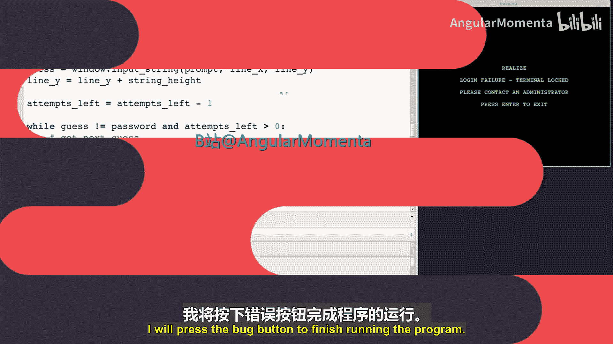
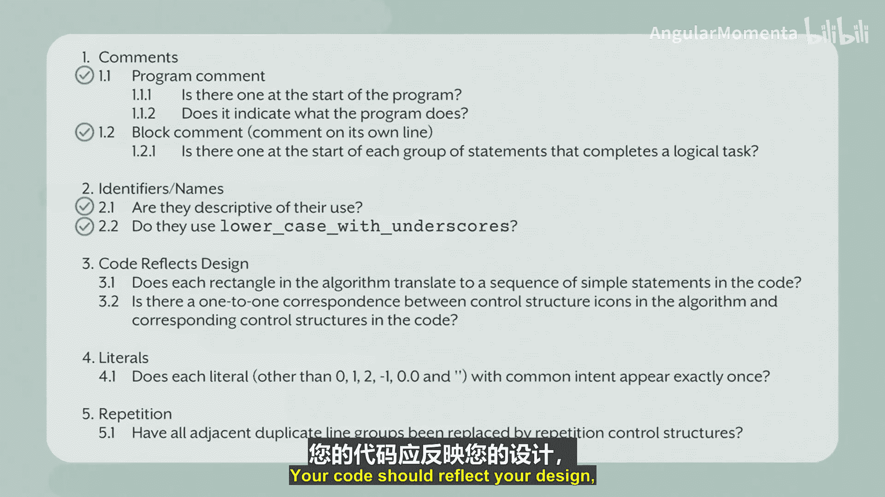
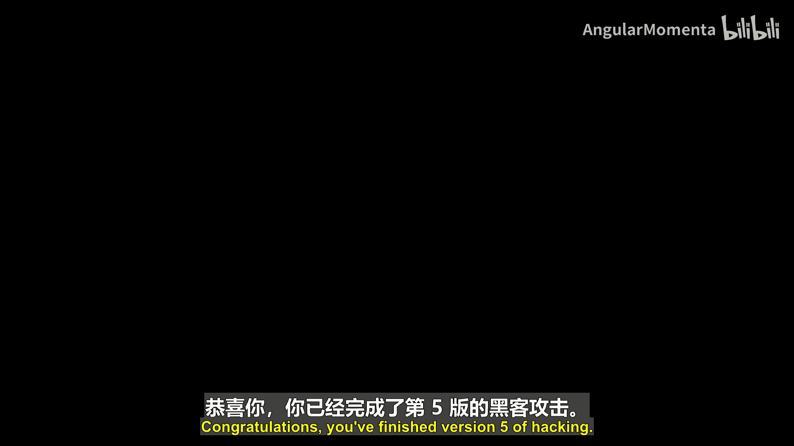

# 062：版本5代码审查与软件质量检查

在本节中，我们将通过调试器追踪一个`while`循环的执行过程，并回顾版本5代码的软件质量要求。

## 概述

我们将使用调试器逐步执行“黑客”游戏版本5的代码，观察变量状态的变化和程序流程的控制。同时，我们将重申并检查代码应满足的软件质量标准。

## 代码追踪：使用调试器分析循环

以下是版本5的代码。我在`while`循环旁设置了一个断点，并通过按下调试按钮开始追踪。

游戏暂停，以便我输入第一个猜测。我将输入一个错误的答案。

追踪停止，调试器高亮显示了`while`循环的头部。

在堆栈数据中，你可以看到`attempts_left`从4减少到了3。

你还可以看到`guess`已被绑定到输入的字符串。

`while`循环的条件有两个表达式，作为`and`运算符的操作数。

我的猜测不等于“hunting”，因此第一个操作数的结果为`True`。

第二个表达式检查`attempts_left`是否大于0，结果为`True`。

`and`运算符计算`True`和`True`，得到`True`。因此，`while`循环的代码块将被执行。

当我按下“单步跳过”按钮时，下一个被高亮的语句是一个`draw_string`调用，它使用了X坐标`line_x`和Y坐标`string_height`。

你可以在堆栈数据中看到这些坐标的值。我将再次按下“单步跳过”按钮。

调试器高亮了`if`语句的头部。由于没有调用`window.update`，`attempts_left`的新值尚未在窗口中显示。

此代码中移除了`window.update`调用，以演示计算机图形学中的一个常见做法。

当你进行多个可以同时显示的`draw_string`调用时，你可以在它们之后跟随一个单独的`update`调用。

在本例中，`window.update`调用位于`input_string`函数内部，你稍后会看到这个更新。

`if`语句头部检查`attempts_left`是否等于1。由于`attempts_left`等于3，`if`条件评估为`False`。

因此，当我再次按下“单步跳过”按钮时，调试器跳过了`if`代码块，并高亮了下一个`input_string`函数调用。

我将再次单步跳过以执行`input_string`调用。

`input_string`调用内部的`update`函数显示了自上次更新以来绘制的所有内容，包括`attempts_left`。

现在，我将输入另一个错误答案，并继续单步跳过几次，直到调试器返回到`while`语句的顶部。

再次检查`while`条件。从堆栈数据中可以看到，`guess`不等于密码，因此条件中的第一个表达式为`True`。

由于剩余尝试次数为2，大于0，条件中的第二个表达式也为`True`。

因为`True`和`True`的结果是`True`，解释器将再次执行`while`循环的代码块。

我将按下调试按钮，并输入第三个错误答案。

你可以在堆栈数据中看到`attempts_left`为1。现在，我将单步执行代码，直到调试器到达`if`语句。

`attempts_left`等于1，因此`if`条件评估为`True`，接下来将执行`if`代码块。

我将按下“单步跳过”按钮，直到到达`if`代码块的最后一条语句。

命名空间中新增了3个标识符，并显示在堆栈数据中。

`warning_string`是锁定警告信息。`warning_x`和`warning_y`是该字符串的X和Y坐标。

为了返回到`while`循环头部，我将再次按下调试按钮，并输入另一个错误答案。

`attempts_left`现在等于0。

`guess`仍然不等于“hunting”，但`attempts_left`为0，不再严格大于0。

由于`True`和`False`的结果是`False`，`while`条件评估为`False`，因此该语句将不再执行。

我将按下调试按钮以完成程序的运行。

## 软件质量检查

在此版本的“黑客”游戏中，我们不会添加新的软件质量测试。然而，你应该借此机会确保你的代码通过已经见过的所有软件质量测试。

以下是需要检查的项目列表：

*   **注释**：你的代码应包含程序注释和块注释。
*   **标识符命名**：你的标识符应具有描述性，并使用小写字母和下划线分隔。
*   **代码反映设计**：你的代码应反映你的设计。每个算法框应转化为几行顺序代码，每个算法控制结构应转化为一个代码控制结构。
*   **字面量使用**：除了规定的例外情况，每个具有共同意图的字面量应只出现一次。
*   **重复代码消除**：最后，检查你是否已用重复控制结构替换了相邻的重复语句组。

## 总结

在本节中，我们使用调试器逐步追踪了“黑客”游戏版本5中`while`循环的执行，观察了条件判断和变量状态的变化。我们还回顾了确保代码质量的几个关键方面，包括注释、命名规范、设计与代码的一致性、字面量管理以及消除代码重复。恭喜你完成了“黑客”游戏的版本5。