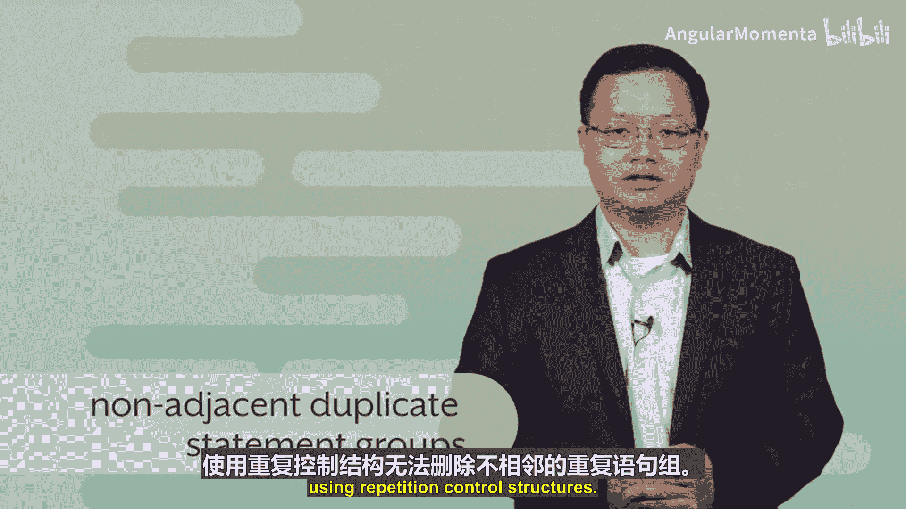

# 063：版本5解决方案的问题与版本6介绍

在本节课中，我们将分析“黑客”游戏版本5解决方案中存在的代码质量问题，并介绍版本6的核心改进目标：通过创建用户自定义函数来提升代码质量。我们将学习函数如何帮助消除非相邻的重复代码，并理解解决方案泛化的概念。

## 🎼 欢迎来到黑客游戏版本6

你即将完成“黑客”游戏的开发。你的前一个版本只缺少两个功能：将密码嵌入随机符号中，以及在玩家猜测错误时提供提示。然而，在版本6中，你并不会实现这些新功能。与版本4类似，版本6只关注代码质量的提升。我们将引入一个对提高代码质量至关重要的语言特性。这个版本的核心是关于创建你自己的函数。

## 😊 用户自定义函数简介

你已经使用过许多函数，包括Python内置函数和从各种模块导入的函数。现在，你将创建自己的用户自定义函数。

函数是编程中非常重要的一部分。它们允许你将代码分解为自包含的片段。这使得代码更易于阅读、编写、修改和重用，因为它允许你一次专注于一个相关的代码段。你可以将使用内置函数和导入函数的所有好处，应用到使用你自己的函数上。

函数调用是控制抽象的一个例子。函数调用会执行函数内部的语句，然后返回到调用语句。调用函数时，你无需理解其代码的内部细节。函数的代码可以编写一次并调用多次，因此它是DRY（Don‘t Repeat Yourself）原则的应用。

## 版本5解决方案中的问题

以下是黑客游戏版本5的解决方案。请注意，程序中仍然存在用于显示字符串的重复代码段。

这组四个语句在程序中重复了三次，只有微小的差异。此外，用于输入字符串的重复的两个语句组也出现了两次。

你在版本4和版本5中无法移除这些重复，因为它们彼此不相邻。当你有一组执行相同功能但被其他不相关的代码行分隔开的语句时，你就有了非相邻的重复语句组。非相邻的重复语句组无法使用重复控制结构（如循环）来移除。因此，我们将用用户自定义函数来替换它们。

## 函数作为解决方案泛化

用户自定义函数是解决方案泛化的另一个例子。回想一下，解决方案泛化会改变解决方案，以便你可以在许多不同的上下文中重用它。

编写函数的人正在执行解决方案泛化。而调用函数的人正在使用控制抽象。

在版本5中，用于显示字符串的四行代码被使用了三次：一次用于标题，一次用于密码，一次用于结果。你将创建的函数之一，将把这12行代码转换成一个仅五行的函数，该函数可用于显示任何字符串。

## 版本6的开发任务

你不需要为版本6创建新的描述或功能测试计划。游戏的功能与前一版本完全相同。你也不需要创建新的算法。在算法层面，你的解决方案没有改变。你将直接进入编辑代码的阶段。

## 总结

本节课中，我们一起学习了版本5代码中存在的非相邻重复问题，并明确了版本6的改进方向：通过创建用户自定义函数来重构代码。我们理解了函数如何作为控制抽象和解决方案泛化的工具，能够将分散的重复逻辑封装起来，从而使代码更简洁、更易维护。在接下来的实践中，你将把重复的显示和输入代码块转化为可重用的函数。