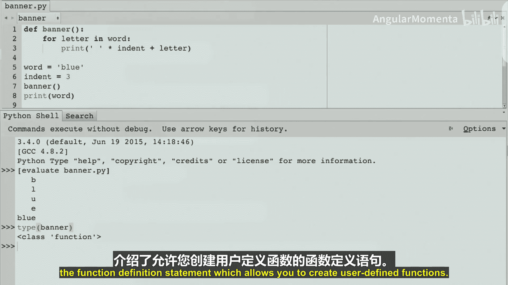

# 064：Python函数定义 🧱


在本节课中，我们将学习如何定义自己的函数。我们将了解什么是用户定义函数，它与内置函数有何不同，并详细探讨函数定义语句的语法和语义。

---

## 概述 📋

到目前为止，我们已经使用了Python标准库中的许多函数，例如 `print()` 和 `len()`。然而，有时我们需要执行一些标准库中没有的特定操作。这时，我们就需要创建自己的函数，即“用户定义函数”。本节课将介绍如何使用 `def` 关键字来定义函数，并解释函数执行时Python解释器如何处理命名空间。

---

## 函数与程序块

一个完整的Python程序由“块”组成。Python中有三种类型的块：
*   **模块**：通常是一个 `.py` 文件。
*   **函数**：可重用的代码块。
*   **类**：将在未来的课程中介绍。

解释器总是从主模块（`__main__`）开始执行，但其他块（如函数）也会在调用时被求值。

---

## 用户定义函数 vs. 内置函数

Python中的函数分为两种：

1.  **用户定义函数**：其代码完全由Python语句编写。例如，标准库 `copy` 模块中的 `copy` 函数。
    *   其类型为 `function`。

2.  **内置函数**：并非用Python实现，而是用实现Python解释器的语言（通常是C语言）编写的。这包括 `builtins` 模块中的函数（如 `print`），也包括其他标准库模块中用C实现的函数（如 `time.sleep`）。
    *   其类型为 `builtin_function_or_method`。

我们将采用更广泛的定义：**所有非Python实现的函数都称为内置函数**。

---

## 函数定义语句

函数定义是一种新的复合语句。以下是其简化的语法图：

```
def function_name():
    # 语句套件
```

*   **函数头**：以关键字 `def` 开始，后跟函数名（一个标识符）、一对括号 `()` 和冒号 `:`。
*   **参数列表**：括号内是可选的参数列表。本节课我们只讨论无参数的函数。
*   **套件**：缩进的语句块，定义了函数被调用时要执行的操作。

---

## 命名空间与标识符解析规则

每个块（模块、函数）都有自己的“命名空间”，即存储其标识符（变量名、函数名）与对象绑定关系的地方。

**绑定标识符的规则**（简化版）：
当在一个块中绑定标识符（如通过赋值 `=` 或函数定义 `def`）时，该绑定会存储在**当前块的本地命名空间**中。

**解引用标识符的规则**（广义版）：
当需要获取一个标识符的值时，解释器按以下顺序查找：
1.  在**当前函数的本地命名空间**中查找。
2.  如果未找到，则在**全局命名空间**（即模块的命名空间）中查找。

---

## 函数定义语义详解

当我们执行一个函数定义语句 `def banner(): ...` 时，解释器会执行以下步骤：

1.  **创建函数对象**：创建一个包含函数套件中代码的函数对象。该对象拥有自己的命名空间。
2.  **检查并添加名称**：如果函数名（如 `banner`）不在当前本地命名空间中，则添加它。
3.  **绑定名称**：将函数名 `banner` **绑定**到刚创建的函数对象上，绑定发生在当前本地命名空间（对于主模块，就是全局命名空间）。
4.  **链接全局命名空间**：在函数对象的命名空间中，保存一个指向其所在**全局命名空间**的引用。这至关重要，它使得函数内部能够访问外部（全局）的标识符。

**关键点**：解释器在定义函数时**不会**执行函数体内的代码。代码只会在函数被调用时执行。

---

## 函数执行流程示例

让我们通过一个创建垂直横幅的函数来演示整个过程。

```python
# 1. 定义函数
def banner():
    for letter in word:
        print(' ' * indent + letter)

# 2. 在主模块中设置变量
word = "blue"
indent = 3

# 3. 调用函数
banner()
# 4. 打印原单词
print(word)
```

**执行步骤分析：**

1.  **定义阶段**：解释器遇到 `def banner():` 时，按上述语义创建函数对象，并将名称 `banner` 绑定到它。此时不执行 `for` 循环。
2.  **变量赋值**：执行 `word = "blue"` 和 `indent = 3`，这两个名称被绑定在主模块的全局命名空间。
3.  **函数调用**：执行 `banner()`。
    *   解释器首先在主模块的命名空间中解引用 `banner`，找到对应的函数对象。
    *   开始执行函数体内的代码。此时，**本地块**变为 `banner` 函数，**本地命名空间**是 `banner` 的命名空间。
    *   执行 `for letter in word:`：
        *   解引用 `word`。在 `banner` 的本地命名空间中找不到 `word`，于是通过保存的引用，到**全局命名空间**中查找，找到字符串 `"blue"`。因此，`word` 在 `banner` 函数内是一个**全局标识符**。
        *   将 `letter` 绑定到 `'b'`，此绑定存储在 `banner` 的**本地命名空间**。
    *   执行 `print(' ' * indent + letter)`：
        *   解引用 `print`。本地没有，在全局找到内置的 `print` 函数。
        *   计算 `' ' * indent`：解引用 `indent`，本地没有，在全局找到整数 `3`。因此，`indent` 也是一个**全局标识符**。
        *   计算 `... + letter`：解引用 `letter`，在 `banner` 的本地命名空间中找到当前字母 `'b'`。
        *   调用 `print('   b')` 输出。
    *   循环继续，为 `'l'`, `'u'`, `'e'` 重复此过程。
4.  **函数返回**：函数执行完毕。由于没有 `return` 语句，它返回一个 `None` 类型的对象。
5.  **清理与后续**：函数调用结束后，在函数执行期间添加到其本地命名空间的所有标识符（如 `letter`）会被删除以释放内存。控制权返回主模块，执行最后的 `print(word)` 语句。

---

## 全局标识符的潜在问题与解决方案

在上面的例子中，`banner` 函数依赖于全局变量 `word` 和 `indent`。这被称为使用了**全局标识符**（在其他语言中常称为全局变量）。

过度依赖全局标识符可能导致代码难以理解和调试，因为函数的行为依赖于其外部的、可能被意外修改的状态。

更安全、更清晰的做法是**通过参数将数据传递给函数**。这样，函数的所有输入都变得明确。我们将在下一节课学习如何为函数定义参数。

---

## 总结 🎯

本节课我们一起学习了：
1.  **用户定义函数**的概念，及其与内置函数的区别。
2.  如何使用 **`def` 语句**来定义自己的函数。
3.  Python程序的**块结构**和**命名空间**模型。
4.  标识符的**绑定**与**解引用**在多个命名空间中的通用规则。
5.  函数定义和调用时，解释器的详细**执行步骤**。
6.  认识到在函数内部依赖**全局标识符**可能带来的问题，并了解到通过**函数参数**传递数据是更优的解决方案。



通过定义函数，我们可以将代码组织成可重用的模块，这是构建复杂程序的基础。下一节课，我们将学习如何定义带参数的函数，使它们更加灵活和独立。