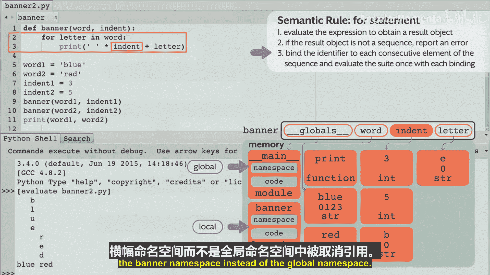

# 065：Python函数参数 🧩

在本节课中，我们将学习如何为函数定义参数列表，以支持在函数调用时传递不同的参数。这将使我们的函数更加灵活和通用。

---

## 概述

函数参数允许我们在调用函数时传递不同的值，从而实现代码的复用。例如，内置函数 `print` 可以多次调用，每次传入不同的参数，如 `print("blue")` 和 `print("red")`。用户自定义函数同样支持这一特性。

我将修改横幅显示程序，使其能够通过参数为两个不同的单词显示横幅，并运行该程序。

程序运行成功。两个横幅分别显示，一个为“blue”，另一个为“red”。

为了在函数调用中包含参数列表，必须在函数定义中支持相应的参数列表。

---

## 函数定义语法回顾

首先，回顾一下函数定义的语法图。

这是一个简化的参数列表语法图。

`banner` 函数定义具有有效的语法。接下来，我将展示Python解释器如何解释这个程序。

---

## 程序执行过程详解

当程序启动时，局部块是主模块，其命名空间既是局部命名空间也是全局命名空间。

预绑定的标识符 `print` 绑定在此命名空间中。

主模块中的第一条语句是一个函数定义。

因此，解释器应用函数定义语义，与上一课相同。

解释器创建一个具有自己命名空间的函数对象。

将标识符 `banner` 添加到局部命名空间，并将 `banner` 绑定到该函数对象。

同时在 `banner` 命名空间中绑定一个指向全局命名空间的引用。

请记住，解释器在评估函数定义时，不会评估函数体。

在函数定义语句之后，解释器使用赋值语句语义评估第5至第8行。

在局部命名空间中，`word1` 被绑定到字符串 `"blue"`。`word2` 被绑定到字符串 `"red"`。

`indent1` 被绑定到整数 `3`，`indent2` 被绑定到整数 `5`。

然后，评估第9行的函数调用 `banner(word1, indent1)`。

---

## 支持参数和参数的函数调用语义

函数调用语义被修改以支持参数和形参。

在现有的步骤4之前添加了一个新的步骤4，以确保参数列表和形参列表长度相同。

原始步骤4的细节也被添加，成为新的步骤5。

**步骤1：** 在局部命名空间中解引用标识符 `banner`，以获取 `banner` 函数对象。

**步骤2：** 由于有两个参数表达式，它们被评估以获取两个参数对象：`"blue"` 和 `3`。这两个对象被放入一个新的参数对象列表中。

**步骤3：** 由于表达式对象 `banner` 不是方法对象，因此没有特殊参数被添加到参数对象列表中。

**步骤4：** 参数对象列表的长度为2，形参列表的长度也为2，因此不报告错误。

**步骤5：** 形参 `word` 被添加到 `banner` 命名空间，并绑定到参数对象 `"blue"`。然后，形参 `indent` 被添加到 `banner` 命名空间，并绑定到参数对象 `3`。

每个形参都是在函数调用期间绑定的局部标识符。

请注意，形参标识符 `word` 和 `indent` 与函数调用中使用的标识符名称不同。

在这个例子中，形参名称 `word` 和 `indent` 不可能同时匹配第一个函数调用中的标识符名称 `word1` 和 `indent1`，以及第二个函数调用中的 `word2` 和 `indent2`。

标识符名称无关紧要，因为形参标识符是按顺序绑定到参数对象的。

如果形参标识符改为 `word2` 和 `indent2`，这些标识符将在第一次函数调用期间被添加到 `banner` 命名空间，并绑定到 `"blue"` 和 `3`。

**步骤6：** 评估 `banner` 的函数体。此时局部块是 `banner`，局部命名空间是 `banner` 的命名空间。

与上一课类似，函数定义体中的单个语句使用四个语句语义。

**步骤一：** 评估标识符 `word`。在此程序中，`banner` 函数定义语句将标识符 `word` 作为形参绑定在 `banner` 的命名空间中。因此，解释器解引用 `word` 以获取对象 `"blue"`。

**步骤二：** 不报告错误。

**步骤三：** 在局部命名空间中，将标识符 `letter` 绑定到字符串对象 `"blue"` 在索引0处的元素，即字符串对象 `"B"`。

`for` 循环体第一次被评估。

`banner` 函数的评估继续，与上一课相同，只是形参 `indent` 是在 `banner` 命名空间而不是全局命名空间中解引用的。

字符串 `"blue"` 被打印为横幅。结果对象是唯一的 `None` 类型对象。

步骤6结束时，从 `banner` 命名空间中删除 `letter`、`indent` 和 `word`，因为它们是在函数调用期间添加的。

解释器返回到主程序，并评估下一条语句，即对 `banner` 的另一个函数调用。

这次调用的评估方式与上一次相同，只是这次在 `banner` 命名空间中，形参 `word` 绑定到参数对象 `"red"`，形参 `indent` 绑定到参数对象 `5`。

字符串 `"red"` 被打印为横幅。返回相同的 `None` 类型结果对象，并且再次从 `banner` 命名空间中删除 `letter`、`indent` 和 `word`。

---

## 总结

在本视频中，我概括了函数定义的语法和语义，使其包含支持函数调用参数的参数列表。通过使用参数，我们可以编写更通用、可复用的函数，根据传入的不同值执行相应的操作。