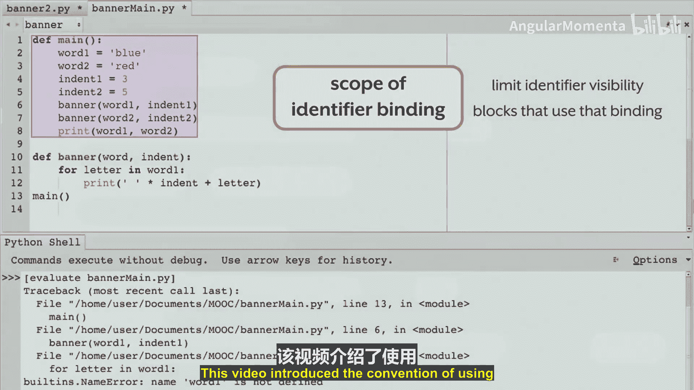
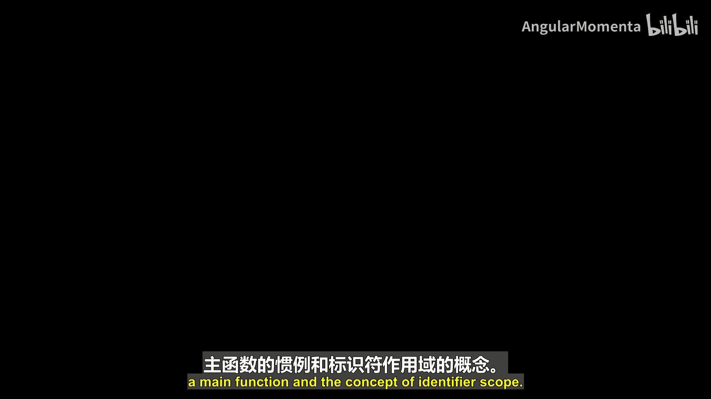

# 066：Python主函数与标识符作用域 🐍


在本节课中，我们将学习一个重要的编程惯例——使用主函数（`main` function），并理解标识符作用域（Identifier Scope）的概念。这将帮助我们编写更安全、更易于维护的代码，避免因意外使用全局变量而导致的错误。

## 概述

上一节我们介绍了函数参数。本节中，我们来看看如果在函数定义中错误地使用了全局标识符会发生什么，以及如何通过引入主函数来防止这类错误。

## 从错误案例开始

回顾函数参数课程中的程序。如果在函数定义的`for`语句头部错误地使用了标识符`word1`，而不是参数`word`，会发生什么？

运行程序后，程序会显示两个横幅，内容都是“blue”，缩进分别为3和5。

```python
# 错误示例：在banner函数内部错误地引用了全局变量word1
def banner(word, indent):
    for i in range(indent):
        print(" ", end="")
    print(word1)  # 错误：应为word，却写成了word1

word1 = "blue"
word2 = "red"
indent1 = 3
indent2 = 5

banner(word1, indent1)
banner(word2, indent2)
```

在两次调用`banner`函数时，解释器在求值`for`语句头部时，会解引用`word1`而不是`word`。由于`word1`在函数定义语句中未被绑定，它是一个全局标识符，解释器会在全局命名空间中解引用它，从而在两次调用中都获得字符串对象“blue”。

## 引入主函数惯例

许多有经验的Python程序员使用一个惯例来防止意外使用此类全局标识符：他们引入另一个用户自定义函数，称为`main`。

以下是使用主函数的相同程序：

```python
def banner(word, indent):
    for i in range(indent):
        print(" ", end="")
    print(word1)  # 这里仍然有错误

def main():
    word1 = "blue"
    word2 = "red"
    indent1 = 3
    indent2 = 5
    banner(word1, indent1)
    banner(word2, indent2)

main()
```

新的`main`函数包含了之前主模块中的所有语句（除了`banner`函数定义）。`word1`、`word2`、`indent1`和`indent2`之前被绑定在主模块的命名空间中（这意味着它们可以在`banner`中被用作全局标识符），现在它们位于`main`函数的命名空间中，因此不能再在`banner`或任何其他用户定义函数中被意外引用。

我们称这个函数为`main`，因为它包含了之前主模块中的大部分语句。

## 主函数的一般规则

通常，你应该将所有语句从主模块移动到`main`函数中，除了以下语句：
*   `import`语句
*   函数定义
*   类定义（将在后续课程介绍）

重要的是要认识到**主模块**和**主函数**是不同的。在上面的程序中，仍然存在一个主模块，它只包含两个函数定义语句（一个用于`main`，一个用于`banner`）。

如果直接运行上面的程序，你会发现没有输出。记住，函数定义不会执行其代码块内的语句，需要函数调用来执行`main`函数的代码块。

## 理解错误报告

在程序末尾添加对`main()`的调用并运行，会得到一个`NameError`，指出`word1`未定义。这个错误报告了我在`banner`内部意外使用了标识符`word1`。

这是一个有用的错误，因为它阻止了我使用一个标识符，而如果我没有使用主函数，这个标识符本应是一个全局标识符。通常，让解释器报告一个错误，比由于程序员的错误而让程序静默地计算出错误答案要好得多。

以下是错误产生的原因分析：
1.  程序启动时，主模块的命名空间既是局部命名空间也是全局命名空间。
2.  解释器依次处理主模块中的语句：定义`main`函数，定义`banner`函数，然后调用`main()`。
3.  执行`main()`时，在其命名空间中绑定了`word1`、`word2`等变量。
4.  当`main`函数调用`banner(word1, indent1)`时，解释器开始执行`banner`函数的代码。
5.  在`banner`函数内部，解释器尝试求值表达式`word1`。由于标识符`word1`没有绑定在`banner`函数的局部命名空间中，解释器会去全局命名空间（即主模块的命名空间）中查找，但依然没有找到，因此报告`NameError`。

**核心机制**：将标识符`word1`从全局命名空间移动到`main`函数的命名空间中，防止了在`banner`函数中意外引用一个全局标识符。

## 标识符作用域的概念

编程语言使用称为**作用域**的概念来限制标识符的可见性。标识符绑定的作用域指的是在代码的哪些地方可以使用该绑定。由于Python代码被划分为块，因此作用域就是所有解引用该标识符时会使用该绑定的代码块。

例如，在上述使用主函数的程序中，`word1`绑定在`main`函数命名空间中，其作用域**仅限**于`main`函数块。它的作用域**不包含**`banner`函数块，因此，在`banner`函数块中引用`word1`会产生`NameError`。

而在之前没有主函数的程序中，`word1`绑定在主模块的全局命名空间中，其作用域既包括主模块块，也包括`banner`函数块。`banner`函数中对`word1`的引用会使用标识符的语义规则，从而意外地访问到一个全局标识符。

## 作用域与封装

在本课程中，我们将使用主函数来从全局命名空间中移除所有标识符（除了导入的标识符和用户定义的函数名）。标识符作用域是**封装**的一个例子。

封装是一种限制对组件实现访问的技术，使得该组件的实现独立于其他组件如何使用它。

考虑这个场景：你是一个新开发者，正在处理一个非常庞大的代码库。你想添加新功能，但已经有成千上万个标识符正在被使用。如果没有有限的作用域，如果你在你的函数中重新绑定了其中一个标识符，可能会对使用该标识符的其他函数和模块产生灾难性的影响。你将需要 meticulously 检查每一个现有的函数和模块，以确保你没有使用别人在其代码中使用的相同标识符。这将是令人不快且容易出错的。

因为作用域限制了标识符的可见性，你可以在你的函数中使用任何你想要的标识符，而不会干扰其他函数中的相同标识符。你将每一个标识符绑定从主模块移动到主函数，都减少了该标识符绑定的作用域，因此它不能在用户定义的函数中被意外访问。

## 总结

本节课中我们一起学习了：
1.  **使用主函数的惯例**：将程序的主要逻辑放入一个名为`main`的函数中，并在脚本最后调用它。这有助于将变量从全局作用域中隔离出来。
2.  **标识符作用域**：一个变量（标识符）在程序中可以被访问到的区域。在函数内部定义的变量通常具有局部作用域。
3.  **封装的好处**：通过限制标识符的作用域，我们可以避免命名冲突，使代码模块更独立，从而提高代码的可维护性和安全性。





通过采用主函数和正确理解作用域，你可以写出更健壮、更清晰的Python程序。