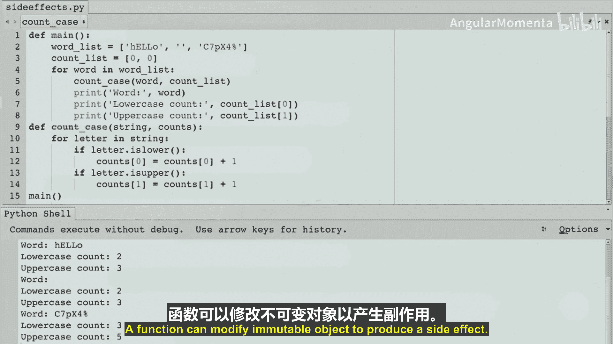

# 068：Python副作用 🎮


在本节课中，我们将要学习Python编程中的一个重要概念：**副作用**。我们将了解函数除了使用`return`语句返回值之外，如何通过修改可变对象来影响程序的其他部分。

## 概述 📋

函数通常通过`return`语句返回结果。然而，函数也可以通过修改传入的**可变对象**（如列表）来产生**副作用**，使得这些修改在函数外部可见。本节将通过一个具体的程序示例，详细解析副作用的工作原理及其语义。

## 副作用的基本概念

上一节我们介绍了函数通过返回值传递结果。本节中我们来看看函数影响程序的另一种方式：**副作用**。

副作用是指函数在执行过程中，修改了其作用域之外的对象状态。这通常通过修改作为参数传入的**可变对象**来实现。

以下是产生副作用的关键条件：
*   函数接收一个**可变对象**（如列表、字典）作为参数。
*   函数内部修改了这个对象的内容。
*   函数调用结束后，通过原始引用访问该对象时，能观察到其内容已被改变。

## 程序示例解析

现在，我们通过一个具体的程序来理解副作用是如何工作的。该程序统计一系列单词中大小写字母的数量。

```python
def count_case(string, counts):
    for letter in string:
        if letter.islower():
            counts[0] += 1
        if letter.isupper():
            counts[1] += 1

def main():
    word_list = ["Hello", "wORLD", "123Ab"]
    count_list = [0, 0]
    for word in word_list:
        count_case(word, count_list)
        print(word, count_list)

main()
```

### 函数`count_case`的作用

`count_case`函数接收两个参数：一个字符串`string`和一个列表`counts`。
*   `counts[0]`用于累计小写字母数量。
*   `counts[1]`用于累计大写字母数量。

函数遍历字符串中的每个字符，使用`.islower()`和`.isupper()`方法判断其大小写，并相应地对`counts`列表中的元素进行递增操作。**这个函数没有`return`语句**，它的作用完全体现在对传入的`counts`列表的修改上。

### 程序执行流程

在`main`函数中：
1.  创建单词列表`word_list`和计数器列表`count_list`（初始值为`[0, 0]`）。
2.  遍历`word_list`中的每个单词。
3.  对每个单词调用`count_case(word, count_list)`。
4.  每次调用后，打印当前单词和更新后的`count_list`。

运行此程序，输出结果将展示`count_list`如何随着每个单词的处理而累积变化。

## 语义分析：理解副作用的发生

让我们深入程序的执行过程，看看副作用在命名空间层面是如何发生的。

当程序启动时，解释器创建主模块的命名空间。函数`main`和`count_case`被定义，它们的名称被绑定到相应的函数对象。

### 第一次调用`count_case`

当`main`函数第一次循环，调用`count_case(“Hello”, count_list)`时：
1.  参数`string`被绑定到字符串对象`”Hello”`。
2.  参数`counts`被绑定到`main`函数中`count_list`所引用的**同一个列表对象**。

在`count_case`函数内部执行`counts[0] += 1`时，发生以下关键步骤：
*   通过`counts`这个引用，找到其指向的列表对象。
*   修改该列表对象中索引`0`处的绑定（从整数`0`重新绑定为整数`1`）。

**这个修改发生在列表对象自身的“内部命名空间”里**。由于`main`函数中的`count_list`和`count_case`函数中的`counts`指向的是**同一个列表对象**，因此通过`count_list`访问该对象时，就能观察到索引`0`的值已经变为`1`。

这就是**副作用**：一个函数通过某个引用（`counts`）修改了对象，而这个修改通过另一个引用（`count_list`）在函数外部被观察到。

### 后续执行与清理

`count_case`函数结束后，其局部命名空间（`string`, `counts`, `letter`）被销毁，并返回`None`（被`main`函数忽略）。控制权回到`main`函数，它打印出已被修改的`count_list`。

`main`函数继续循环，对下一个单词`”wORLD”`再次调用`count_case`。此时，`counts`参数再次被绑定到同一个`count_list`列表对象，并继续在其当前值（`[1, 1]`）基础上进行累加。

当`main`函数执行完毕，其局部变量被清理，程序结束。

## 总结 🎯

本节课中我们一起学习了Python中的**副作用**概念。

我们了解到，函数影响程序不仅可以通过`return`语句返回一个新对象，还可以通过修改传入的**可变对象**参数来产生副作用。关键在于，函数内用于修改对象的引用和函数外观察该对象的引用，必须指向内存中的**同一个对象**。



副作用是一种强大的工具，但需要谨慎使用，因为它使得函数的行为不那么透明，可能让代码更难理解和调试。通常，明确使用返回值是更清晰的做法。然而，在需要对大型数据结构进行原地修改以提升效率时，副作用机制非常有用。