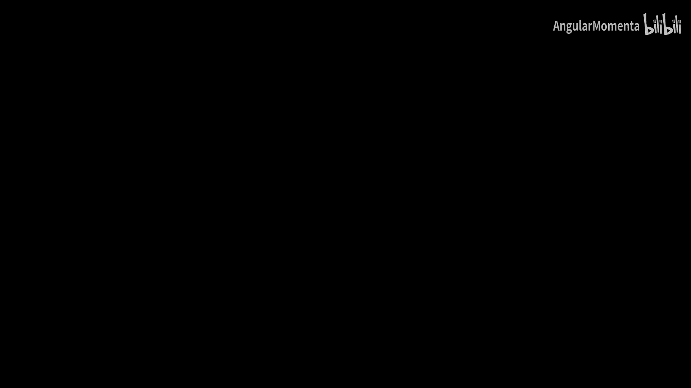
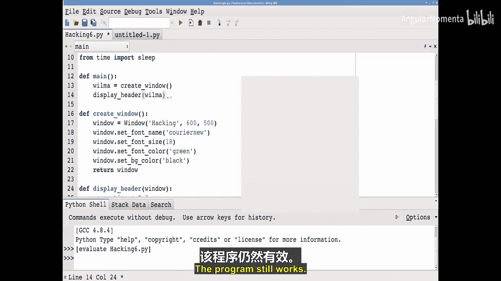
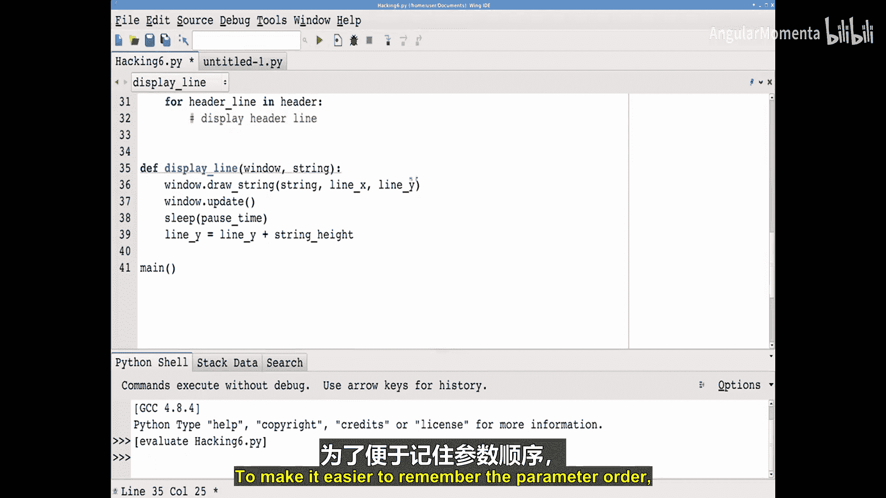
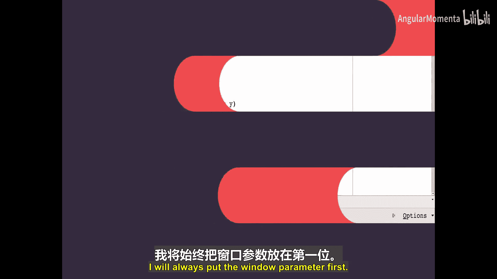

# 069：使用函数改进代码质量



## 概述

在本节课中，我们将学习如何通过使用函数来改进“黑客”游戏第六版的代码质量。我们将看到，函数作为一种控制结构，可以在不改变核心算法的情况下，让代码变得更清晰、更模块化，并且易于测试。

## 从算法面板到函数

上一节我们完成了第五版的设计。本节中我们来看看如何将第五版的算法结构转化为第六版的函数结构。

将代码转换为函数的过程，与你一直以来的工作——将算法分解为面板——非常相似。算法中的几乎每一个面板都将成为代码中的一个函数，而面板的标题将成为对应函数的名称。

此外，还会有两个函数在算法中没有对应的面板。

函数用于创建清晰、可读的代码。它们将代码分割成小段，使得每一段都可以独立编写和测试。它们还能整合具有相似功能的语句组。

## 创建第一个函数：`create_window`

我将从主程序面板的第一个矩形“创建窗口”开始。

“创建窗口”将成为我第六版代码中的一个函数。我将把 `# 创建窗口` 的注释替换为函数头 `def create_window()`。然后，我将把所有属于这个函数体的语句缩进到函数头下方。

以下是创建窗口函数的代码：

```python
def create_window():
    # 设置窗口尺寸和标题
    window_size = (600, 400)
    window_title = "黑客游戏 v6"
    window = graphics.create_window(window_size, window_title)
    return window
```

## 引入 `main` 函数

为了限制全局标识符的意外使用，我将在黑客游戏中引入一个 `main` 函数。

我算法中的主面板将成为程序中的 `main` 函数。我需要在 `main` 函数的函数体中调用 `create_window`，所以我现在就创建 `main` 函数。

在 `create_window` 函数上方，我将写一个新的函数头：`def main():`。在这个 `main` 函数内部，我将添加一个对 `create_window` 的调用。

```python
def main():
    window = create_window()
```

## 单元测试的重要性

现在我已经写了两个函数，我应该测试它们。我运行程序，但在函数下方的代码中得到了一个关于 `window` 的名称错误。

主模块中的代码无法访问 `create_window` 函数内部的 `window` 绑定。然而，我仍然需要测试我的新函数。为此，我可以删除其余代码，但我会将其粘贴到一个新文档中，因为我稍后还需要使用大部分代码。

每次编写新函数时，都需要测试该函数。这个过程被称为**单元测试**。每一个小的代码单元都应该在用于完整程序之前进行独立测试，以确保其正常工作。在本课程中，我们通常将每个函数视为一个单元，并在编写时测试每个函数。

为了测试 `create_window`，我只需要在程序底部添加一个对 `main` 的调用，因为 `main` 已经包含了对 `create_window` 的调用。

```python
if __name__ == "__main__":
    main()
```

这次，当我运行程序时，没有出现任何错误。但是，由于我移除了关闭窗口的代码，窗口不再关闭。我稍后会处理这个问题。

## 创建 `display_header` 函数

接下来，我将继续编写下一个函数。在 `create_window` 之后的下一个步骤是“显示标题”，所以我接下来将编写这个函数。

我将首先在函数体中写下 `def display_header():`，然后粘贴显示标题的旧版本5代码。

```python
def display_header(window):
    header_line = "尝试破解以下密码："
    line_x = 50
    line_y = 50
    graphics.draw_string(window, (line_x, line_y), header_line)
    graphics.update_window(window)
    time.sleep(1)
    line_y += 30
```

然后，我在 `main` 中添加对 `display_header` 的调用，并再次运行程序以测试新函数。

一个名称错误报告说 `window` 未定义，因为它没有在 `display_header` 中绑定。这个问题有两个方面。首先，标识符 `window` 的作用域被限制在 `create_window` 函数内。我需要返回 `window` 对象，以便在 `create_window` 外部可以访问它。其次，`window` 对象必须在另一个函数 `display_header` 内部被访问。

我将向 `display_header` 添加一个 `window` 参数，以便我可以将 `window` 对象作为参数传递。我将在 `create_window` 中添加一个 `return` 语句：`return window`。我将在 `main` 中，将 `create_window` 函数调用的返回对象绑定到一个名为 `window` 的新标识符。然后，我可以将该 `window` 对象作为参数传递给 `display_header`。我还将向 `display_header` 函数定义添加一个名为 `window` 的参数。




```python
def create_window():
    # ... 之前的代码 ...
    return window
def main():
    window = create_window()
    display_header(window)

def display_header(window):
    # ... 函数体 ...
```

我再次运行程序，它正常工作了。一个窗口打开，标题被显示出来。

## 参数与标识符的作用域

尽管我在 `main`、`create_window` 和 `display_header` 函数中使用了相同的标识符 `window`，但我可以在这些独立的代码块中使用任何名称。我将通过将 `main` 中的名称改为 `wilma` 来说明这一点。程序仍然可以工作。

```python
def main():
    wilma = create_window()
    display_header(wilma)
```

我会把它改回来，因为 `wilma` 对于窗口来说不是一个非常具有描述性的标识符。

## 抽象通用功能：`display_line` 函数

下一步是显示密码列表。注意，`display_header` 和 `display_password_list` 都使用了那四行熟悉的代码：调用 `draw_string`、调用 `update_window`、暂停以及更新 `line_y` 的赋值语句。





我们之前说过，函数可以整合具有相似功能的代码。如果我打算反复使用那四行代码，我应该编写一个包含这些行的函数。然后，我就可以在想要使用该代码时调用这个函数。

和往常一样，我将从函数头开始，在最后一个函数定义下方写下 `def display_line():`。我将从 `display_header` 中剪切并粘贴显示字符串的四行代码到 `display_line` 的函数体中。

我希望这个函数足够通用，可以显示标题、密码或结果行。这是**解决方案泛化**的一个例子。它应该能够显示我作为参数传递的任何字符串。我将用标识符 `string` 替换 `draw_string` 调用中的 `header_line`，然后在函数头中添加 `string` 作为参数。我还将添加一个 `window` 参数，以便我可以绘制和更新窗口。为了更容易记住参数顺序，我将始终把 `window` 参数放在第一位。

显示每个字符串还需要一个位置。这个函数必须在显示当前字符串后更改位置的 Y 坐标。为了更改函数中的参数对象，我将对可变参数对象使用**副作用**。我将使用一个包含两个坐标整数的列表作为参数。

我将把标识符 `location` 添加到 `display_line` 的参数列表中。我将用 `location[0]` 和 `location[1]` 替换 `draw_string` 调用中的 `line_x` 和 `line_y`。我还将用 `location[1]` 替换更新赋值语句中的 `line_y`。

标识符 `pause_time` 和 `string_height` 在 `display_header` 中被绑定，但只在 `display_line` 中使用。我将把这些赋值语句移到它们被需要的 `display_line` 中。

为了完成这个函数，我必须在函数顶部添加一个块注释，描述函数的行为以及每个参数的用途，包括其类型。

```python
def display_line(window, string, location):
    """
    在指定窗口的指定位置显示一个字符串，然后暂停并更新垂直位置。

    参数:
        window: 图形窗口对象。
        string (str): 要显示的文本。
        location (list): 一个包含两个整数的列表 [x, y]，代表显示位置的坐标。
                        函数会修改此列表，将 y 坐标增加固定的行高。
    """
    pause_time = 1
    string_height = 30

    graphics.draw_string(window, (location[0], location[1]), string)
    graphics.update_window(window)
    time.sleep(pause_time)
    location[1] += string_height
```

现在，我可以在 `display_header`、`display_password_list` 和 `display_outcome` 中使用我的 `display_line` 函数。

## 重构 `display_header` 以使用 `display_line`

我将更新 `display_header` 中的代码以使用这个函数。当添加一个实现了注释中描述的所有功能的函数调用时，你应该用该函数调用替换注释。例如，我将用函数调用 `display_line` 替换冗余的注释 `# 显示标题行`。

我需要三个顺序正确的参数。我将使用 `window` 作为窗口参数，`header_line` 作为字符串参数。最后一个参数必须是位置，它是一个包含显示所需 X 和 Y 坐标的列表。

我还没有在程序中创建位置列表。如果一个对象需要在多个函数中使用，则必须在能够将该对象作为参数传递给所有需要它的函数的代码块中创建它。我应该在 `main` 函数中创建位置列表，因为它在 `main` 中调用的三个不同函数中使用：`display_header`、`display_password_list` 和 `get_guesses`。它也在这些函数调用的其他函数中使用。

我将把这个位置列表传递给 `display_header`。最后，我将修改 `display_header` 以包含一个 `location` 参数，并移除 `line_x` 和 `line_y` 的赋值语句。

```python
def display_header(window, location):
    header_line = "尝试破解以下密码："
    display_line(window, header_line, location)
```

这个函数完成了。

## 你的任务

现在轮到你了，你必须创建以下函数并在 `main` 函数中调用它们：
*   `display_password_list`
*   `get_guesses`
*   `end_game`

在 `get_guesses` 内部，你必须调用 `prompt_for_guess` 和 `check_warning` 函数。在 `end_game` 内部，你必须调用 `display_outcome` 和 `prompt_for_end` 函数。

你还必须为你调用的每个函数创建一个函数定义。然而，`prompt_for_guess` 和 `prompt_for_end` 非常相似，你应该创建一个名为 `prompt_user` 的单一函数来替代它们。创建 `prompt_user` 类似于创建 `display_line`。

你会发现标识符 `attempts_left` 在多个用户定义的函数中被使用。你必须决定在哪里绑定它，以及如何使其在需要的任何地方都可用。

每次创建新函数时都应该测试它。不要忘记为你编写的所有函数（包括我写的函数）包含描述性注释。

## 总结


本节课中，我们一起学习了如何通过函数来重构和优化“黑客”游戏的代码。我们了解了如何将算法面板映射为函数，如何通过参数传递数据，以及单元测试的重要性。我们还学习了抽象通用代码（如 `display_line` 和 `prompt_user`）来消除重复，并使代码更易于维护。记住，良好的函数设计是编写清晰、健壮和可测试代码的关键。