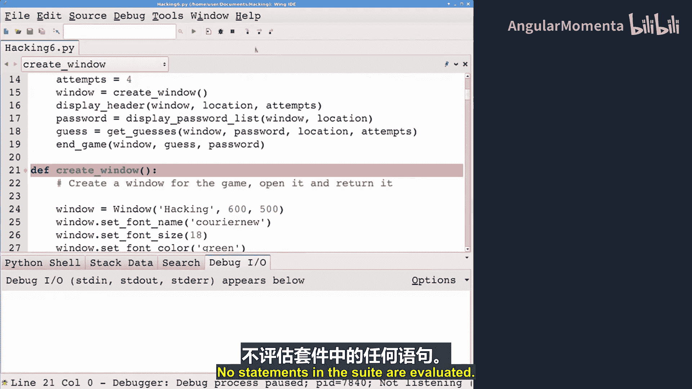
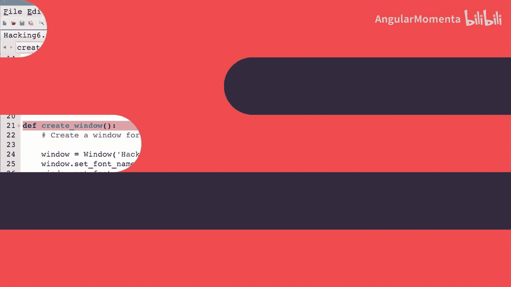
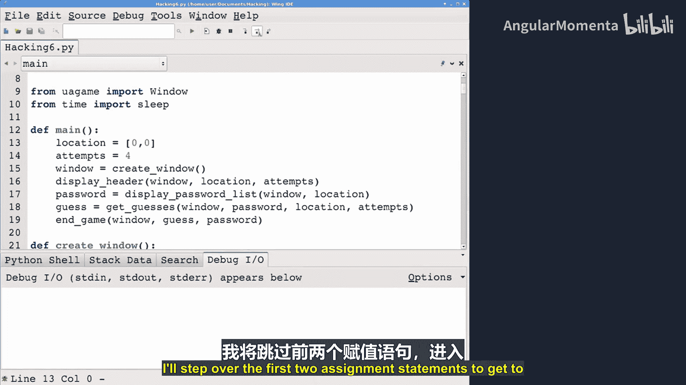
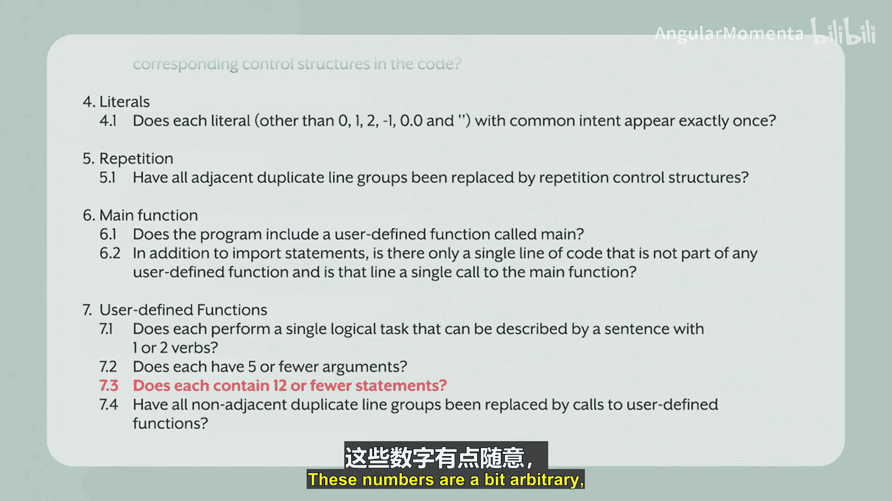

# 070：代码审查 - 黑客游戏版本6

在本节课中，我们将学习如何审查和追踪黑客游戏版本6的代码。我们将重点关注用户自定义函数的追踪方法，并介绍版本6引入的新软件质量测试标准。

## 概述

上一节我们完成了黑客游戏版本5的构建。本节中，我们将深入分析版本6的代码结构，学习如何逐步追踪用户自定义函数的执行过程，并理解版本6新增的代码规范要求。

## 代码结构与算法对应

版本6的代码始于与版本5相同的程序注释。接下来是两个自版本2以来一直使用的导入语句。

第一个显著变化是 `main` 函数的定义。在编程演示中我们曾提到，算法中的几乎每个面板都需要被翻译成一个函数，而版本6正是这样做的。

以下是 `main` 函数定义与算法步骤的对应关系：

*   **前两个赋值语句**：不在算法中，因为它们是简单的赋值语句。
*   **后续五个语句**：每个都对应算法中的一个矩形（即一个步骤），因为它们都是函数调用。

这种对应关系非常方便。让我们开始追踪代码。

## 追踪用户自定义函数

我将通过设置断点和单步执行来演示如何追踪代码。

1.  **开始追踪**：首先，我按下“步入”按钮开始追踪。追踪从导入语句开始，按下“步过”按钮可以跳过它们。整个函数定义会被一步求值，仅将函数名添加到程序的命名空间中，其内部的语句组不会被执行。

2.  **设置断点**：我在程序最底部的 `main` 函数调用处设置了一个断点。接着，我按下调试按钮，使程序运行到该断点处。

3.  **“步过”与“步入”的区别**：
    *   如果此时按下“步过”按钮，调试器将一步求值整个 `main` 函数及其调用的所有函数，我无法追踪单个函数调用。如果 `main` 函数调用后还有其它语句，“步过”会先运行完整个游戏，然后高亮显示那条后续语句。
    *   为了检查 `main` 函数内部的语句，我需要按下“步入”按钮。

4.  **进入main函数**：按下“步入”后，`main` 函数内的第一个赋值语句被高亮。我“步过”前两个赋值语句，来到 `main` 中的第一个函数调用：`create_window`。

    在进入此函数前，请注意栈数据中已有两个标识符：`attempts` 和 `location`。函数（或代码块）拥有自己的命名空间。由于我们目前在 `main` 函数定义内部，“局部变量”区域代表该函数的命名空间。

5.  **进入 `create_window` 函数**：当我按下“步入”按钮进入 `create_window` 函数时，其第一条语句被高亮。此时，栈数据中 `location` 和 `attempts` 不再出现，因为它们不属于 `create_window` 函数的命名空间，而是属于 `main` 函数。

    我“步过” `create_window` 中熟悉的前四条语句，直到 `return` 语句被高亮。此时，栈数据显示 `create_window` 的命名空间中有了 `window` 标识符。

6.  **观察返回值**：再次按下“步入”按钮，`return` 语句仍被高亮，栈数据中显示了函数的返回值是一个 `window` 对象。注意，返回值与 `window` 对象具有相同的内存地址，因此它们是同一个窗口对象。

7.  **返回main函数**：按下“步过”按钮后，`display_header` 函数调用被高亮。查看栈数据，由于赋值语句已将 `window` 添加到 `main` 函数的命名空间，`window` 现在出现在局部变量中。`main` 函数中的 `window` 绑定到了 `create_window` 函数的返回对象，它与 `create_window` 中的 `window` 指向同一对象（地址相同）。

    在步入 `display_header` 函数前，请注意 `attempts` 绑定为 4，并记下 `location` 和 `window` 对象的地址。

8.  **进入 `display_header` 函数**：步入后，即使该函数内的语句尚未求值，其局部命名空间中已有三个标识符：`attempts`, `location`, `window`。这是因为当函数被调用时，它的每个参数会按顺序被添加到命名空间并绑定到对应的实参。可以看到 `attempts` 是 4，另外两个对象的内存地址也相同。

    我“步过” `header` 赋值语句，此时 `header` 已被添加到局部命名空间。接着，我展开 `location` 列表，注意到索引 0 和 1 已绑定值，然后步入 `for` 语句，再步入其中的 `display_line` 函数调用。

9.  **进入 `display_line` 函数**：在 `display_line` 函数定义中，`pause_time` 赋值语句被高亮。栈数据显示 `window`、`location` 和 `string` 参数已被添加到局部命名空间。同时注意，此函数的最后一条语句将 `location[1]` 的值更改为了字符串 `'height'`。

10. **观察副作用**：我按下“步出”按钮完成此函数的求值，返回到调用函数 `display_header`，`for` 语句的头部被高亮。查看栈数据，可以看到 `location[1]` 已被重新绑定为字符串 `'height'`。再次按下“步出”按钮，求值返回到 `main` 函数，`password` 赋值语句被高亮。请注意，`location[1]` 现在绑定的是 57，因为在我按下“步出”按钮之前，第四条语句又求值了 `display_line` 两次。`display_line` 中对 `location` 的修改就是**副作用**的体现。

## 版本6的新软件质量测试

让我们停止追踪，介绍黑客游戏版本6新增的软件质量测试。

### 1. 用户自定义函数的注释测试

除了在程序开头和逻辑代码块上方放置注释外，你现在必须为每个用户自定义函数（除了 `main`）添加注释。

*   `main` 函数不需要单独注释，因为它已由程序注释描述，且没有参数。
*   每个函数注释必须：
    *   位于函数开头。
    *   使用一两个动词描述函数的功能。
    *   从函数定义处缩进一级。
    *   描述每个函数参数。
*   每个函数参数应使用一行注释来描述其**作用**和**类型**。

### 2. 主函数部分测试

新增了两个关于主函数的测试：

*   程序包含一个名为 `main` 的用户自定义函数。
*   除了导入语句，只有一行代码不属于任何用户自定义函数，且该行代码是对 `main` 函数的**单次调用**。

你可能在其他地方看到不包含 `main` 函数的 Python 程序。然而，在本课程中，你编写的每个程序都必须包含一个 `main` 函数定义和一次对该函数的调用。这将减少因意外访问全局标识符而导致的错误。

在前五个版本中，你使用的所有标识符都是全局标识符。从现在开始，你将在用户自定义函数中使用局部标识符。拥有多个局部命名空间可以限制标识符的作用域，这使得多个程序员可以更独立地工作，因为任何标识符都可以在函数内部局部使用。

### 3. 用户自定义函数测试

新增了一个名为“用户自定义函数”的测试部分。

*   **功能单一性**：你的每个函数应该足够简单，无需长篇大论来描述。一个好的测试方法是检查它是否执行一个可以用带有一两个动词的句子描述的逻辑任务。
*   **复杂度限制**：第二个测试也是为了确保函数的简单性。每个函数应包含**不超过 5 个参数**，以及**不超过 12 条语句**。这些数字有些随意，但对于本课程来说是一个不错的选择。

## 总结

本节课中，我们一起学习了如何追踪黑客游戏版本6中用户自定义函数的执行流程，深入理解了函数调用栈、命名空间和副作用。同时，我们详细了解了版本6引入的三类新软件质量测试：用户自定义函数的注释规范、主函数的定义与调用规范，以及函数本身的复杂度和单一职责要求。请确保你的代码同时遵循新的和之前的软件质量测试标准。

恭喜你，已经完成了黑客游戏的版本6。只剩下最后一个版本了。😊