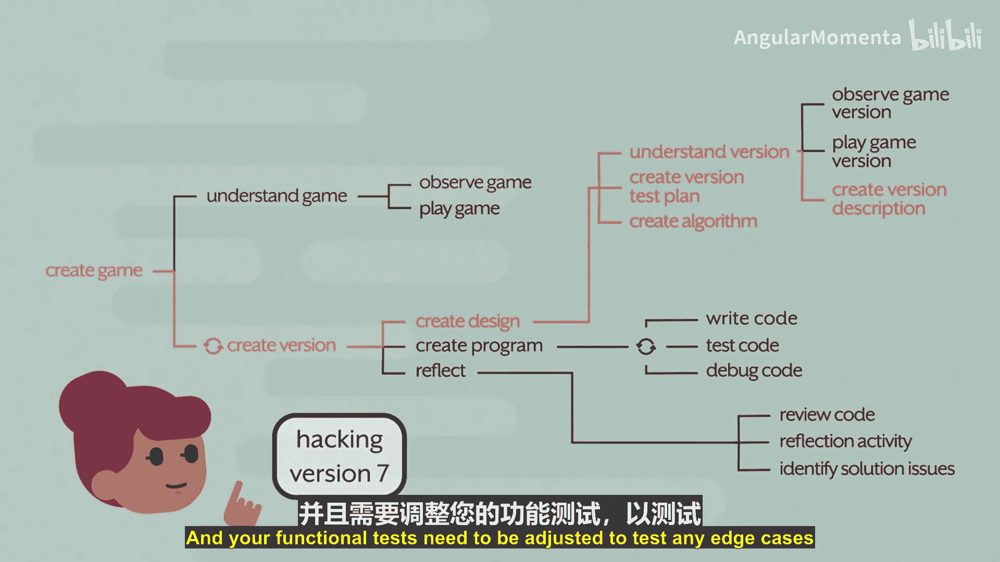

**Python编程与问题解决：第8章：第1节：黑客游戏V6解决方案回顾与V7展望**

在本节中，我们将回顾黑客游戏第6版（V6）的完成情况，并展望第7版（V7）需要实现的新功能。我们将总结已掌握的技能，并明确下一步的改进目标。

---

上一节我们完成了黑客游戏V6的开发。在开始V7的“破解”工作之前，让我们先看看你已经取得了哪些进展。

你从一个简单的基于文本的游戏开始，并将其转变为一个图形化游戏。你修改了设计和代码，加入了多次猜测、选择、循环和用户自定义函数。为了实现这些，你学会了使用许多不同的Python表达式和七种不同的Python语句，其中包括四种控制结构：`if`、`for`、`while`和函数定义。

你也学习了三种问题解决策略：问题分解、算法和抽象。你将在下一个游戏以及未来创建的任何项目中运用所有这些技术。

但在开始下一个游戏之前，你必须完成黑客游戏的最终版本。

黑客游戏目前剩余的解决方案问题主要涉及缺失的功能。在一个密码猜测游戏中，如果玩家没有得到关于猜测与秘密密码接近程度的反馈，游戏将很难进行下去。此外，为游戏添加能营造氛围的图形元素是使其更有趣的好方法。

在黑客游戏的最终版本中，你将练习迄今为止学到的所有技能。你将为此游戏添加最后两个功能：为错误猜测提供提示信息，以及将所有密码字符串嵌入到随机的符号字符中。

你还将在接下来的活动中制定新的描述、功能测试计划和算法。你的描述必须根据观察游戏时将看到的两个新功能进行调整，你的功能测试也需要调整，以测试这些更改可能产生的任何边界情况。

---

**总结**

本节课我们一起回顾了黑客游戏V6的成果，明确了V7版本需要增加的两个核心新功能：**猜测提示**和**图形化氛围增强**。这标志着我们将综合运用之前学到的所有编程语句、控制结构和问题解决策略，来完成这个项目的最终优化。