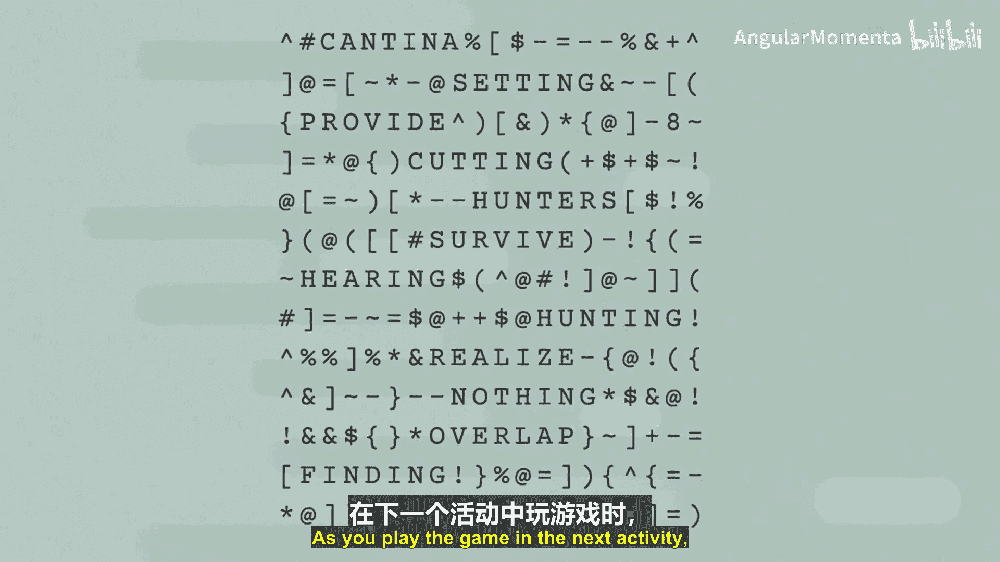

# 072：观察黑客游戏最终版 🎮

在本节课程中，我们将观察黑客游戏的最终版本。这个版本包含了之前所有版本的功能，并引入了一些新的视觉元素和反馈机制，使游戏体验更加完整。

---

在上一节中，我们分析了游戏的核心逻辑。本节中，我们将仔细查看这个最终版本的具体表现，特别是新增加的功能。

首先，请注意密码列表中出现的**符号字符**，这些字符在之前的任何版本中都不曾出现。

以下是游戏启动后的初始界面示例：

---

接下来，我们通过几次尝试来观察游戏的新反馈机制。

我将输入一个错误答案 `finding`。此时，游戏界面会展现出本版本的第二个新特性：在屏幕右上角出现了一条**提示信息**。

这条提示信息表明我的猜测是错误的，并显示了我的猜测与秘密密码在相同位置上有多少个字母匹配。
对于 `finding` 和 `hunting`，提示信息显示有 **4** 个字母在匹配位置上正确。

---

然后，我将尝试用小写字母输入 `hunting`。这次，提示信息显示为 **0 out of 7** 个字母匹配。

这个结果很好地从视觉上证实了我们在之前版本中做过的一项测试：游戏对字母的大小写是敏感的。

---

最后，为了观察另一个功能，我将输入 `putting` 作为最后一个错误答案。

这次尝试给出了 **5 out of 7** 个字母匹配的结果。同时，在窗口的右下角出现了**锁定警告**提示，这是多次输入错误后触发的机制。

---

最终，输入正确的密码 `hunting` 将带领我们进入熟悉的成功结局屏幕。

---

当你在接下来的活动中运行这个游戏时，请密切关注密码列表中使用的符号字符。

以下是需要注意的几个观察点：
*   注意使用了哪些符号。
*   观察每次运行程序时，每一行选择的符号是否相同。
*   留意符号放置的位置。例如，每个密码前后选择的符号数量是否相同？密码前和密码后的符号数量会变化吗？

---

本节课中，我们一起观察了黑客游戏的最终版本。我们看到了新增加的符号字符、实时匹配度提示以及锁定警告机制。这些功能共同构成了一个更具交互性和反馈性的完整游戏体验。在接下来的实践中，请仔细体会这些设计细节。