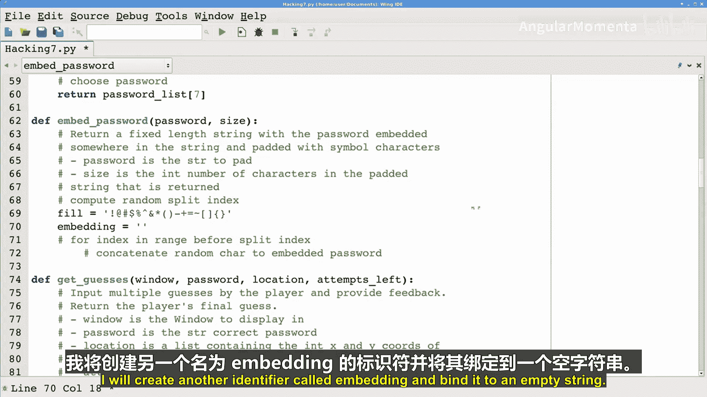

# 074：程序破解版本7 🎮

在本节课中，我们将学习如何编写破解游戏的最终版本。这个版本将要求我们创建更多的函数定义，并对现有函数进行修改。我们将重点关注如何将密码嵌入到一个随机符号字符串中，并实现显示提示的功能。


---

## 嵌入密码函数

上一节我们介绍了程序的基本结构，本节中我们来看看如何编写 `embed_password` 函数。这个函数负责将真实的密码嵌入到一个由随机符号组成的字符串中。

函数定义如下：

```python
def embed_password(password, size):
    """
    将密码嵌入到一个指定长度的随机符号字符串中。
    :param password: 需要嵌入的密码字符串。
    :param size: 嵌入后字符串的总长度。
    :return: 嵌入后的字符串。
    """
```

在函数内部，我们首先需要创建一个包含所有可能随机符号的字符串，用于填充密码周围的空间。

```python
    fill = "!@#$%^&*()_+-=[]{}|;:,.<>?/~`"
```

接下来，我们创建一个空字符串 `embedding`，用于逐步构建最终的嵌入字符串。

```python
    embedding = ""
```

计算分割索引是关键步骤。分割索引决定了在密码之前放置多少个随机符号。我们不能简单地选择一个0到20之间的随机数，因为这可能导致最终字符串长度超过20。我们需要确保密码前的符号数量最多为 `size - len(password)`。

```python
    password_size = len(password)
    split_index = random.randint(0, size - password_size)
```

以下是构建嵌入字符串的步骤：

首先，我们使用一个循环来添加分割索引前的随机符号。

```python
    for index in range(0, split_index):
        random_char = random.choice(fill)
        embedding = embedding + random_char
```

然后，我们将密码本身添加到嵌入字符串中。

```python
    embedding = embedding + password
```

最后，我们使用另一个循环来添加剩余的随机符号，直到字符串达到指定的总长度。

```python
    for index in range(split_index + password_size, size):
        random_char = random.choice(fill)
        embedding = embedding + random_char
```

完成循环后，函数返回构建好的嵌入字符串。



```python
    return embedding
```

为了使用 `random.randint` 和 `random.choice` 函数，我们需要在程序开头导入 `random` 模块。


```python
import random
```

---

## 更新显示密码列表函数

现在我们已经有了 `embed_password` 函数，接下来需要更新 `display_password_list` 函数。这个函数现在需要调用 `embed_password` 来生成每个显示项，而不是直接显示密码。

我们需要修改函数，使其接收密码列表和嵌入字符串的长度作为参数。

```python
def display_password_list(passwords, size):
    """
    显示嵌入后的密码列表。
    :param passwords: 密码列表。
    :param size: 每个嵌入字符串的长度。
    """
```

在函数内部，我们遍历密码列表，对每个密码调用 `embed_password` 函数，并打印结果。

```python
    for password in passwords:
        embedded = embed_password(password, size)
        print(embedded)
```

---

## 编写显示提示函数

最后，我们需要编写一个新的函数 `display_hint`。这个函数的作用是根据玩家的猜测，给出一个提示，指出密码中有多少个字母在正确的位置上。

函数定义如下：

```python
def display_hint(password, guess):
    """
    比较密码和猜测，给出位置正确的字母数量提示。
    :param password: 正确的密码。
    :param guess: 玩家的猜测。
    :return: 位置正确的字母数量。
    """
```

在函数内部，我们初始化一个计数器。

```python
    correct_positions = 0
```

然后，我们遍历猜测字符串的每个位置（假设猜测和密码长度相同）。

```python
    for i in range(len(guess)):
        if i < len(password) and guess[i] == password[i]:
            correct_positions += 1
```

循环结束后，函数返回计数器的值。

```python
    return correct_positions
```

在游戏的主循环中，在玩家每次猜测后，我们可以调用这个函数来提供反馈。

```python
        hint = display_hint(secret_password, player_guess)
        print(f"提示：有 {hint} 个字母在正确的位置上。")
```

---


本节课中我们一起学习了如何构建破解游戏的最终版本。我们创建了 `embed_password` 函数来将密码隐藏在一串随机字符中，更新了 `display_password_list` 函数来展示这些嵌入的字符串，并编写了 `display_hint` 函数来为玩家提供有价值的反馈。通过这些步骤，我们使游戏的核心逻辑更加模块化和清晰。