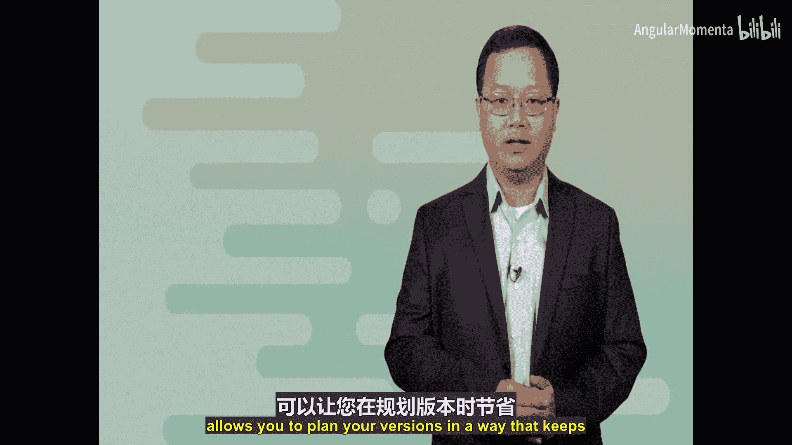
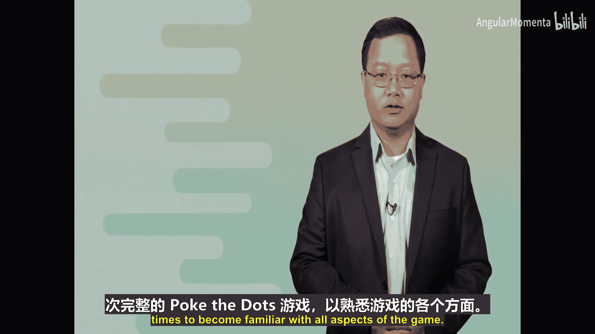

# 076：Poke the Dots游戏介绍 🎮

在本节课中，我们将要学习如何创建名为“Poke the Dots”的新游戏。我们将从理解游戏的整体功能开始，并介绍版本规划的核心概念，特别是事件处理技术。

## 游戏创建任务重启 🚀

你已经完成了“Hacking”游戏，现在回到了游戏创作流程的第一个任务。距离你上次接触“创建游戏”任务已经有一段时间了。

你将要制作的下一个游戏叫做“Poke the Dots”。在创建这个游戏的过程中，你将学习如何处理多个玩家操作，并让图形对象动起来。为此，你将学习新的编程概念，例如**类**和**用户自定义方法**。

在开始制作“Poke the Dots”的第一个版本之前，必须将最终游戏的完整功能集分解为多个版本功能集。

## 版本功能集规划 📋

我们使用一种名为“功能选择”的问题解决技术来创建这些功能子集。与“Hacking”游戏一样，我将为你提供“Poke the Dots”的版本功能集。

我们之前讨论过为游戏创建版本功能集的两个考虑因素。

以下是这两个核心考虑因素：

1.  **平衡功能集**：所有版本应该花费大致相同的精力来实现。
2.  **功能依赖性**：依赖于其他功能的功能必须在之后实现。

例如，在“Hacking”游戏中，显示提示信息是你最后实现的功能之一。它要求你已经实现了提示用户猜测并将该猜测与正确答案进行比较的功能。你需要学习 `if` 语句、`for` 循环和多个 `ua_game` 函数来编写提示信息的代码。试图一次性学习和实现所有这些功能对于一个版本来说工作量太大了。

了解功能的依赖性和复杂性，可以让你以一种可控的方式规划版本，使制作每个版本的时间和精力保持在可管理的范围内。

## 版本一：事件处理 🖱️

“Poke the Dots”的第一个版本将专注于一项名为**事件处理**的新技术。

游戏中有许多类别的事件，包括鼠标点击和按键按下。事件处理允许你识别这些事件，并在必要时对其做出反应。

为了处理事件，你将使用 `pygame` 库。回想一下，`ua_game` 是基于 `pygame` 库构建的。你将继续使用 `ua_game`，但也需要直接使用 `pygame` 的一些功能。

在接下来的几节课中，你将观察并试玩完整的“Poke the Dots”游戏。你还将为“Poke the Dots”版本一进行观察、试玩、描述并创建测试计划。

## 理解游戏任务：观察与试玩 👀🎮

你现在回到了游戏创作流程中的“理解游戏”任务。使用经验分解法来理解完整游戏的前两个步骤是：**观察游戏**和**试玩游戏**。

首先，让我们看看完整的“Poke the Dots”游戏。

当窗口打开时，屏幕上有两个圆点在移动。当圆点碰到屏幕边缘时，它们会反弹。在屏幕的左上角有一个记分板，游戏运行的每一秒分数都会增加。当两个圆点相撞时，游戏结束。

与“Hacking”不同，我不会按回车键来结束游戏，而是按关闭图标来关闭窗口。

我将再次启动游戏。这次，圆点从屏幕上的不同位置开始。我会重新启动游戏几次，以确认每次圆点都从不同的位置开始。

接下来我要做的是点击鼠标左键。当我这样做时，圆点会从屏幕上消失，然后重新出现在一个随机位置。每次我点击鼠标按钮时，它们都会这样做。

最后，注意圆点的速度：红点和蓝点的移动方式不同。红点在垂直方向上移动得更快，而蓝点在水平方向上移动得更快。

你现在应该自己试玩几次完整的“Poke the Dots”游戏，以熟悉游戏的各个方面。

## 总结 📝

本节课中，我们一起学习了“Poke the Dots”游戏的引入和规划。我们回顾了游戏创作流程，并介绍了通过**功能选择**来规划版本功能集的方法，重点考虑了**平衡性**和**依赖性**。我们明确了版本一的核心是学习**事件处理**技术。最后，我们通过观察和试玩，熟悉了完整游戏的基本行为，包括圆点移动、碰撞、计分和鼠标交互。在接下来的课程中，我们将开始为第一个版本制定具体的实现计划。