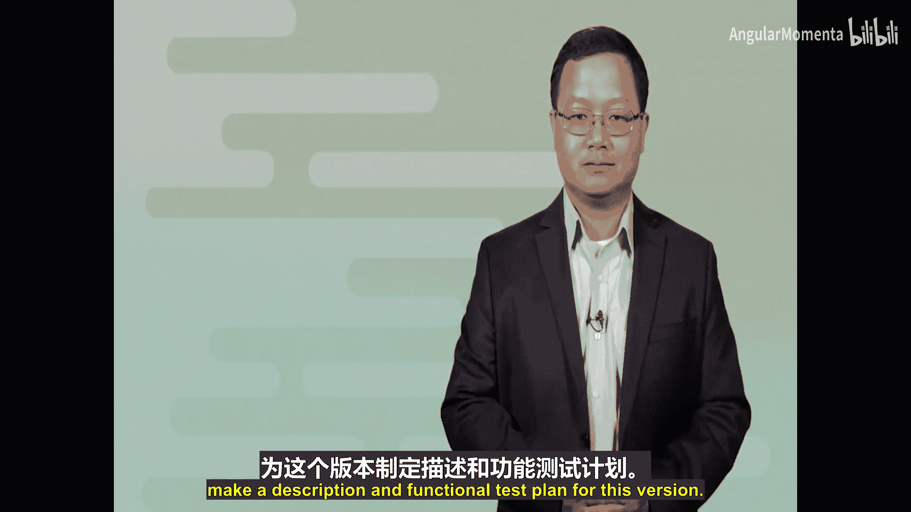

# 077：观察“戳点游戏”版本一 🎮

在本节课程中，我们将观察并分析“戳点游戏”的第一个版本。我们将了解该版本与完整游戏之间的核心区别，并学习如何为其制定描述与功能测试计划。

## 游戏演示与观察 👀

现在，我将向你展示“戳点游戏”的第一个版本。当游戏窗口打开时，界面上没有显示记分板。

两个圆点仍在移动和反弹。然而，当两个圆点相互接触时，游戏并不会结束。

我仍然可以通过点击关闭图标来关闭游戏窗口。

## 互动探索任务 🕵️

在接下来的活动中，请你自己运行并体验“戳点游戏”版本一，以熟悉其行为。

请尝试找出完整游戏与此第一版本之间的其他差异。以下是几个需要你验证的关键问题：

以下是几个需要你验证的关键问题：
*   圆点的移动轨迹是否仍然是随机的？
*   玩家是否仍然可以通过点击鼠标按钮来移动圆点？
*   每次你重启游戏时，圆点的初始移动方向是怎样的？

## 制定文档与测试计划 📝

在你熟悉了“戳点游戏”版本一之后，请为这个版本制作一份描述文档和功能测试计划。