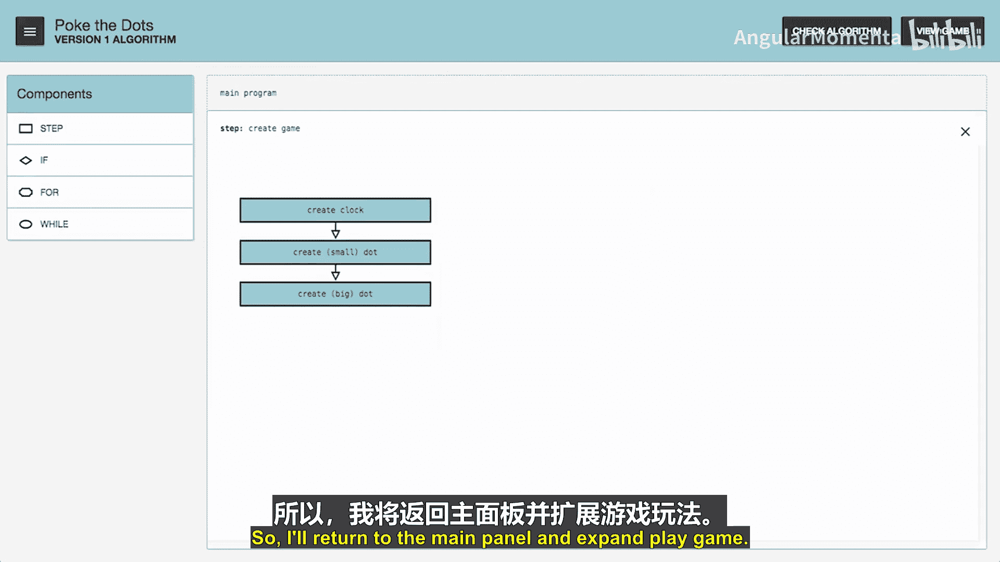
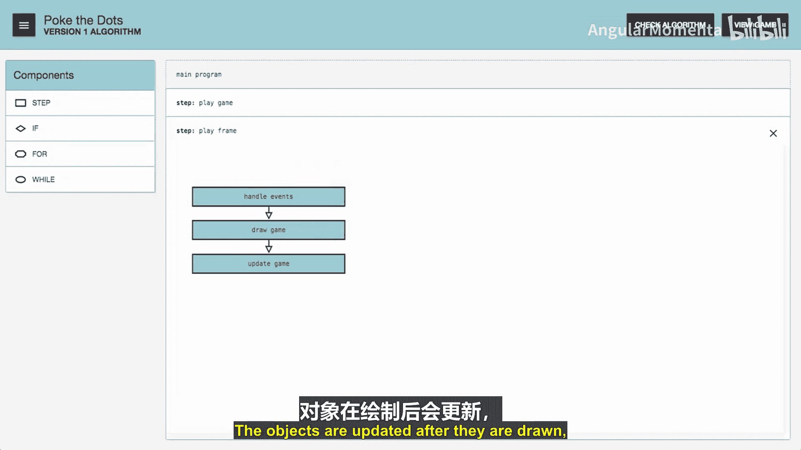
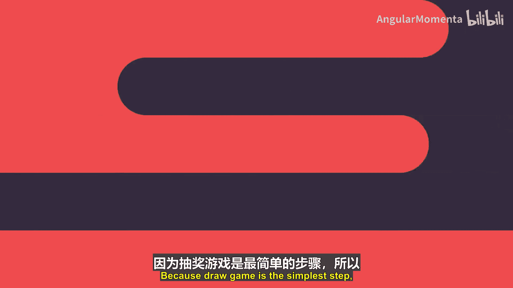

# 078：创建“戳点”游戏第一版算法 🎮


在本节课中，我们将学习如何为“戳点”游戏的第一版创建算法。我们将重点关注游戏动画的核心概念——帧循环，并了解它与之前“黑客”游戏的主要区别。

---

## 概述

“戳点”游戏与“黑客”游戏有两个主要区别。首先，“戳点”中的圆点会在游戏窗口内持续移动，直到它们相互碰撞。其次，游戏更新不仅基于玩家输入（如鼠标点击），还基于游戏条件（如圆点碰到窗口边缘）和时间变化。为了处理持续动画和玩家操作，我们将引入一个名为“帧循环”的新概念。

## 帧循环：游戏动画的核心

帧循环是程序中的一个控制结构，它通过反复更新游戏对象和重绘游戏窗口内容来模拟运动。一帧就是一张包含所有应显示对象的静态图像。每次执行帧循环，程序还必须检查玩家是否执行了任何操作并做出相应响应。

“戳点”游戏将以每秒90帧的速度运行，这意味着每秒将有90张静态图像被绘制到窗口。

以下是帧循环的基本概念公式：
```
while 游戏未结束:
    处理事件()
    绘制游戏()
    更新游戏()
```

## 创建算法的主要步骤

现在，让我们开始创建算法。我们将遵循一个可复用的四步模板，这是“使用模板”问题解决技术的一个例子。


以下是创建游戏算法的四个主要步骤：

1.  **创建窗口**：与我们在“黑客”游戏中所做的一样。
2.  **创建游戏**：创建游戏所需的所有对象。
3.  **运行游戏**：包含帧循环。
4.  **关闭窗口**：与“黑客”游戏结束时一样。

不同的游戏可以通过改变“创建游戏”和“运行游戏”这两个步骤的子步骤来实现。

## 展开“创建游戏”步骤

在“创建游戏”步骤中，我们需要初始化游戏所需的所有对象。对于“戳点”游戏的第一版，这包括：

*   **创建时钟**：时钟负责控制游戏的速度或帧率。在未来的版本中，它还将用于更新记分牌。
*   **创建小圆点**：定义圆点的属性，如位置、颜色、大小和速度。
*   **创建大圆点**：定义另一个圆点的属性。

在编写创建圆点的代码时，你只需要一个函数，但算法中需要为每个圆点明确一个步骤。




## 展开“运行游戏”步骤

“运行游戏”是放置帧循环的地方。我们希望窗口保持打开状态，直到玩家点击关闭图标。

以下是“运行游戏”步骤的详细分解：

```
while 玩家未选择关闭:
    运行一帧()
```





“运行一帧”步骤本身又包含三个关键子步骤：

1.  **处理事件**：跟踪任何玩家操作。
2.  **绘制游戏**：绘制当前帧。
3.  **更新游戏**：为下一帧更新所有游戏对象。

对象在绘制后才被更新，因此它们最初的位置会被显示出来。

### 详细分解“绘制游戏”

“绘制游戏”步骤相对简单，它包含三个操作：

*   绘制小圆点
*   绘制大圆点
*   更新显示

“更新显示”步骤将更新窗口以显示刚刚绘制的所有对象。与“黑客”游戏每绘制一个字符串就更新一次显示不同，在“戳点”中，我们可以绘制所有对象，然后每帧更新一次显示，这样效率更高。

### 详细分解“处理事件”

每个图形库都有一个函数，可以返回一个事件序列。这个序列包含自上次调用该函数以来发生的所有事件。我们将每帧调用一次这个函数，然后使用确定的循环来处理序列中的所有新事件。

在“处理事件”步骤中，我们使用一个 `for` 循环来遍历事件列表。对于列表中的每个事件，我们调用“处理单个事件”函数。

“戳点”游戏的第一版只处理一类事件：点击窗口上的关闭图标。我们称这类事件为“关闭事件”。

以下是处理单个事件的逻辑：
```
if 事件类别 == 关闭:
    记住玩家已选择关闭
```

“玩家已选择关闭”是一个布尔值，它控制着外层的 `while` 循环。只要这个值为假，游戏就会继续运行下一帧。

### 详细分解“更新游戏”

“更新游戏”步骤负责更新游戏状态，为下一帧做准备。它包括：

*   移动小圆点
*   移动大圆点
*   控制帧率（确保游戏在不同机器上以一致的速度运行）

我们将详细展开“移动小圆点”的步骤，“移动大圆点”的逻辑与之相同，因此无需重复。

## 圆点的表示与移动逻辑

在屏幕上，一个圆由大量像素组成。为了高效地表示和移动圆，我们使用两个对象：圆心点（一个包含两个整数坐标的序列）和半径（一个整数）。当圆移动时，半径保持不变，只有圆心改变。改变两个整数远比改变圆周上的大量像素要快。

移动圆点的逻辑是更新其圆心的X和Y坐标。每个坐标的更新公式为：
```
新坐标 = 旧坐标 + 速度分量
```

我们使用一个 `for` 循环来遍历圆心坐标的索引（0代表X，1代表Y），并更新每个坐标。

### 边界碰撞检测与反弹

我们需要检查圆点是否移出了窗口。如果圆点的边缘移出了窗口，我们需要让它从窗口边缘反弹回来。

反弹的逻辑是：**否定**导致其移出边界的那个方向上的速度分量。

以下是三个例子：

1.  如果圆点仅以每帧+2像素的速度向右移动并碰到右边缘，则其X方向速度（索引0）被取反，变为每帧-2像素。
2.  如果圆点仅以每帧-1像素的速度向左移动并碰到左边缘，则其X方向速度被取反，变为每帧+1像素。
3.  如果圆点仅以每帧+3像素的速度向下移动并碰到底部边缘，则其Y方向速度（索引1）被取反，变为每帧-3像素。

## 总结


本节课我们一起学习了为“戳点”游戏第一版创建完整算法的过程。我们引入了**帧循环**的核心概念来管理持续动画和玩家输入。算法遵循了创建窗口、创建游戏对象、运行游戏（包含帧循环）和关闭窗口的四步模板。我们详细探讨了如何表示和移动圆点，以及如何处理边界碰撞使其反弹。在开始编写代码实现版本1之前，请确保观看接下来的几节编程语言视频。