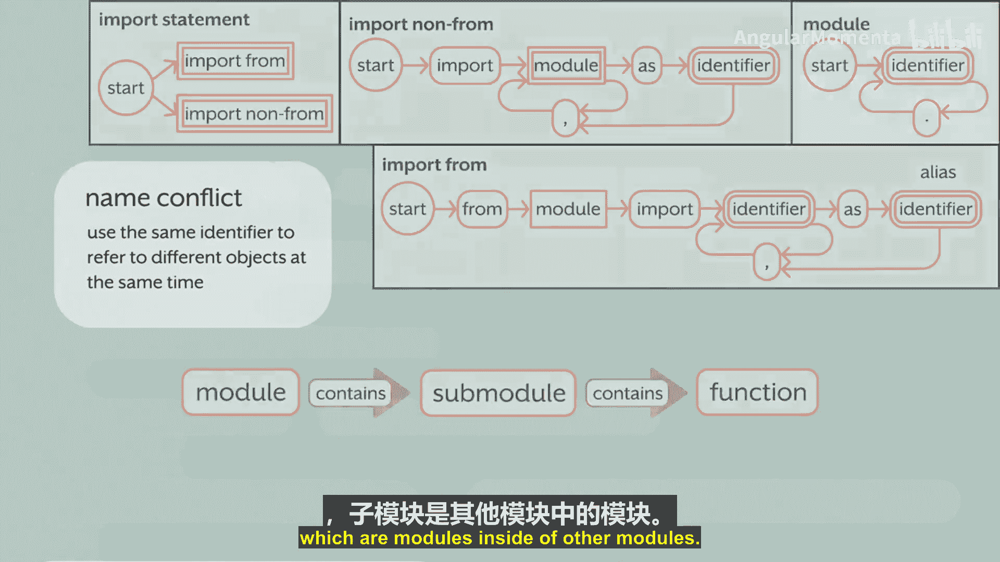

# 079：import语句的变体 📦


在本节课中，我们将学习Python中`import`语句的几种变体。这些变体可以帮助我们解决程序中可能出现的名称冲突问题，并且允许我们从子模块（即位于其他模块内部的模块）中导入对象。

---

## 名称冲突问题

上一节我们了解了基本的`import`语句。本节中，我们来看看当程序中存在相同标识符时会发生什么。

名称冲突发生在你尝试同时使用同一个标识符来指代不同对象的时候。

例如，下面这个程序使用标识符`sleep`来指代不同的睡眠模式，如REM（快速眼动）和非REM。我想在打印睡眠模式和“dreams”输出之间有一个暂停。为此，我将从`time`模块导入`sleep`函数，并在第一个`print`函数调用后调用这个`sleep`函数。

```python
from time import sleep

sleep = input("Enter sleep mode: ")
print(sleep)
sleep(1)
print("dreams")
```

Python解释器报告了一个类型错误，指出`sleep`不是一个可调用对象。

发生了什么？
1.  程序开始时，主模块的命名空间包含标识符`input`和`print`，每个都绑定到一个函数对象。
2.  当执行`import`语句时，标识符`sleep`被添加到命名空间，并绑定到来自`time`模块的`sleep`函数对象。
3.  接下来，`input`函数返回一个字符串对象（例如“REM”），赋值语句将标识符`sleep`重新绑定到这个字符串对象。
4.  `print`函数调用显示这个字符串对象。
5.  下一条语句是一个函数调用，其函数名是`sleep`。解释器解引用`sleep`标识符，得到一个字符串对象，而字符串不是函数，因此函数调用失败。

当赋值语句重新绑定标识符`sleep`时，对`sleep`函数的引用就丢失了。这就是一个名称冲突。

Python使用“最近绑定规则”来解决名称冲突：无论哪个绑定发生得最近，该绑定就会被用来解引用一个标识符。

例如，我将`import`语句移到程序后面：

```python
sleep = input("Enter sleep mode: ")
print(sleep)
from time import sleep
sleep(1)
print("dreams")
```

这次，标识符`sleep`首先被添加到命名空间并绑定到`input`函数调用的结果对象（“REM”）。然后`print`函数调用显示“REM”。接着，`import`语句将`sleep`重新绑定到`time`模块的`sleep`函数。对`sleep`的函数调用按预期工作。

然而，当评估`if`语句的条件时，标识符`sleep`被解引用以获得`sleep`函数对象，它不等于字符串“REM”，即使用户输入了“REM”。名称冲突依然存在，程序输出不正确。

---

## 使用`as`子句解决冲突

你可以通过为其中一个冲突对象选择不同的标识符来绑定，从而解决名称冲突。

我可以为输入字符串绑定一个不同的标识符，例如`sleep_mode`，并保留标识符`sleep`给导入的`sleep`函数。这需要在所有想引用用户输入的字符串的地方，将`sleep`改为`sleep_mode`。

在这种情况下，`sleep_mode`可能是输入字符串更具描述性的标识符。然而，在一个关于睡眠主题、名为`sleep.py`的程序中，使用`sleep`作为暂停函数的名称并不十分贴切。

Python提供了灵活性，可以使用`import`语句的不同变体来解决由导入名称引起的冲突。这些变体允许你在程序中使用最合适的本地名称来表示每个导入的对象，而不受其他模块中使用的名称的限制。

以下是我们在之前`import`语句基础上的一般化形式，它添加了一个可选的`as`子句，为每个导入的名称提供一个替代的本地名称。这个本地名称通常被称为**别名**。

我将恢复使用`sleep`来指代输入字符串，并使用`import`语句的这个新变体，将导入的本地名称从`sleep`改为`pause`，这在本程序中更具描述性。

```python
from time import sleep as pause

sleep = input("Enter sleep mode: ")
print(sleep)
pause(1)
print("dreams")
```

程序输出正确。

以下是带`as`子句的`import`语句的语义：
1.  程序开始时，主模块的命名空间包含标识符`input`和`print`，每个都绑定到一个函数对象。
2.  当执行`import`语句时，标识符`pause`被添加到命名空间，并绑定到来自`time`模块的`sleep`函数对象。
3.  接下来，`input`函数返回一个“REM”字符串对象，赋值语句将`sleep`标识符绑定到这个对象。
4.  `print`函数调用显示这个字符串对象。
5.  下一条语句是一个函数调用，其函数名是`pause`。解释器解引用`pause`标识符以获得一个函数对象，因此程序按预期继续。名称冲突已被消除。

---

## 不使用`from`关键字的变体

`import`语句的另一个变体不使用`from`关键字。这是一个新的语法图，它支持你已经见过的`from`变体和新`非from`变体。

以下是`from`变体的语法图（已见过）：
```
import_statement ::= "from" module "import" identifier ["as" identifier]
```

以下是新的`非from`变体的语法图：
```
import_statement ::= "import" module ["as" identifier]
```

如果使用这个新变体，那么当使用导入模块中的标识符时，必须将其作为该模块的**属性**来使用。

例如，以下是使用此变体的睡眠程序版本：

```python
import time

sleep = input("Enter sleep mode: ")
print(sleep)
time.sleep(1)
print("dreams")
```

程序输出正确。

以下是`非from`变体`import`语句的语义：
1.  程序开始时，主模块的命名空间包含标识符`input`和`print`，每个都绑定到一个函数对象。
2.  当执行`import`语句时，标识符`time`被添加到命名空间，并绑定到`time`模块对象。`time`模块中的任何标识符都不会绑定到主模块的命名空间，只有模块本身的名称。
3.  接下来，`input`函数返回一个“REM”字符串对象，赋值语句将`sleep`标识符绑定到这个对象。
4.  `print`函数调用显示这个字符串对象。
5.  下一条语句是一个函数调用，其函数名是`time.sleep(1)`。这是一个**属性引用**。之所以需要属性引用，是因为只有模块名在主模块的命名空间中，而`sleep`函数的名称不在。

回顾方法调用课程中属性引用的语法和语义：
1.  首先，解释器计算表达式`time`以获得一个对象（这里是`time`模块对象）。
2.  其次，解释器检查属性`sleep`是否在`time`模块对象的命名空间中。由于`sleep`是在`time`模块中定义的函数，`sleep`在`time`的命名空间中，因此获得了`sleep`函数对象。
3.  解释器将此函数应用于参数列表（这里是单个整数对象`1`），`sleep`函数暂停一秒钟。程序按预期继续。名称冲突已被消除。

---

## 从子模块导入

在Python中，模块可以定义在其他模块内部。位于另一个模块内部的模块称为**子模块**。

为了从子模块导入对象，我将对模块本身的语法图进行一般化。之前，我们假设模块名是单个标识符，因此我们使用这个语法图表示模块：
```
module ::= identifier
```

为了访问子模块中的对象，我可以使用这个一般化的语法，将模块表示为由点分隔的标识符序列：
```
module ::= identifier ("." identifier)*
```

例如，标准库包含一个名为`os`的模块，它提供对操作系统功能的访问。在`os`模块内部有一个名为`path`的子模块，其中包含一个名为`isfile`的函数。`isfile`函数如果其字符串参数是Python运行时所在文件夹中存在的文件名，则返回`True`，否则返回`False`。

我可以使用这个模块的一般化语法来访问此函数：

```python
from os.path import isfile

print(isfile("sleep.py"))  # 假设当前文件夹有sleep.py文件，返回True
print(isfile("snobz.py"))  # 假设没有此文件，返回False
```

---

## 总结



本节课中，我们一起学习了Python `import`语句的几种重要变体。我们首先探讨了名称冲突的产生原因和Python的“最近绑定规则”。接着，我们学习了如何使用`from ... import ... as ...`语句为导入的对象创建别名，从而避免冲突并使代码更清晰。然后，我们介绍了不使用`from`关键字的`import`语句，它要求通过模块名加点号的方式来访问其内部对象（属性引用）。最后，我们了解了如何通过点号表示法（如`os.path`）从子模块中导入对象。掌握这些`import`语句的变体，能够帮助你更灵活、更清晰地组织代码，有效管理不同模块和命名空间中的标识符。