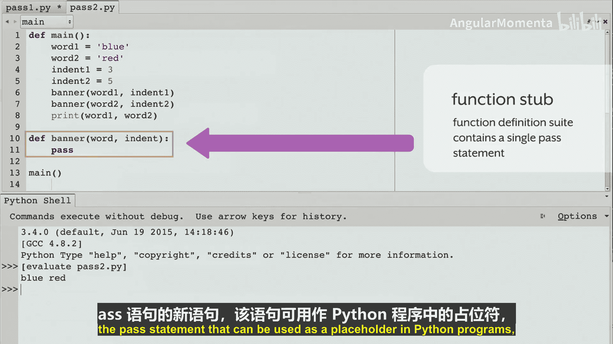
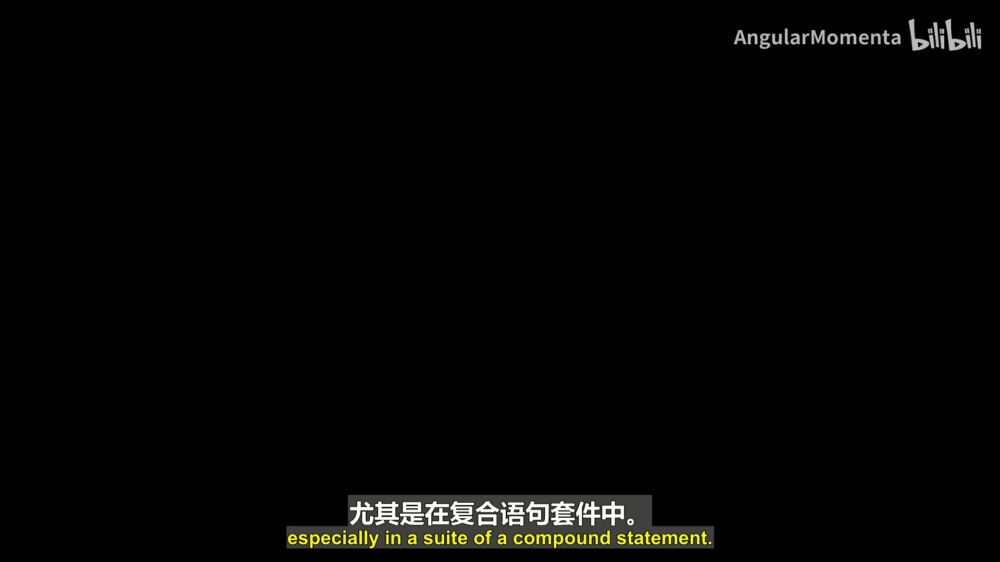

**Python编程与问题解决：09_05_01：pass占位语句** 🧩


在本节课中，我们将学习Python中的一个特殊语句——`pass`语句。它不执行任何操作，但可以作为代码中的占位符，帮助我们构建程序结构，避免语法错误。

---

在编写代码时，我们常常会先搭建程序框架，某些具体的代码块可能暂时还未想好如何实现。如果这些代码块是空的，Python解释器会报语法错误。`pass`语句就是为了解决这个问题而存在的。

### **pass语句的语法与语义**

以下是`pass`语句的语法图。它非常简单，只包含一个关键字 `pass`。

```
pass_statement ::=  "pass"
```

`pass`语句的语义是：**不执行任何操作**。当Python解释器执行到`pass`语句时，它会直接跳过，继续执行后续的代码。

### **pass语句的常见用途**

`pass`语句虽然简单，但在特定场景下非常有用。以下是它的两个主要应用场景。

**1. 在复合语句的代码块中占位**
在`if`、`while`、`for`或函数定义等复合语句中，代码块（suite）必须包含至少一条语句。如果暂时不想写具体逻辑，可以使用`pass`占位。

例如，考虑以下程序，我们根据输入决定输出，但尚未想好当输入是`"blue"`时该输出什么字符串：

```python
color = input()
if color == "red":
    print("apple")
elif color == "blue":
    # 待完成：决定输出什么
```

上面的代码是无效的，因为`elif`子句的代码块是空的。注释不是语句，不能填充代码块。我们可以使用`pass`语句来避免语法错误：

```python
color = input()
if color == "red":
    print("apple")
elif color == "blue":
    pass  # 待完成：决定输出什么
```

**2. 创建函数存根以进行测试**
在编写包含多个函数的程序时，你可能希望先测试部分已完成的函数，而其他函数稍后再实现。这时，可以为未完成的函数创建“存根”。

函数存根是一个函数定义，但其函数体只包含一条`pass`语句。这允许程序在语法上保持完整，从而可以运行和测试其他部分。

例如，这是上一课中出现的横幅程序，但`banner`函数暂时只是一个存根：

```python
def banner():
    pass  # 函数存根，具体实现稍后完成

def main():
    result = banner()
    print(result)

if __name__ == "__main__":
    main()
```

通过使用`pass`语句作为`banner`函数的存根，我们可以先运行和测试`main`函数，而无需立刻完成`banner`函数的所有细节。



---



本节课我们一起学习了`pass`语句。它是一个不执行任何操作的占位语句，主要用于在复合语句的代码块中避免语法错误，以及为尚未实现的函数创建存根，方便我们分步构建和测试程序。