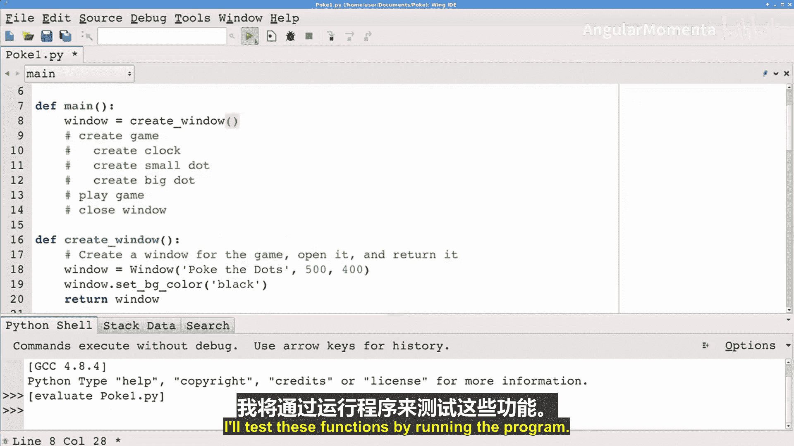
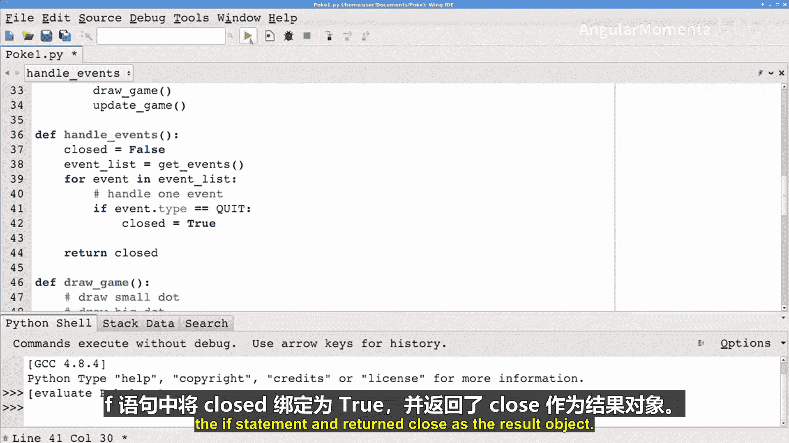
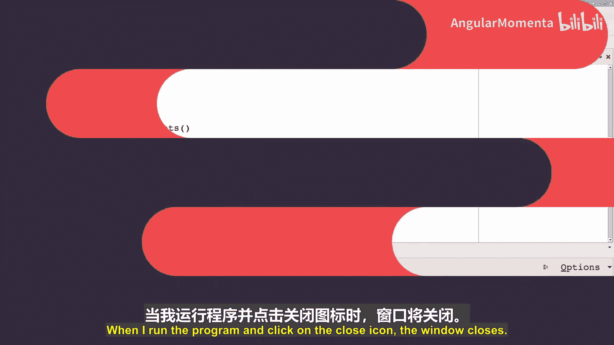
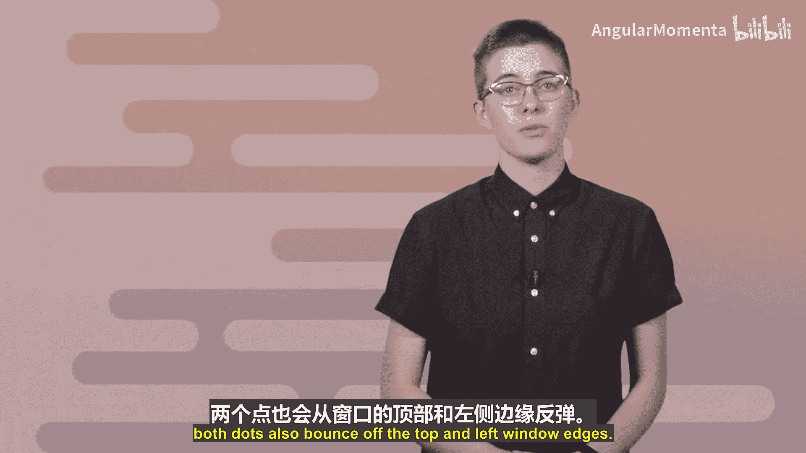

# 081：编程“戳点”游戏版本1


在本节课中，我们将学习如何从零开始编程“戳点”游戏的第一版。我们将遵循一个结构化的过程，从编写程序注释和算法步骤开始，逐步实现游戏窗口、游戏对象、事件处理、图形绘制和游戏逻辑。

## 概述

我们将创建一个简单的游戏，其中包含两个移动的圆点。本节将指导你完成初始化项目、创建游戏窗口、处理用户事件、绘制图形以及实现基础物理（如反弹）的整个过程。

## 创建程序框架与注释

编程“戳点”游戏版本1的第一步，是创建一个程序注释，并为所有算法步骤添加注释。这与编程“黑客”游戏时使用的过程相同，但这是你在七个版本中首次从空文档开始。添加你的注释，并记得保存文档。



我首先要做的是为每个函数编写一个头部注释。在每个函数体内，我会先使用一个 `pass` 语句，直到我准备好添加更多代码。我将在程序底部添加对 `main` 函数的调用，并运行它。


程序运行无误，没有显示任何内容，这符合预期。

## 创建游戏窗口

上一节我们介绍了如何搭建程序框架。本节中，我们来看看如何创建游戏窗口。

算法步骤中的一些注释与“黑客”游戏类似。例如，你之前创建过打开窗口的函数。我将开始为“戳点”游戏编写 `create_window` 函数。这次，窗口标题是“Poke the dots”，尺寸是500x400像素。

由于版本1中没有文本，我还不需要设置字体属性，但我会设置背景颜色，尽管默认是黑色。

现在，我将在 `main` 函数体中添加代码。我会删除 `pass` 语句，并使用 `create_window` 来创建一个窗口对象。我将通过运行程序来测试这些函数。

窗口成功打开，进展顺利。

## 初始化游戏对象与主循环

窗口创建成功后，下一步是在 `main` 函数中创建游戏对象。在我们的算法中，我们使用一个时钟来控制帧率。在 Pygame 中，`Clock` 类管理帧率。这个类定义在 Pygame 模块的 `time` 子模块中。

要创建一个时钟，首先我必须从 `pygame.time` 导入 `Clock`。现在，我将在 `main` 函数中通过调用类名 `Clock()` 来创建这个对象。

我将通过为“大点”的颜色、半径、中心点和速度创建对象来生成大点。颜色和速度来自版本描述。大点是蓝色的，并且它在水平方向上的移动速度是垂直方向的两倍。另外两个属性，半径和中心点，是通过观察游戏估算出来的。你可以自己估算小点的值。

`main` 函数中最后两个注释是 `play_game` 和 `close_window`。我将为它们分别添加函数调用：一个是普通的函数调用 `play_game()`，另一个是方法调用 `window.close()`。

当然，当我运行程序时，除了窗口关闭，没有发生任何新的事情。`play_game` 函数中唯一的语句是 `pass`，所以调用这个函数时什么也不会发生。接下来让我们改变这一点。

## 实现游戏主循环与事件处理

现在我们来编写 `play_game` 的代码。在“戳点”游戏中，窗口会一直保持打开，直到玩家点击关闭窗口图标。Pygame 将每个玩家动作表示为一个事件，点击关闭图标由一个 `QUIT` 事件表示。

我将使用一个名为 `close_selected` 的布尔变量来跟踪是否发生了关闭事件。我将其初始绑定为 `False`，因为直到玩家采取相应动作前，Pygame 不会创建关闭事件。

`handle_events` 函数处理 Pygame 创建的所有事件。当发生关闭事件时，我将让它返回 `True`，这样我就知道何时关闭窗口。因此，我将把 `close_selected` 重新绑定到 `handle_events` 的返回对象。

游戏的帧循环应该在 `close_selected` 为 `False` 时一直运行，所以 `while` 循环头是 `while not close_selected:`。我将在循环体中将 `draw_game` 和 `update_game` 的注释替换为它们各自的函数调用。



好的，现在来看 `handle_events`。由于 `handle_events` 必须返回玩家是否点击了关闭图标，我必须跟踪这个关闭事件是否发生。



我将使用一个局部标识符 `closed` 并将其绑定为 `False`。只有在发生关闭事件后，我才会将其重新绑定为 `True`，并返回 `closed` 作为结果对象。

我需要访问我想要处理的事件。Pygame 的 `pygame.event` 模块中的 `get` 函数返回自上次调用该函数以来发生的事件列表。我将导入它以便在 `handle_events` 函数中使用。然而，`get` 这个名字描述性不强。仅看名字我无法判断这个函数获取的是什么。我将使用别名 `get_events` 导入这个函数。现在，我在 `handle_events` 函数中调用 `get_events()` 并将标识符 `event_list` 绑定到结果上。

因为 `get_events()` 返回一个事件序列，所以我需要一个事件循环来遍历这个序列。我将使用一个 `for` 循环。在这个版本中，我只处理关闭事件。

每个事件都有一个名为 `type` 的属性，它指的不是其实际的对象类型，而是绑定到一个代表事件类别的对象，例如鼠标点击、按键或关闭。在 Pygame 中，关闭事件由标识符 `QUIT` 表示。我将从 `pygame` 导入 `QUIT`。

现在，我将使用一个 `if` 语句来检查事件循环当前处理的事件类别是否为 `QUIT`。我将在 `if` 语句内将 `closed` 绑定为 `True`，并返回 `closed` 作为结果对象。

当我运行程序并点击关闭图标时，窗口关闭了。

## 绘制游戏图形

接下来让我们编写 `draw_game`。正如算法视频中所讨论的，`draw_small_dot` 和 `draw_big_dot` 将使用同一个函数来绘制每个点。由于我只创建了大点，我将只为大点调用 `draw_dot`。

`draw_game` 的最后一步是调用 `update` 来更新窗口显示，我将添加这个函数调用。

现在，我来编写 `draw_dot`。函数头将是 `def draw_dot`，因为它将被用来绘制任何点。Pygame 包含一个有用的绘制圆的函数，它叫 `circle`，位于 `draw` 模块中。但 `circle` 这个名字描述性不强，所以我会使用别名，将其导入为 `draw_circle`。

让我们看看这个函数的文档。它有四个必需的参数：一个 `surface`（表面）、一个 `color`（颜色）、一个 `position`（位置）和一个 `radius`（半径）。`surface` 是绘制圆的地方。每个窗口都有一个表面，可以通过调用 Pygame 窗口对象的 `get_surface` 方法来获取。因此，我必须在函数头的参数列表中添加 `window`。

`draw_circle` 的下一个参数是 `color`。Pygame 使用特定的颜色类型来表示颜色。我已经有了想要绘制的颜色的名称字符串，但我不能直接将名称字符串传递给 `draw_circle` 函数。我将从 `pygame` 导入颜色类型，就像我从 `ui_game` 导入 `window` 一样。现在，我可以使用 `Color` 函数，以名称字符串作为参数来创建一个颜色对象。

记住，`draw_dot` 函数必须足够通用以绘制任何点，所以我需要为其颜色字符串、中心点和半径使用参数。我将在 `draw_dot` 的参数列表中添加相应的参数：`color_string`、`center` 和 `radius`。

我现在可以调用 `draw_circle`，使用我刚创建的表面和颜色对象，以及中心点和半径。

现在我将返回到 `draw_game`，并为 `draw_dot` 添加参数：`window`、大点的颜色字符串、中心点和半径。这意味着我必须将 `window`、`big_color`、`big_center` 和 `big_radius` 添加为 `draw_game` 的参数。由于 `draw_game` 在 `play_game` 中被调用，我也将在那里添加这些参数。最后，我将在我已经完成的 `play_game` 和 `draw_game` 调用中传递所有这些对象作为参数。

我运行程序。一个蓝点显示出来了，但它不动。游戏需要更新才能让点移动。

## 实现游戏更新与运动逻辑

我将用移动点和控制帧率的语句替换 `update_game` 中的 `pass` 语句。我将使用一个名为 `move_dot` 的单一函数来移动每个点。由于我只创建了大点，目前我只进行一次调用。

现在我们来编写 `move_dot` 函数。第一个注释是用于创建从0到1序列的 `for` 循环占位符，我将使用 `range` 函数。回想一下，`range` 函数创建一个从第一个参数到第二个参数减一的序列，所以我必须使用参数 `0` 和 `2` 来更新中心的坐标。我将使用下标来访问中心和速度在当前索引（即 `for` 循环的目标变量）处的值。我将添加 `center` 和 `velocity` 作为参数，以便在函数内部使用。

当点碰到窗口边缘时必须反弹。如果我希望点在中心碰到右窗口边缘时反弹，我可以检查点的X坐标是否等于窗口宽度。然而，点实际上是在其边缘碰到右窗口边缘时反弹，即当点的X坐标加上其半径等于窗口宽度时为真。

由于点在一帧内可以移动多个像素，点有可能越过窗口边缘而不仅仅是触碰到它。因此，我将检查点的X坐标加上半径是否大于或等于窗口宽度，以执行从右边缘的反弹。

我将在窗口上调用 `get_width` 方法来获取其宽度，但为此我需要将 `window` 添加为参数。我还将添加 `radius` 作为参数。我将使用与其他函数相同的参数顺序，这样更容易记忆。

回想一下，正速度意味着点向右或向下移动，负速度意味着点向左或向上移动。我将通过取反其速度来使点反弹。

由于 `move_dot` 有四个参数，我将回到 `update_game`，并为 `move_dot` 添加四个对应的参数：`window`、`big_center`、`big_radius` 和 `big_velocity`。现在我将把这些参数作为参数添加到 `update_game` 中。

现在，我将在 `play_game` 中添加 `update_game` 的参数。虽然 `play_game` 已经将其中一些作为参数，但它缺少 `big_velocity`。我将把这个参数添加到 `play_game`，并在 `main` 中对 `play_game` 的函数调用中添加相应的参数。

我运行程序看看是否工作。蓝点移动了并且会反弹。然而，它移动得太快，有拖尾，并且在反弹前向下移动得太远。

反弹条件在X和Y方向都进行了检查，因为它位于 `for` 循环内部，该循环对索引0（X）和1（Y）都进行了求值。但是，Y方向的条件应该使用窗口高度而不是窗口宽度。

点向下移动太远是因为Y方向的反弹条件是其Y坐标加上半径大于或等于窗口宽度，而不是窗口高度。

为了对索引0检查宽度，对索引1检查高度，我将把宽度和高度放在一个 `size` 列表中。我再次运行程序。点现在能正确地从底部边缘反弹了。我将把左边缘和上边缘留给你处理。你只需要修改 `if` 条件，添加一个 `or` 和一个比较操作。这个比较将在索引为0时检查左边缘，在索引为1时检查上边缘。

为了改变点的速度，我需要控制帧率。我将返回到 `update_game` 函数，并将帧率注释替换为一个语句。在 Pygame 中，帧率由我在 `main` 函数中创建的时钟控制。这意味着我必须向 `update_game` 添加一个 `clock` 参数。现在我可以使用 Pygame 时钟对象的 `tick` 方法来设置帧率。这个方法以帧率作为参数，并防止游戏运行得比指定的每秒帧数更快。没有这个方法调用，你的游戏会以计算机允许的最快速度运行，我们已经看到这太快了。我将添加一个赋值语句将 `frame_rate` 绑定到90，然后我将用参数 `frame_rate` 调用 `clock.tick()`。现在我运行程序。

游戏速度好多了。你将在反思环节尝试不同的帧率。

## 修复图形残留问题

为什么点有拖尾？每次我调用 `draw_game`，它都会在更新后的位置重新绘制大点。由于我从未清除屏幕，点被一个接一个地绘制在上面。由于点在每一帧中移动的量非常小，这给人一种在窗口中绘制了拖尾的外观。

要解决这个问题，我需要在绘制新点之前擦除前一个点。我将在 `draw_game` 函数的开头添加一个 `clear_window` 调用，并再次运行程序。

除了从上边缘和左边缘反弹外，其他一切工作正常，但你会自己修复这个问题。

拖尾问题在算法层面也存在。我将更改算法，使其与程序一致。`draw_game` 面板有三个步骤：绘制小点、绘制大点和更新显示。在我绘制任何东西之前，我需要清除窗口，所以我将在第一个绘制步骤之前添加一个清除窗口的步骤。

并非编程时犯的每个错误都可以通过简单地更改一行代码来修复。有些问题更深层，可能根源于游戏创建过程的早期迭代，比如算法。点上的意外拖尾就是这类问题的一个很好的例子。我必须运行程序才能认识到这个问题，然后才能修复代码。我在创建算法时没有预见到这个问题。我需要使用图形库才能意识到这个问题的存在。这就是我们使用迭代过程来创建游戏的原因。在单个版本内进行编码然后修复算法的迭代没有明确显示在游戏创建过程图中，但它确实会发生。

## 总结

本节课中，我们一起学习了如何从零开始构建“戳点”游戏的第一版。我们完成了以下核心步骤：
1.  **建立框架**：创建程序结构，编写函数头部注释。
2.  **创建窗口**：使用 Pygame 初始化游戏窗口并设置属性。
3.  **处理事件**：实现事件循环，响应用户关闭窗口的操作。
4.  **绘制图形**：使用 `draw.circle` 函数在窗口表面上绘制圆点。
5.  **实现运动**：编写 `move_dot` 函数更新点的位置，并使其在窗口边缘反弹。
6.  **控制游戏**：使用 `Clock` 对象控制游戏帧率，管理游戏速度。
7.  **修复问题**：识别并解决了图形残留（拖尾）问题，这涉及到返回修改算法步骤。

核心概念和代码片段总结如下：
*   **创建时钟控制帧率**：`clock = pygame.time.Clock()`
*   **游戏主循环条件**：`while not close_selected:`
*   **获取并处理事件**：
    ```python
    for event in pygame.event.get():
        if event.type == pygame.QUIT:
            closed = True
    ```
*   **绘制圆形**：`pygame.draw.circle(surface, color, center, radius)`
*   **移动并反弹逻辑（示例为右/下边缘）**：
    ```python
    size = [window.get_width(), window.get_height()]
    for idx in range(0, 2):
        center[idx] += velocity[idx]
        if center[idx] + radius >= size[idx]:
            velocity[idx] = -velocity[idx]
    ```
*   **控制帧率**：`clock.tick(90)`



现在轮到你来编程了：添加小点，并修改代码使两个点也能从上边缘和左窗口边缘反弹。