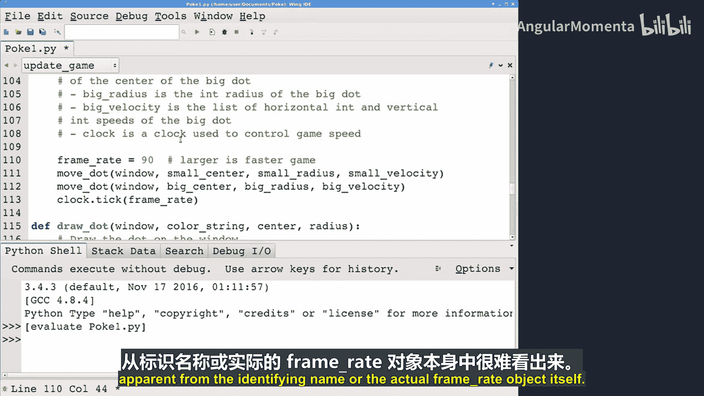

# 082：Poke the Dots 版本1代码回顾

在本节课中，我们将通过代码追踪的方式，回顾“Poke the Dots”游戏第一个版本的实现细节。我们将学习如何理解程序的执行流程、检查变量状态，并评估代码的软件质量。

## 概述

我们将从导入语句开始，逐步追踪程序的执行，观察函数调用时命名空间的变化、事件的处理、游戏帧率的影响以及图形的绘制。最后，我们将根据已建立的软件质量标准来评估此版本代码。

## 代码追踪与执行流程

首先，通过点击“步入”按钮开始追踪“Poke the Dots”版本1的代码，然后“步过”导入语句。

导入语句会将标识符添加到当前代码块的本地命名空间中。在堆栈数据面板的“局部变量”部分，只会显示部分导入的标识符。然而，你可以通过查看其长度来了解本地命名空间中标识符的数量。

当我步过导入 `pygame` 中 `quit` 和 `color` 的语句后，标识符 `quit` 在堆栈数据中可见，它被绑定到整数 `12`，而标识符 `color` 不可见。当导入绑定到简单对象（如字符串和整数）的标识符时，这些绑定会添加到堆栈数据中相应的命名空间。绑定到更复杂对象（如函数和模块）的标识符不会明确显示，这就是为什么你之前从未在堆栈数据中看到过这些绑定。

我将步过所有函数定义，直到遇到对 `main` 函数的调用。当我步入 `main` 函数调用时，本地命名空间现在属于 `main` 函数。由于 `main` 函数的命名空间中尚未绑定任何内容，其局部变量的长度为 `0`。

我将步过 `main` 函数中的所有语句，直到遇到对 `play_game` 函数的调用。此时，`main` 函数的命名空间中已添加了 `10` 个新的绑定。别忘了，你可以展开包含多个元素的对象（例如列表）以查看这些元素。例如，我可以展开 `small_center` 列表来查看它的两个元素。现在，小圆点的 X 坐标（即 `small_center` 列表的第一个元素）绑定为 `50`，Y 坐标（列表的第二个元素）绑定为 `75`。

点击“步入”按钮进入 `play_game` 函数调用。本地命名空间现在是 `play_game` 函数的命名空间。该命名空间包含该函数 `10` 个参数中每一个的绑定，因此这里也有 `10` 个绑定。我将步过 `play_game` 中的语句，直到遇到对 `handle_events` 的调用并步入其中。

这次，本地命名空间是空的，因为 `handle_events` 没有参数。我将步过 `handle_events` 中的语句，直到 `event_list` 被添加到本地命名空间。对 `get_events` 的调用会检索自上次调用 `get_events` 以来发生的所有事件。当我在堆栈数据面板中展开 `event_list` 时，你可以看到当前事件列表中的事件。在此版本的“Poke the Dots”中，除了退出事件外，所有这些事件都被忽略。检查事件列表并不能提供太多关于事件的有用信息，但它确实让我看到了正在发生的事件。

点击“步出”按钮返回到 `play_game`。当我步过对 `draw_game` 的调用时，圆点出现在游戏窗口中。我将步入 `update_game`。`update_game` 中的第一个语句是帧率赋值语句，帧率设置为 `90`，即每秒最多绘制 `90` 帧。圆点每秒在每个方向上移动 `90` 像素乘以速度。例如，如果速度的 X 分量为 `2`，则圆点每秒在 X 方向上移动 `180` 像素。

## 理解帧率的影响

更高的帧率意味着每秒绘制更多帧，因此圆点每秒移动更多像素，这会导致游戏速度更快。相反，更低的帧率会导致游戏速度更慢。我将停止追踪以试验帧率。

如果我将帧率改为 `1000` 并运行程序，游戏速度会快得多。如果我将帧率改为 `5` 并再次运行程序，游戏会变得极其缓慢。选择一个合理的帧率是创建可玩游戏的一部分。

我将帧率改回 `90`。为了记住更高的数字意味着更快的游戏，更低的数字意味着更慢的游戏，我将添加一种称为行内注释的新注释类型。

行内注释用于提供无法从上下文中轻易推断出的澄清信息。例如，为值的递增添加注释没有帮助，因为查看代码中的加法操作可以清楚地表明正在发生加法。然而，帧率值的含义并不明显。虽然标识符 `frame_rate` 让你知道整数 `90` 是游戏的帧率，但它并没有告诉你每秒 `90` 帧意味着什么。注释写着“更大的数字意味着更快的游戏”。

这个行内注释总结了帧率的工作方式，因为从标识符名称或实际的帧率对象本身并不容易看出这一点。

## 移动圆点的机制

让我们更仔细地看看移动圆点的代码。我将在 `move_dot` 函数套件中的第一个语句旁边放置一个断点，然后点击调试按钮。

对 `move_dot` 的第一次调用是针对小圆点的。当我在堆栈数据面板中展开 `center` 时，我可以看到小圆点的原始中心：X 坐标 `50` 和 Y 坐标 `75`。

点击“步过”按钮来执行这个 `for` 循环语句。`for` 循环的第一次迭代将 X 坐标增加 `1`。第二次迭代将 Y 坐标增加 `2`。这个函数在每一帧中为每个圆点调用。

我将移除这个断点，并在 `handle_events` 函数的 `if` 语句套件内放置一个新的断点。

点击调试按钮。游戏开始并正常运行。

点击关闭图标以生成一个退出事件。游戏停止，但窗口尚未关闭。在堆栈数据中，事件列表只有一个元素。我可以看到事件的地址与事件列表中单个元素的地址相同。

我将停止追踪。

## 绘制函数与默认参数

我想展示给你的最后一段代码是来自 `pygame` 的 `draw.circle` 函数。在编程演示中，你在文档中看到这个函数需要四个参数。

`draw.circle` 函数有第五个参数，称为默认参数。默认参数有一个默认值，如果在调用函数时没有为该参数提供实参，则使用该默认值。此外，省略该参数的实参不会导致错误。

`draw.circle` 函数的默认参数指定了圆的宽度。如果指定了宽度，则绘制一个具有该宽度的圆环。宽度的默认值是 `0`，这会导致绘制一个实心圆而不是圆环。

我将在调用 `draw.circle` 的参数列表末尾添加一个 `5`，然后运行程序。看，我们现在有了“戳圆环”，而不是“戳圆点”。

我将把代码改回“Poke the Dots”，并检查此版本的软件质量测试。

## 软件质量评估

所有旧的测试仍然适用。确保你的代码注释得当，并使用了我们已为标识符、字面量、重复和主函数制定的所有准则。

现在让我们看看用户定义函数的测试。虽然每个函数都执行一个单一的逻辑任务，可以用一句话轻松描述，并且它们都没有超过 `12` 条语句，但我们的几个函数有超过 `5` 个参数。这使得代码更难阅读和编写。一长串参数列表增加了参数顺序错误的可能性。当参数以不正确的顺序传递时，会发生此类错误，导致报告错误或不正确的程序行为。

然而，在此版本的“Poke the Dots”中，除非使用全局标识符，否则使用超过 `5` 个参数是不可避免的，但使用全局标识符会违反主函数软件质量测试。所以这不是一个选项。

到目前为止，使用已涵盖的编程特性，你无法修复这个软件质量缺陷。在下一个版本中，你将学习一种称为“类”的新语言特性，它可以用来解决这个问题。

## 总结

在本节课中，我们一起回顾了“Poke the Dots”游戏版本1的代码。我们追踪了程序的执行流程，观察了函数调用时命名空间的变化，理解了帧率对游戏速度的影响，并学习了 `pygame.draw.circle` 函数的默认参数用法。最后，我们根据软件质量标准评估了当前代码，并认识到参数过多的问题，为后续引入“类”的概念来解决此问题做好了准备。