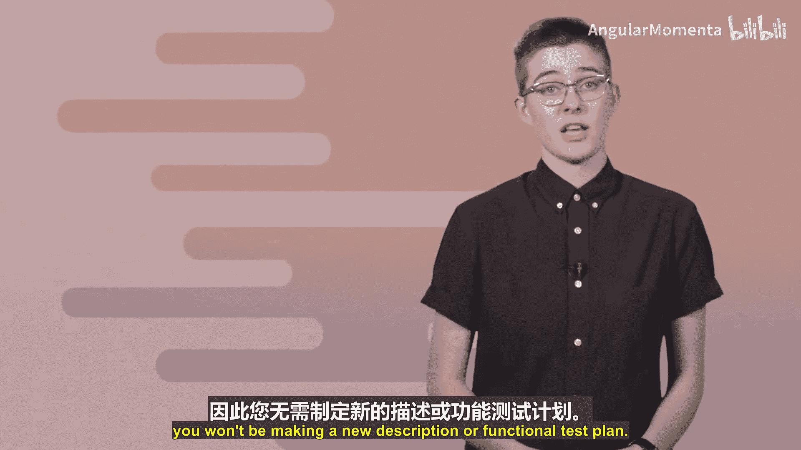

**Python编程与电子游戏问题解决：09_08_01：Poke the Dots 版本1的解决方案问题与改进**

在本节课中，我们将分析 Poke the Dots 游戏版本1的代码，识别其中存在的解决方案问题，并探讨如何通过引入用户自定义类来改进代码质量。

上一节我们介绍了问题识别的重要性，本节中我们来看看 Poke the Dots 版本1的具体代码问题。

让我们查看 Poke the Dots 版本1的代码。其中存在一个主要问题：多个函数需要7到10个参数。这带来了不便，并且代码未能通过一项软件质量测试。用户自定义函数的参数不应超过五个。

那么，我们能做什么呢？

是时候学习用户自定义类了。在本课程中，你一直在使用类。请回忆，类和类型是同义词，你已经使用过许多类型，例如 `int`、`list`、`pygame.Surface` 和 `pygame.Color`。当你对特定的 Python 对象调用 `type()` 函数时，它会返回告诉你该对象所属类的信息。

你也已经学习了与类相关联的方法。例如，你已经见过将字符串转换为大写或小写的方法、检查字符串中的字符是否为数字或字母的方法等等。

在 Poke the Dots 版本2中，你将开始学习创建自己的类。

用户自定义类是封装的另一个例子。你之前已经使用封装来限制标识符的作用域。这种封装称为名称封装，因为它管理程序中的名称。

下一种封装类型称为数据封装。数据封装是一种将对象分组以创建新的单一对象的方法。

例如，列表是一组可以作为一个整体进行操作的对象。列表可以被打印、迭代遍历，并作为单个参数传递。`len()` 和 `print()` 函数以及 `append()` 方法都是将列表对象作为一个整体来操作的。

创建用户自定义类是解决方案泛化的另一个例子，因为新的对象类型可以作为解决方案在许多不同问题中重复使用。

由于这个版本的重点是提高代码质量，因此在下一课中，你将修改算法以使用类，而不会制定新的描述或功能测试计划。

---

**总结**

本节课中我们一起学习了 Poke the Dots 版本1代码中的主要问题：函数参数过多。我们探讨了通过引入用户自定义类来解决此问题的方向，并回顾了类、类型、方法和封装（包括名称封装和数据封装）的基本概念。在接下来的课程中，我们将应用这些知识来重构代码，提升其质量。