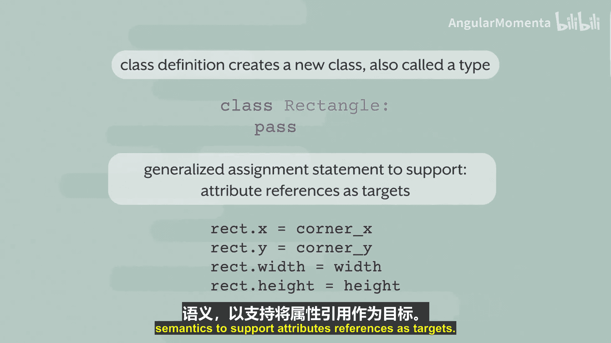

# 085：Python类定义 🐍


在本节课中，我们将学习Python中一个强大的新语句——**类定义**。类定义用于创建新的用户自定义类型，它允许我们将多个对象组合成一个复合对象。我们还将学习如何将属性引用作为赋值语句的目标，从而为对象动态添加属性。

## 概述 📋

类定义是Python中创建自定义数据类型的基础。通过定义类，我们可以将相关的数据和功能封装在一起，使代码更加模块化和易于理解。本节我们将通过一个矩形相交检测的例子，来展示如何使用类来改进程序的结构和可读性。

## 类定义的基本概念

一个用户定义的类（或类型）允许我们将多个对象组合成一个单一对象。Python的类定义语句用于创建这种新的用户定义类。

考虑下面这个检查两个矩形是否相交的程序。用于检查相交的公式不是本节课的重点，但你可以自行研究其工作原理。

```python
def rectangles_intersect(corner1_x, corner1_y, width1, height1, corner2_x, corner2_y, width2, height2):
    return not (corner1_x > corner2_x + width2 or
                corner1_x + width1 < corner2_x or
                corner1_y > corner2_y + height2 or
                corner1_y + height1 < corner2_y)

print(rectangles_intersect(5, 10, 15, 20, 10, 5, 20, 15))
```

程序报告第一个矩形（左上角在(5,10)，宽15，高20）与第二个矩形（左上角在(10,5)，宽20，高15）确实相交。尽管我们将其视为计算两个矩形对象是否相交，但程序中并没有显式的矩形对象。相反，程序使用了八个整数对象来描述两个隐式的矩形。

这既模糊了程序的意图，也模糊了实现代码。例如，`rectangles_intersect`函数的参数列表非常长，在调用和定义时都容易出错。如果程序中存在两个显式的矩形对象，程序将更容易阅读、编写和修改。

## 使用类定义改进程序

我已经使用类定义语句创建了一个矩形类型，并重写了程序以使用这个类型。

```python
class Rectangle:
    pass

def create_rectangle(corner_x, corner_y, width, height):
    rec = Rectangle()
    rec.x = corner_x
    rec.y = corner_y
    rec.width = width
    rec.height = height
    return rec

def rectangles_intersect(r1, r2):
    return not (r1.x > r2.x + r2.width or
                r1.x + r1.width < r2.x or
                r1.y > r2.y + r2.height or
                r1.y + r1.height < r2.y)

def main():
    rec1 = create_rectangle(5, 10, 15, 20)
    rec2 = create_rectangle(10, 5, 20, 15)
    if rectangles_intersect(rec1, rec2):
        print("overlap")

main()
```

运行这个程序同样会显示“overlap”。我为每个矩形对象使用了四个属性：`x`、`y`、`width`和`height`。其中`x`和`y`是矩形左上角的整数坐标。

## 类定义语句的语法和语义

以下是类定义语句的简化语法图：

```
class <identifier>:
    <suite>
```

标识符被称为类名。

以下是类定义的简化语义规则：

1.  使用一个新的局部命名空间和全局命名空间来评估类体（suite）。
2.  创建一个类对象，并使用新的局部命名空间作为该类对象的命名空间。
3.  如果类名不在原始的局部命名空间中，则添加它。
4.  在原始的局部命名空间中将类名绑定到新的类对象。

我将使用矩形程序来展示类定义语义是如何工作的，并强调新的局部命名空间与原始局部命名空间之间的区别。

当程序启动时，局部代码块是主模块，其命名空间既是局部命名空间也是全局命名空间。预绑定的标识符`print`就绑定在这个命名空间中。

主模块中的第一个语句是函数定义，因此解释器应用函数定义语义。它创建一个具有自己命名空间的函数对象，将标识符`main`添加到局部命名空间，将`main`绑定到函数对象，并在`main`函数的命名空间中绑定一个指向主模块命名空间的引用。

由于接下来的两个语句也是`create_rectangle`和`rectangles_intersect`的函数定义，解释器为每个函数重复这些函数定义语义。

下一个语句是类定义，因此解释器应用类定义语义。

**第一步**，解释器创建一个新的空命名空间作为局部命名空间。它使用这个局部命名空间和当前的全局命名空间来评估类体。

回想一下，函数定义中的类体在函数定义被评估时并不会被评估。相反，函数定义的类体只有在函数被调用时才会被评估。然而，类定义的语义规定，类定义的类体在类定义被评估时就会被评估。由于类体只包含一个`pass`语句，而`pass`语句什么都不做，所以类体评估完成。

**第二步**，创建一个新的类对象，其命名空间就是新的、空的局部命名空间。

**第三步**，类名`Rectangle`被添加到原始的局部命名空间，即主模块的命名空间。

**第四步**，`Rectangle`在这个原始的局部命名空间（主模块）中被绑定到新的类对象。

主模块中的最后一个语句是对`main`的函数调用，因此解释器应用函数调用语义。标识符`main`在局部命名空间中被解引用以获得`main`函数对象。`main`函数代码被评估以获得结果对象。

## 对象创建与属性赋值

现在，局部代码块是`main`函数，局部命名空间是`main`函数命名空间。第一个语句是一个赋值语句，其表达式是对`create_rectangle`的函数调用。

使用熟悉的函数调用语义在全局命名空间中找到函数对象`create_rectangle`，评估四个参数表达式`5`、`10`、`15`和`20`，并将它们放入参数列表。然后，解释器将参数`corner_x`、`corner_y`、`width`和`height`添加到`create_rectangle`的命名空间，将每个参数绑定到其对应的实参，并评估`create_rectangle`的代码。

现在，局部代码块是`create_rectangle`函数，局部命名空间是`create_rectangle`函数命名空间。`create_rectangle`的第一个语句是一个赋值语句，其表达式是对名为`Rectangle`的函数的调用。

当应用函数调用语义时，标识符`Rectangle`在全局命名空间中被用来查找`Rectangle`对象，它是一个类。在Python中，类是一种函数。到目前为止，你已经见过几种函数：像`len`这样的内置函数，像`create_rectangle`这样的用户定义函数，以及像`lower`这样的内置方法。类是另一种函数，它返回一个类型为该类的新对象。例如，不带参数调用`int()`会创建整数对象`0`，不带参数调用`str()`会创建空字符串对象。不带参数调用`Rectangle()`也会创建一个矩形对象，但它没有一个非常美观的人类可读形式。

大多数Python文档使用术语“可调用对象”（callable）而不是“函数”来描述类和方法。然而，无论我们说类是一个函数还是一个可调用对象，它都像函数调用一样被评估，并且它创建一个类型为该类的新对象。

`create_rectangle`中的赋值语句将标识符`rec`绑定到由那个`Rectangle()`调用创建的新矩形对象。

## 属性引用作为赋值目标

第二个语句是一个赋值语句，其中目标`rec.x`是一个属性引用。在“方法调用”课程中，你看到了属性引用用作表达式（如`"Hello".lower`）的语法和语义。在“导入语句的替代形式”课程中，你使用属性引用来访问模块中的函数（`time.sleep`）和模块中的模块（`os.path`）。然而，在本课程中，你还没有见过属性引用用作赋值语句的目标。

当前赋值语句的语法图支持的目标要么是标识符，要么是下标表达式。以下是一个广义的赋值语句目标语法图，它也支持属性引用作为目标。

```
<target> ::= <identifier> | <subscription> | <attribute_reference>
```

以及现有的属性引用语法图：

```
<attribute_reference> ::= <expression> "." <identifier>
```

最后，以下是当目标是属性引用时的赋值语义规则：

1.  评估赋值语句的表达式以获得结果对象。
2.  评估属性引用表达式以获得基对象。
3.  如果标识符不在基对象的命名空间中，则添加它。
4.  在基对象的命名空间中将标识符绑定到结果对象。

我将把这个语义规则应用到`create_rectangle`中的第二个赋值语句。

**第一步**，表达式`corner_x`被评估以获得结果对象整数`5`。

**第二步**，表达式`rec`被评估以获得基对象，即一个矩形。

**第三步**，标识符`x`不在基对象（一个空的矩形对象）的命名空间中，因此`x`被添加到这个命名空间。

**第四步**，矩形对象命名空间中的标识符`x`被绑定到结果对象整数`5`。

一个名为`x`的新属性已被添加到矩形对象，并且这个新属性已被绑定到整数对象`5`。Python允许程序员在可以引用包含该属性的对象的代码中的任何地方创建新属性。

接下来的三个赋值语句被类似地解释。注意，参数名`width`和`height`恰好与属性`width`和`height`相同，但这没关系。另外两个属性`x`和`y`与参数`corner_x`和`corner_y`不同，后者用于访问实参对象。

`return`语句将矩形对象返回给调用函数`main`，`main`将标识符`rec1`添加到其命名空间，并将`rec1`绑定到这个矩形对象。

`main`函数中的下一个赋值语句被类似地解释，使得标识符`rec2`被绑定到第二个矩形对象。

## 使用属性改进代码清晰度

`main`函数中的下一个语句是一个`if`语句，其条件调用了函数`rectangles_intersect`。标识符`rectangles_intersect`在全局命名空间中被解引用，它的两个参数表达式被评估以获得两个矩形对象，并将它们放入参数列表。然后，解释器将参数`r1`和`r2`添加到`rectangles_intersect`的命名空间，将它们绑定到实参矩形，并评估`rectangles_intersect`的代码。

现在，局部代码块是`rectangles_intersect`函数，局部命名空间是`rectangles_intersect`函数命名空间。这个函数包含一个带有复杂表达式的单个`return`语句。

每个属性引用，如`r1.x`，都使用“方法调用”课程中的属性引用语义规则进行评估。

**第一步**，表达式`r1`在局部命名空间中被评估以获得第一个矩形对象。

**第二步**，属性`x`在这个矩形对象的命名空间中，因此它被解引用以获得整数对象`5`。

类似地，当评估属性引用`r2.width`时，表达式`r2`在局部命名空间中被评估以获得第二个矩形对象。属性`width`在这个矩形对象的命名空间中，因此它被解引用以获得整数对象`20`。

`return`语句中表达式的评估结果是布尔对象`True`。因此，`True`被返回给调用函数`main`，并显示字符串“overlap”。

## 类与列表的对比

你已经看到序列可以用来引用多个对象。我可以在程序中使用列表，而不是创建一个矩形类型。

以下是一个具有相同功能的使用列表的程序：

```python
def create_rectangle_list(corner_x, corner_y, width, height):
    return [corner_x, corner_y, width, height]

def rectangles_intersect_list(r1, r2):
    return not (r1[0] > r2[0] + r2[2] or
                r1[0] + r1[2] < r2[0] or
                r1[1] > r2[1] + r2[3] or
                r1[1] + r1[3] < r2[1])

rec1_list = create_rectangle_list(5, 10, 15, 20)
rec2_list = create_rectangle_list(10, 5, 20, 15)
if rectangles_intersect_list(rec1_list, rec2_list):
    print("overlap")
```

尽管列表程序更短，但`rectangles_intersect`函数中的数字索引比属性名`x`、`y`、`width`和`height`难理解得多。事实上，在我正确翻译之前，我尝试了五次才成功地将前一个矩形程序中的不同组件转换为索引。最后，我制作了一个图表来增加我对翻译正确的信心。

如果我想向这个程序添加更多操作矩形的函数，我需要保留这个图表来记住哪个索引代表哪个组件。在编写了更多操作复合对象的函数的程序中，使用属性而非列表所带来的清晰度提升将变得更加明显。

## 总结 🎯

本节课我们一起学习了Python中的**类定义**语句，它用于创建新的Python类或类型。类定义允许我们将多个相关的对象组合成一个复合对象，从而显著提高代码的可读性、可维护性和模块化程度。

我们还学习了如何**泛化赋值语句的语法和语义**，以支持将属性引用作为赋值目标。这使得我们可以动态地为对象添加和修改属性，为对象提供灵活的数据结构。

通过将隐式使用多个简单对象（如整数）表示复合概念（如矩形）的程序，重构为使用显式类定义和对象属性的程序，我们看到了面向对象编程在表达程序意图和简化代码逻辑方面的优势。与使用列表和数字索引相比，使用具有命名属性的对象使得代码的意图更加清晰，更不容易出错。



掌握类定义是迈向编写更复杂、更结构化Python程序的关键一步。