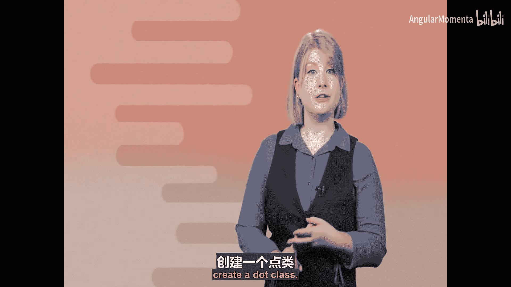

# 086：编程“戳点”游戏第二版 🎮


在本节课中，我们将学习如何将“戳点”游戏的第一版代码重构为第二版。我们将引入**类**的概念，将游戏和点封装成对象，从而简化函数参数传递，使代码结构更清晰、更易于管理。

---

## 概述

上一节我们完成了“戳点”游戏第一版的编程。本节中，我们将开始第二版的开发。核心变化是使用**类**来组织游戏和点的数据与行为。我们将创建一个 `Game` 类和一个 `Dot` 类，用对象属性替代之前分散的变量。

## 开始编程

我将从第一版函数定义的下方开始，编写 `Game` 类的定义。

### 定义Game类

首先，我编写类的定义头，即 `class Game:`。在类内部，我先添加一个 `pass` 语句占位。和函数一样，每个类也需要一个描述性注释。

```python
class Game:
    """此类的对象代表一个完整的游戏。"""
    pass
```

我还将为每个属性添加注释。在每个注释中，我会将算法中的一个属性描述翻译成有效的Python标识符。

在第一版中，“创建游戏面板”的每一步都被翻译成了 `main` 函数内的一系列赋值语句。在这一版中，这些赋值语句将被移除，取而代之的是创建一个 `Game` 对象和两个 `Dot` 对象。

### 创建create_game函数

我将编写一个新的函数 `create_game`，用于创建 `Game` 对象并为其属性赋值。你将在 `create_game` 函数内部创建两个 `Dot` 对象。

在 `create_game` 函数内部，我通过将 `Game` 类名作为函数调用来创建一个 `Game` 对象，并将标识符 `game` 绑定到这个新对象。

```python
def create_game(window):
    game = Game()
```

我的 `Game` 对象的第一个属性应该是窗口，因此我将 `window` 作为参数添加到函数定义中。

现在，我将 `game` 对象的 `window` 属性绑定到传入的 `window` 参数对象。

```python
    game.window = window
```

一个新的 `window` 属性被添加到了 `game` 对象，并且这个新属性绑定到了一个窗口对象。

请记住，Python允许程序员在可以引用包含该属性的对象的任何代码位置创建新属性。

参数名称并不重要。如果我使用一个名为 `fred` 的参数而不是 `window`，我需要将 `game.window` 绑定到 `fred` 对象。然而，`fred` 不是一个描述性的名称，所以我会将参数改回 `window`。

我还将 `game.close_selected` 属性绑定到 `False`。

```python
    game.close_selected = False
```

两个点是 `game` 对象的属性，但它们需要自己的属性，因此你将使用一个单独的函数来创建点。

### 创建Dot对象

你可以创建一个 `create_dot` 函数，并调用它两次来创建两个点。这类似于调用单个 `draw` 函数两次来绘制两个点。

我将 `game.small_dot` 属性绑定到调用 `create_dot` 的结果。你必须为 `create_dot` 添加适当的参数。

```python
    game.small_dot = create_dot(...)  # 参数待补充
    game.big_dot = create_dot(...)   # 参数待补充
```

`create_game` 函数应该返回 `game` 对象，因此我将添加一个 `return` 语句。

```python
    return game
```

### 修改main函数

现在，我将回到 `main` 函数，移除那些创建点和时钟的旧赋值语句，因为它们将被对 `create_game` 函数的调用所取代。

我将添加这个调用，并传递 `window` 作为参数。我还将一个新的标识符 `game` 绑定到 `create_game` 的结果。

```python
def main():
    window = create_window(...)
    game = create_game(window)
```

现在，我可以将单个 `game` 对象传递给 `play_game` 函数，而不是传递那一大堆单独代表游戏每个方面的参数。

```python
    play_game(game)
```

你将在下一个活动中完成 `create_game` 函数，但你已经可以看到，传递一个包含许多属性的单个对象比传递那么多单独的对象要容易得多。

### 修改play_game函数

接下来，我将修改 `play_game` 函数的定义。我要做的第一件事是用单个参数 `game` 替换冗长的参数列表。

```python
def play_game(game):
```

由于 `game` 对象现在作为参数传递，我不再需要局部标识符 `close_selected`，相反，我可以使用 `game` 对象的 `close_selected` 属性。

类似地，`handle_events` 函数不再需要返回 `close_selected` 的更新值。相反，我可以通过 `handle_events` 的副作用来重新绑定 `game` 对象的 `close_selected` 属性。

`close_selected` 属性在可以访问 `game` 对象的任何地方都是可访问的。

我还将 `game` 作为参数添加到 `handle_events` 函数的定义中。

```python
def handle_events(game):
```

现在，我将移除那些绑定和重新绑定 `close_selected` 的代码行，因为我可以从 `game` 对象访问 `close_selected` 属性。

当事件类型是退出时，我只需将 `game.close_selected` 重新绑定为 `True`。

```python
    if event.type == QUIT:
        game.close_selected = True
```

### 完成版本2的编程

你需要自己完成第二版的编程。你需要完成绑定 `game` 的属性、创建一个 `Dot` 类并绑定点的属性。然后，你就可以在其他函数中使用这些属性。

例如，当你在 `update_game` 中调用 `move_dot` 时，你将能够传递 `game.small_dot` 作为参数，而不是传递小点的那一堆组件。

在 `move_dot` 函数内部，你可以使用点的属性，而不是第一版中使用的那些单独的参数对象。



随着编程经验的积累，你会看到类是多么方便。

---

## 总结

本节课中，我们一起学习了如何为“戳点”游戏第二版搭建框架。我们引入了 **`Game` 类** 来封装游戏状态，并计划引入 **`Dot` 类**。通过使用对象，我们显著简化了函数间的参数传递，使代码结构更模块化、更易于理解和维护。这是面向对象编程思想的一次初步实践。