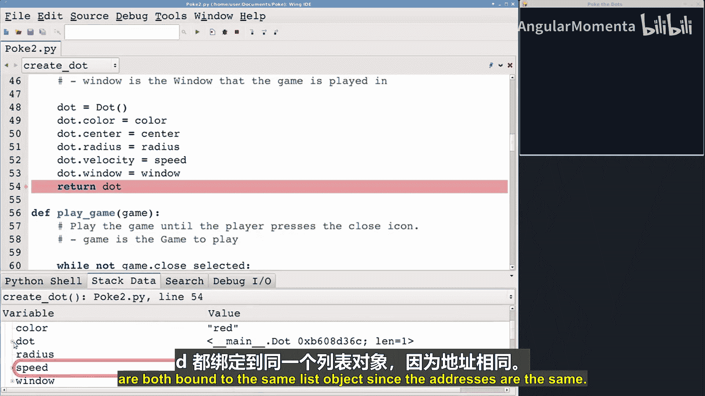
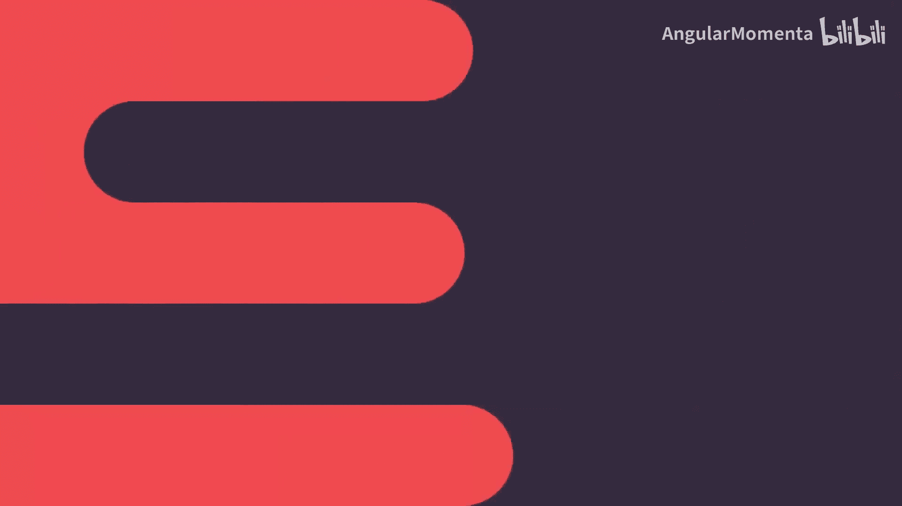
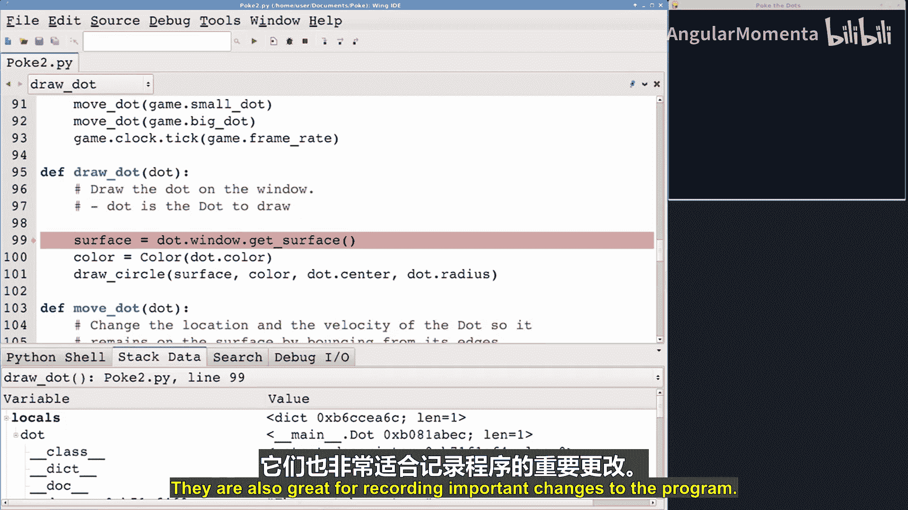
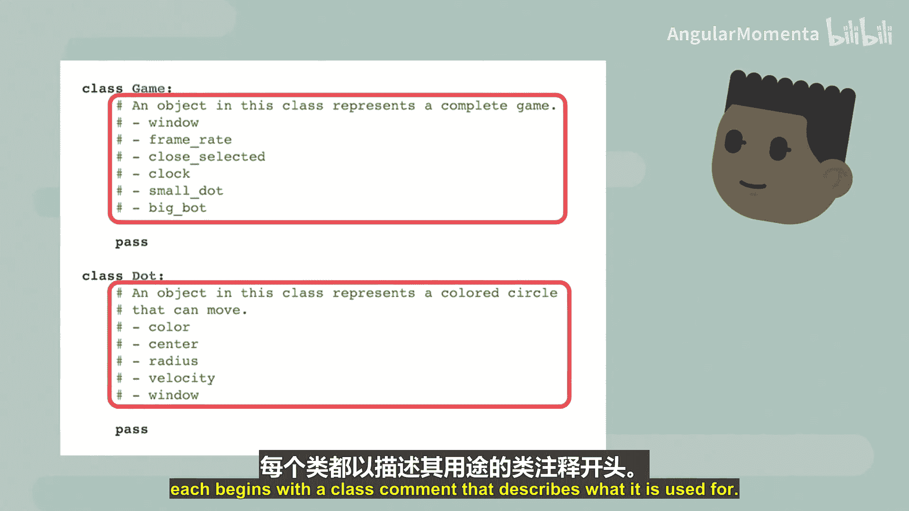

# 087：Poke the Dots 版本2代码回顾

在本节中，我们将回顾Poke the Dots游戏版本2的代码。我们将通过调试器跟踪程序的执行，观察`Game`和`Dot`类对象是如何被创建和使用的，并学习如何通过属性引用在函数间传递多个对象。最后，我们将检查新代码是否符合用户定义类的软件质量测试标准。

## 🎼 代码结构与调试入门

以下是版本2的代码。通过引入新的`Game`和`Dot`类，我们成功通过了版本1中失败的软件质量测试。

现在，查看`play_game`和`update_game`函数。它们的参数数量已从原来的7个和8个分别减少到各1个，这是一个显著的改进。

为了理解这是如何实现的，我们需要深入查看`Game`和`Dot`对象内部的属性。我们将通过设置断点并使用调试器来逐步执行代码。

## 🔍 深入调试：观察对象的创建

首先，在`create_game`函数的第一个语句旁添加一个断点，然后按下调试按钮。

高亮的语句包含一个对`Game`类的函数调用，该调用会创建一个新的`Game`对象。按下“步入”按钮。

由于我们尚未为`Game`类提供任何代码，调试器不会显示`Game`函数的Python代码。从之前的课程中我们知道，每个类对象同时也是一个函数对象。在未来的版本中，你将看到如何向同时也是类的函数对象添加代码。

尽管`Game`函数被求值，但一个新的`Game`对象已被创建。赋值语句将标识符`game`绑定到这个新对象。

你可以看到几个以双下划线开头的属性。我们暂时忽略这些属性。

在`Game`类注释中列出的属性，例如`window`和`small_dot`，目前还不在`Game`对象中。当我们将这些对象绑定到属性时，它们才会被添加到`Game`对象。

当我按下“步过”按钮时，栈数据显示一个`window`属性已被添加到`Game`对象，并绑定到我们传入函数的`window`对象。

接下来的三个赋值语句也发生了同样的情况。

现在，`Game`对象拥有了三个新属性：`clock`、`close_selected`和`frame_rate`。

当前高亮的语句创建了一个新的`Dot`对象，并将其绑定到`Game`的一个属性引用上。

## 🎯 创建Dot对象

我按下“步入”按钮来访问`create_dot`函数。

`create_dot`函数开始时，其局部命名空间中有五个参数。

第一个赋值语句创建了一个`Dot`对象。当我步过这个语句时，`dot`被添加到局部变量中，并绑定到新的`Dot`对象。

我继续步过接下来的五个语句，为新的`Dot`对象添加属性。在局部变量中，你可以看到所有五个属性都已添加到`dot`对象，并绑定到五个参数对象。

例如，属性`velocity`和参数`speed`都绑定到同一个列表对象，因为它们的地址相同。

随着`small_dot`创建完成，我将其返回到`create_game`函数。在栈数据中，你可以看到`small_dot`已作为属性添加到`Game`对象。

我步过`big_dot`的创建语句，并再次检查栈数据。

可以看到，`big_dot`也已作为`Game`的属性添加。最后，我步出函数，将`Game`对象返回到`main`函数。

正如你在栈数据中看到的，`main`函数在其局部命名空间中引用了两个对象：`window`和`game`。

## 🕹️ 游戏运行与属性使用

我步入`play_game`函数。你可以在`play_game`的局部命名空间中看到`game`对象参数。展开`game`对象，你可以看到在`create_game`中添加的属性，例如`game.close_selected`是`False`。

在程序的这个阶段，我们已经设置了许多`Game`和`Dot`属性，但尚未使用它们。`while`语句是我们第一次使用先前设置的属性。

设置一个属性却从不使用它是没有意义的。

属性也可以用来记录对象发生的变化。在`handle_events`函数中，当关闭事件发生后，`game`的`close_selected`属性会被重新绑定，这样`while`语句就能识别这个变化并停止程序。

`Dot`对象的`center`和`velocity`属性也被用来记录程序中的重要变化。

相比之下，`game`的`window`属性在多个地方被使用，但从未被改变。

我向下滚动到`draw_game`函数，在第一个`draw_dot`函数调用旁放置一个断点，然后按下调试按钮跳转到那里。

`game`对象已被传入`draw_game`函数，因此你可以在局部命名空间中看到它。高亮的`draw_dot`函数使用了另一个属性引用来访问`game`的`small_dot`属性，并将其传递给`draw_dot`函数。

步入`draw_dot`函数，你可以看到`dot`（而不是`game`）已被添加到局部命名空间。当前高亮的语句是另一个属性引用，它引用了之前绑定的`dot`对象的`window`属性。

它使用了`window`类关联的`get_surface`方法，并将一个局部标识符绑定到其结果上。

非常巧妙。属性引用非常适用于在函数间传递多个对象，而无需为你的函数设置多个不同的参数对象。

它们也非常适合记录程序的重要变化。

跟踪到此结束。

## ✅ 用户定义类的软件质量测试

让我们看看为用户定义类新增的软件质量测试。

在注释部分，有一些针对用户定义类的新测试：你创建的每个类都应该有一个注释，说明该类的用途。

在标识符和名称部分，用户定义类的名称应使用大写单词；这是Python的风格约定。

最后，为用户定义类新增了一个测试类别。

该测试询问你的类是否代表一组用于两个或更多任务的对象，并形成一个单一的概念对象。

让我们检查新的`Dot`和`Game`类是否通过了这些新测试。

每个类都有一个以大写字母开头的名称，并且都以描述其用途的类注释开头。

`Game`类代表了构成整个Poke the Dots游戏的六个对象组。它在多个函数中被使用，例如`main`、`play_game`和`handle_events`。

`Dot`类代表了窗口中的一个圆形对象，它具有颜色、中心点、半径和速度。有多个`Dot`对象在多个函数中被使用，例如`update_game`、`draw_dot`和`move_dot`。

你应该编辑你的代码以确保满足这些测试要求。在未来的课程中，将有更多测试被添加到“用户定义类”部分。

## 📝 本节总结

版本2的回顾到此结束。恭喜你！在下一个版本中，你将添加更多功能，使你的游戏更加有趣。

在本节课中，我们一起学习了：
1.  如何使用调试器跟踪`Game`和`Dot`类对象的创建过程。
2.  属性引用如何简化函数间的数据传递。
3.  如何利用属性记录程序状态的变化。
4.  用户定义类需要满足的软件质量测试标准，包括清晰的注释、遵循命名约定以及代表一个有用的概念对象组。