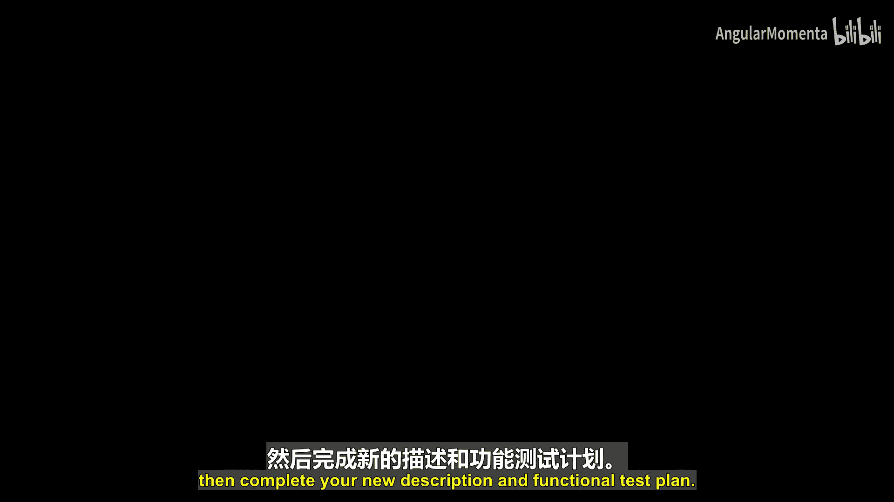

# 089：观察“点戳游戏”版本3 👾

在本节课中，我们将要观察和分析“点戳游戏”的第三个版本。我们将了解这个版本相比之前版本新增的功能，特别是计分板和点随机传送的机制。

## 游戏概述

让我们来看看“点戳游戏”的第三个版本。它与第一和第二个版本有相似之处。

## 核心行为观察

上一节我们介绍了游戏的基本框架，本节中我们来看看版本3的具体表现。

两个圆点会移动，并且在碰到窗口边缘时会反弹。当两个圆点相互碰撞时，游戏**不会**停止。

在第三个版本中，窗口角落会出现一个计分板。它显示的是游戏开始后经过的秒数。

当我按下鼠标左键时，两个圆点会消失，然后在窗口内的不同位置重新出现，即它们会进行“传送”。

以下是游戏中的关键交互列表：
*   圆点持续移动并会在窗口边缘反弹。
*   圆点碰撞不会导致游戏结束。
*   屏幕角落显示一个以秒为单位的计时计分板。
*   点击鼠标左键会使两个圆点随机传送到窗口内的新位置。
*   点击窗口的关闭按钮可以关闭游戏窗口。

我再多按几次鼠标按钮。每次按下，两个圆点都会传送到新的随机位置。

当然，按下窗口上的关闭按钮可以关闭窗口。

## 学习任务

请试玩这个版本，以熟悉这些新的变化。然后，请完成你更新的游戏描述和功能测试计划。

---

本节课中我们一起学习了“点戳游戏”版本3的新特性。我们观察到游戏增加了实时计分（计时）功能，并引入了通过鼠标点击使圆点随机传送的交互机制，这为游戏增添了新的变化和挑战。