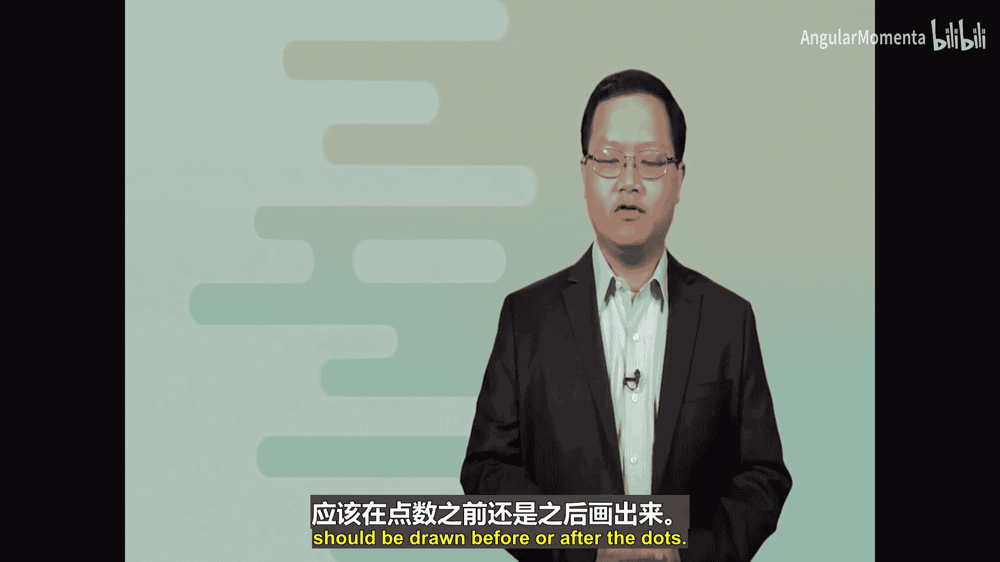

# 090：为“戳点游戏”版本3创建算法

## 🎯 概述
在本节中，我们将更新“戳点游戏”版本3的算法。我们将学习如何处理鼠标点击事件，以实现圆点的瞬间移动功能。同时，我们也会探讨在绘制多个游戏对象时，如何安排它们的绘制顺序。

## 🔄 更新算法以处理鼠标点击事件
上一节我们介绍了游戏的基本框架，本节中我们来看看如何为版本3添加新的交互功能。

首先，我们需要在算法中导航到“处理单个事件”的面板。我们不会更改“关闭事件”的判断步骤，因为游戏仍需处理窗口关闭事件。

我们将为“非关闭事件”的假值分支添加处理逻辑。展开该分支的假值框，并添加一个新的判断图标。在算法中，展开一个判断图标的假值分支并添加另一个判断图标，这相当于代码中的 `elif` 子句。

对于这个新的判断，我们选择的条件是：**事件类别等于鼠标点击**。

在该判断的真值框中，我们添加文字“处理鼠标点击”，然后将此步骤展开为它自己的独立处理面板。

以下是算法更新的核心步骤：
1.  **if event.type == pygame.QUIT:**
    *   处理关闭事件。
2.  **else:**
    *   **if event.type == pygame.MOUSEBUTTONDOWN:**
        *   处理鼠标点击事件。

本次演示到此为止。在接下来的实践活动中，你将完成整个算法，包括实现圆点的瞬间移动以及添加新的计分板。

## 🖼️ 游戏对象的绘制顺序
当你在游戏中绘制多个对象时，每个后绘制的对象都会覆盖在先绘制的对象之上，并可能遮挡其部分内容。

因此，你需要通过实际游玩游戏来确定计分板应该在圆点之前还是之后绘制。这取决于你希望计分板显示在圆点下方作为背景，还是覆盖在圆点上方作为UI界面。

## 📝 总结
本节课中我们一起学习了如何为“戳点游戏”版本3更新算法，重点引入了对鼠标点击事件的处理逻辑。我们还了解了多个游戏对象绘制顺序的重要性，这决定了它们在屏幕上的最终视觉效果。在接下来的实践中，你将应用这些知识来完成游戏的增强功能。