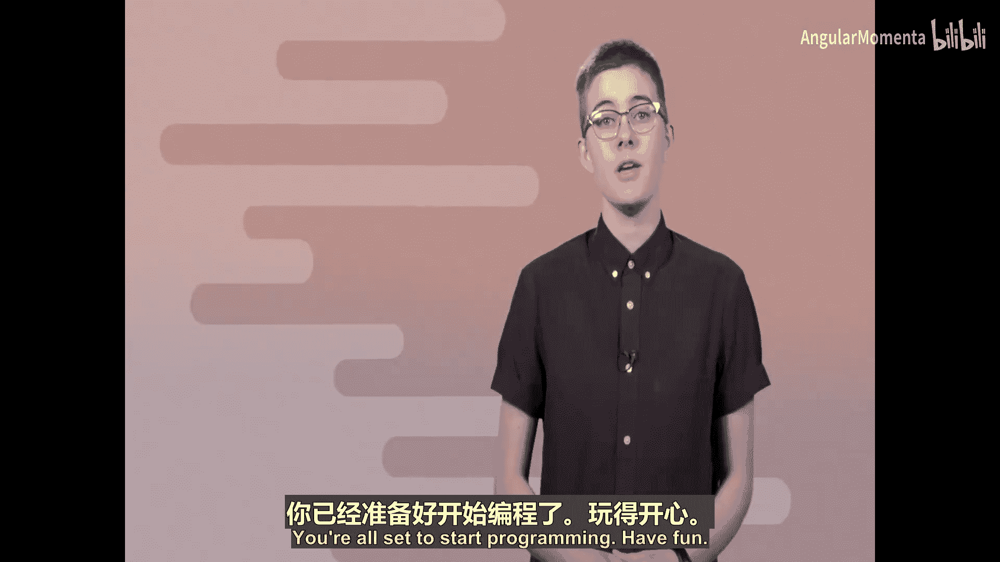

# 091：编程实现“戳点游戏”版本3 🎮

在本节课中，我们将学习如何为“戳点游戏”的第三个版本编写代码。我们将重点实现**使用经过的时间来更新分数**的功能，并学习如何处理**鼠标点击事件**以使圆点“传送”。大部分编程工作将由你完成，但本节会提供关键的指导和提示。


---

上一节我们介绍了游戏的基本框架，本节中我们来看看如何实现更动态的分数系统和交互功能。

## 使用经过时间更新分数 ⏱️

算法步骤“使用经过的时间更新分数”可以通过调用 **PyGame** 时间模块中的 `get_ticks` 函数来实现。

这个函数返回自游戏窗口创建以来所经过的**毫秒数**。

你必须将毫秒转换为秒，然后将这个整数转换为字符串对象以便在屏幕上显示。

**核心代码公式**如下：
```python
# 获取自程序开始以来的毫秒数
milliseconds = pygame.time.get_ticks()
# 转换为秒
seconds = milliseconds // 1000
# 转换为字符串以便渲染
time_string = str(seconds)
```

## 实现鼠标点击传送功能 🖱️

我们希望圆点在鼠标点击后能够“传送”。PyGame 支持三种鼠标事件。

以下是三种主要的鼠标事件：
*   **鼠标移动事件**：每当鼠标移动时生成。
*   **鼠标按键按下事件**：当鼠标按键被按下时生成。
*   **鼠标按键释放事件**：当鼠标按键被释放时生成。

一次完整的鼠标点击直到鼠标按键被**释放**时才被认为发生。因此，你应该使用 `MOUSEBUTTONUP` 事件来检测一次点击。

**核心代码概念**：
```python
for event in pygame.event.get():
    if event.type == pygame.MOUSEBUTTONUP:
        # 在这里处理点击逻辑，例如重置圆点位置
        dot.center = event.pos  # 将圆点中心传送到点击位置
```

---

本节课中我们一起学习了如何利用 `pygame.time.get_ticks()` 来创建基于时间的分数系统，以及如何通过检测 `MOUSEBUTTONUP` 事件来实现对鼠标点击的响应。你现在已经掌握了开始编程实现游戏版本3所需的所有关键知识。



祝你编程愉快！🚀