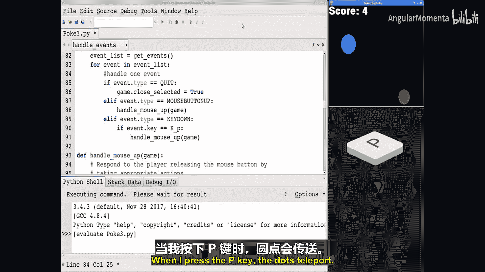
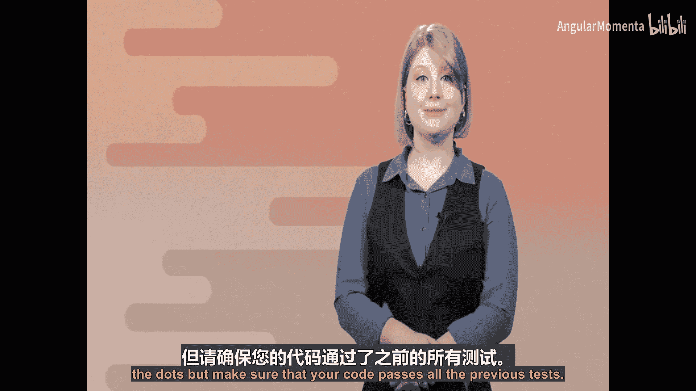

# 092：Poke the Dots 版本3代码回顾 🎮

在本节课中，我们将回顾 Poke the Dots 游戏版本3的代码。我们将重点学习如何扩展事件处理模板，以处理键盘按键这类新的事件类别。通过一个具体的例子，你将看到如何让游戏在按下特定按键（如‘P’键）时，产生与鼠标点击相同的效果。

## 扩展事件处理模板

上一节我们建立了稳固的事件处理模板。本节中我们来看看如何轻松地添加新的事件类别。

尽管 Poke the Dots 的最终版本不会处理按键事件，但本示例将展示如何处理按键事件，以便你能在自己的项目中应用。

在这个例子中，每当我按下 P 键，圆点就会像鼠标点击时一样进行传送。

我们需要为每个新的事件类别导入一个 Pygame 标识符。我将从 Pygame 模块导入 `KEYDOWN` 事件类别。

`KEYDOWN` 是一个事件类别，每当键盘上的一个键被按下时就会生成。

## 添加键盘事件处理

在 `MOUSEBUTTONUP` 事件的 `if` 语句块下方，我将添加一个新的子句：`if event.type == KEYDOWN`。这次，我将事件的 `type` 属性与导入的 `KEYDOWN` 类别进行比较。

为了响应这个事件，我会再次调用 `handle_mouse_up` 函数。我也可以创建一个名为 `handle_key_down` 的新函数，并将 `handle_mouse_up` 中的两个随机化圆点的函数调用复制进去。然而，由于我希望两个事件产生相同的效果，不如为两个事件处理器使用同一个函数。

运行游戏。当我按下 P 键时，圆点传送了，效果很好。但当我按下其他键（如 Q 键）时会发生什么？圆点仍然会传送，这就不太好了，因为我只希望 P 键影响圆点。

## 筛选特定按键

`KEYDOWN` 事件在按下任何键时都会生成，但这个程序应该只响应单个特定的键。

每个事件都有一个 `type` 属性，代表其类别（如 `MOUSEBUTTONUP` 或 `KEYDOWN`）。每个事件类别还有其他属性，代表该事件的特性。

例如，鼠标光标的位置由 `MOUSEBUTTONUP` 事件的 `pos` 属性表示。`pos` 绑定了一个元组，包含事件发生时鼠标光标的 X 和 Y 坐标。

`KEYDOWN` 事件的 `key` 属性代表生成事件的按键。我必须将 `event.key` 与一个键值进行比较。每个属性的值都必须从 Pygame 导入。

以下是 Pygame 中 `key` 属性值的文档。P 键被标记为 `K_p`（一个大写的 K 后跟下划线和一个小写的 p）。我将导入这个代表小写或大写 P 的属性值。

在 `if` 语句块内，我将添加一个 `if` 语句，其子句为 `if event.key == K_p`。我将把对 `handle_mouse_up` 函数的调用移入这个 `if` 语句块内。

再次运行游戏。当我按下 P 键时，圆点传送。但当我按下其他不同的键时，圆点不会传送。

## 调试与检查

为了检查 `key` 属性，我将在 `KEYDOWN` 事件内的 `if` 子句旁边设置一个断点。然后，我将按下调试按钮并按下 P 键，这会使调试器停在 `if event.key == K_p` 旁边。

在堆栈数据中，我将在本地变量中展开事件对象。注意事件的 `key` 属性是整数 112，这与导入到全局变量中的 `K_p` 标识符的值相同。

同时注意事件的 `unicode` 属性是 ‘p’，因此我可以轻松看到按下了哪个键，这很酷。

我再次按下调试按钮，这次按下 Q 键。现在，堆栈数据显示一个 `key` 属性为 113、`unicode` 属性为 ‘q’ 的事件，它不等于 `K_p`，因此圆点不应传送。我再次按下调试按钮，圆点继续移动而没有传送。

我停止跟踪。

## 代码结构建议

我本可以将 `if` 子句与 `if` 子句合并为 `if event.type == KEYDOWN and event.key == K_p`。然而，为整个 `KEYDOWN` 事件类别设置一个 `if` 子句，并在其中包含多个 `if` 子句来检查不同的属性值，可以让我为不同的按键执行不同的操作。

通常，你应该为每种事件类型设置一个 `if` 子句，其中包含多个 `if` 子句来检查不同的属性值。

## 总结与测试

如你所见，通过为每个事件类别添加更多的 `if` 子句，可以很直接地向事件循环中添加更多的事件类别。

这个版本的 Poke the Dots 没有新的软件质量测试，但请确保你的代码通过了之前的所有测试。

恭喜，你已经完成了 Poke the Dots 版本3！本节课中，我们一起学习了如何扩展事件处理循环以响应键盘事件，并掌握了如何筛选特定的按键来触发游戏逻辑。