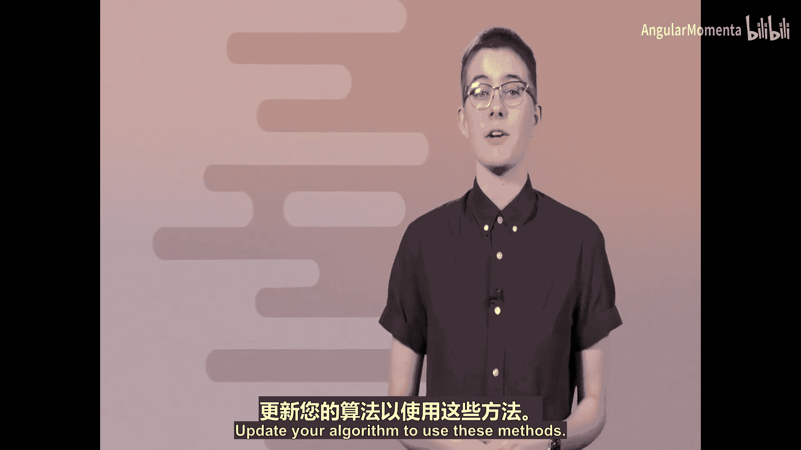

# 094：为第四版“戳点”游戏创建算法

## 概述
在本节课中，我们将学习如何为“戳点”游戏（版本四）的算法添加方法。我们将重点理解类、方法、属性以及封装的概念，并学习如何将之前用函数实现的功能重构为类的方法。

---

## 回顾：类与属性
上一节我们介绍了类的基本概念，并使用属性定义了类的状态。例如，我们曾创建了一个`Person`类，它拥有`name`、`birth_date`和`height`三个属性。

## 为类添加方法
本节中，我们来看看如何为类添加方法。方法是定义在类内部的函数，用于描述对象可以执行的操作。

在算法构建器的形状面板中，添加类时有两个选项：属性和方法。我们之前只使用了属性，现在我们将添加方法。

### 添加`initialize`方法
我添加的第一个方法将命名为`initialize`。方法与普通步骤不同，它只包含一个动作短语，而不包含动作和对象。

当你从`Person`类应用一个方法时，它总是应用于一个`Person`对象。因此，无需从词汇表中选择对象。在这种情况下，动作短语是“initialize”，我将在对象菜单中选择空白选项。

`initialize`方法将包含创建和绑定对象属性所需的所有步骤。回想一下，`Person`类有三个属性：`name`、`birth_date`和`height`。要创建一个`Person`对象，必须绑定这些属性。

设置`name`和`height`的值过于简单，不值得用单独的步骤表示，因为它们只是字面字符串和整数。然而，绑定`birth_date`更复杂，因为它包含年、月、日三个部分。因此，我将在`initialize`方法中添加一个“create birth date”的步骤。

如果创建`Person`对象还需要其他复杂步骤，我也会将它们添加到这里。“create birth date”只是一个将成为`initialize`方法中代码块的步骤，它本身不是一个方法。

### 添加`get_age`方法
一个人的年龄会随时间变化，因此我将创建另一个方法来计算年龄。我将添加一个方法，并选择“get age”作为动作短语。

在普通步骤中，格式是“动作 对象”。如果这是一个普通步骤，“get”是动作，“age”是对象。然而，对于方法，对象是该方法所应用的特殊参数。因此，`Person`是“get age”动作短语所应用的对象。

与处理`initialize`方法一样，我将展开`get_age`方法并向其中添加两个步骤：添加普通步骤“get current date”和“subtract birth date from current date”。

## 在主程序中使用方法
现在，我返回到主程序面板。我将添加一个步骤。请注意，我现在可以选择添加普通步骤或从现有类添加方法。

首先，我添加一个名为“create person”的普通步骤。在能够对其应用任何方法之前，我们需要一个步骤来创建新对象。因此，我们将始终使用名为“create [类名]”的步骤来创建对象，并且`initialize`方法将应用于这个新对象。

由于`initialize`必须始终被应用，为了避免为创建的每个类重复展开“create [类名]”并显式调用`initialize`方法，我们将采用一个约定：在算法中，“create [类名]”步骤将隐式地自动在新创建的对象上调用名为`initialize`的方法。因此，我不需要为创建的每个类都展开“create person”并添加对`initialize`方法的调用。

相反，“create person”将自动创建一个新的`Person`对象并对其调用`initialize`方法。

对于主面板中的第二步，我将从列表中添加一个方法。我选择`Person`类的`get_age`方法。现在，我的算法创建了一个新的人并计算了他们的年龄。

## 重构“戳点”游戏算法
让我们看看“戳点”游戏的算法。请注意，“create window”步骤位于主面板中。然而，当我们实现“create window”时，我们包含了游戏名称“Poke the dots”和窗口大小。因此，“create window”并非独立于我们正在创建的游戏。游戏应该封装所有关于游戏的信息，包括窗口要求。

现在你了解了更多关于封装的知识，这个问题就显得很重要了。为了改进封装，我将在`Game`类内部重新创建“create window”的功能。

首先，我将向`Game`类添加一个`initialize`方法。接着，我将向`initialize`方法添加一个“create window”步骤，并从主面板中删除“create window”步骤。

我还需要对主面板进行另一项更改，因为我现在在`Game`类中创建窗口，我也希望在`Game`类中关闭它。因此，我将从主面板中删除“close window”。在接下来的活动中，当你创建`play`方法时，你将在`Game`类的`play`方法末尾添加“close window”。

## 任务总结
目前由用户定义函数实现的大部分功能，必须用你现有`Game`和`Dot`类中的用户定义方法重新创建。

以下是你的任务：
*   完成`Game`类中的`initialize`方法，并为`Dot`类创建一个`initialize`方法。
*   创建适当的`Game`和`Dot`类方法。
*   更新你的算法以使用这些方法。

---

## 总结
本节课中，我们一起学习了如何为类添加方法，特别是`initialize`方法用于初始化对象状态。我们理解了方法调用与普通步骤的区别，并学习了如何通过将功能（如创建窗口）封装到类内部的方法中来改进代码结构。这为接下来实现更复杂的游戏逻辑奠定了基础。