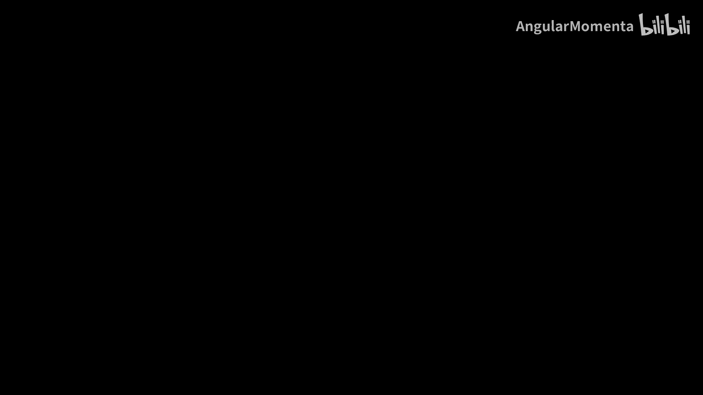
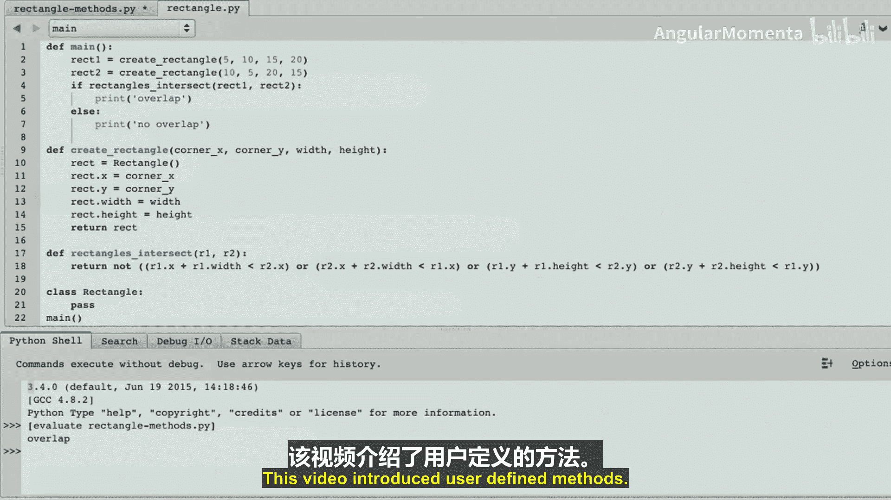

# 095：用户自定义方法与self参数



在本节课中，我们将要学习Python中的用户自定义方法。我们将了解什么是方法，它与普通函数有何不同，以及如何使用`self`参数。通过一个矩形相交检测的程序示例，我们将详细拆解方法的定义、调用过程以及Python解释器在幕后是如何工作的。

## 概述：什么是方法？

一个在类内部定义的函数被称为**方法**。每个方法都必须应用于一个对象，该对象的类型就是定义该方法的类。

回想一下之前关于方法调用的课程，`lower`方法定义在字符串类中，因此它可以应用于一个字符串对象，返回一个将所有大写字母转换为小写字母的相似字符串对象。另一个例子是字符串方法`find`，它返回子字符串在字符串中首次出现的索引。

方法所应用的对象是一个特殊的参数，除此之外，它还可以有普通的参数。例如，对于方法调用`R2D2.lower()`，特殊参数是`R2D2`。对于`Edmonton.find('O')`，特殊参数是`Edmonton`，而`'O'`是它的普通参数。

## 定义用户自定义方法

用户自定义方法是通过在定义它的类的代码块（suite）中放置一个函数定义来创建的。在函数定义的参数列表开头，需要添加一个额外的参数，这个参数将绑定到那个特殊的对象（即方法被调用的对象）。

上一节我们介绍了方法的基本概念，本节中我们来看看如何在实际程序中定义和使用方法。

考虑之前课程中用于检查两个矩形是否相交或重叠的程序。每个矩形对象有四个属性：`x`、`y`、`width`和`height`，其中`x`和`y`是矩形左上角的整数坐标。

以下是该程序的新版本，其中创建矩形和检查相交的函数已被替换为方法`__init__`和`intersects`。

```python
class Rectangle:
    def __init__(self, corner_x, corner_y, width, height):
        self.x = corner_x
        self.y = corner_y
        self.width = width
        self.height = height

    def intersects(self, other_rect):
        return not (self.x + self.width <= other_rect.x or
                    other_rect.x + other_rect.width <= self.x or
                    self.y + self.height <= other_rect.y or
                    other_rect.y + other_rect.height <= self.y)

def main():
    rec1 = Rectangle(5, 10, 15, 20)
    rec2 = Rectangle(10, 15, 15, 20)

    if rec1.intersects(rec2):
        print("Overlap")

if __name__ == "__main__":
    main()
```

我将使用这个新的矩形程序来展示用户自定义方法是如何定义的。稍后我会解释为什么使用了下划线。

## 程序执行与命名空间分析

当程序启动时，局部代码块是主模块，其命名空间既是局部命名空间也是全局命名空间。为了简化图示，我们省略了预绑定标识符`print`。

以下是程序执行时命名空间和对象创建的关键步骤：

1.  **定义`main`函数**：解释器应用函数定义语义，创建一个函数对象及其自己的命名空间，并将标识符`main`添加到局部命名空间并绑定到这个函数对象。

2.  **定义`Rectangle`类**：解释器应用类定义语义。
    *   步骤1：创建一个新的空命名空间作为局部命名空间，并使用当前的全局命名空间来评估类定义块。
    *   类定义块由两个函数定义语句组成，因此使用函数定义语义来评估每个定义。注意，函数名被添加到了这个新的局部命名空间（即类的命名空间）中。
    *   步骤2：创建一个新的类对象，其命名空间就是这个新的局部命名空间。**当一个函数定义出现在类内部时，函数名被添加到类对象的命名空间中，这正是一个函数成为方法的原因。** 任何名称绑定在类对象命名空间内的函数，都会被创建为方法对象，而不是普通的函数对象。因此，`__init__`和`intersects`都是方法对象。
    *   步骤3和4：类名`Rectangle`被添加到原始的局部命名空间（主模块的命名空间），并绑定到新的类对象。

3.  **调用`main`函数**：解释器应用函数调用语义，开始执行`main`函数内的代码。

4.  **创建`Rectangle`对象 (`rec1`)**：
    *   语句`rec1 = Rectangle(5, 10, 15, 20)`是一个对`Rectangle`类对象的函数调用。
    *   由于`Rectangle`是一个类对象，函数调用语义需要扩展：如果函数对象是一个类，则创建一个该类型的新对象，然后对其应用`__init__`方法，并将这个新对象作为结果返回。
    *   因此，创建一个新的`Rectangle`对象，并将其作为特殊参数添加到`__init__`方法的参数列表开头。
    *   `__init__`方法的参数`self`、`corner_x`、`corner_y`、`width`、`height`被绑定到对应的参数对象（新矩形对象和四个数字）。
    *   `__init__`方法内的四条语句为这个新矩形对象添加了四个属性（`x`, `y`, `width`, `height`）并将它们绑定到相应的值。
    *   `__init__`方法没有`return`语句，它隐式返回`None`。但根据修订后的语义，调用`Rectangle`类函数返回的结果对象是新创建的那个矩形对象。标识符`rec1`被绑定到这个矩形对象。

5.  **创建第二个`Rectangle`对象 (`rec2`)**：过程与创建`rec1`类似。

6.  **调用`intersects`方法**：
    *   条件语句`if rec1.intersects(rec2):`中的`rec1.intersects`是一个属性引用。
    *   解释器解引用`rec1`得到第一个矩形对象，并在该对象的命名空间中查找属性`intersects`。**方法名并不在单个对象的命名空间中。**
    *   当类定义被评估时，其方法名被添加到了**类的命名空间**中，并与该类的所有对象共享。对象使用从其类中共享的方法名。
    *   因此，当在对象中找不到某个属性时，解释器会到该对象的类中去搜索。这是属性引用语义的扩展。
    *   解释器在`Rectangle`类的命名空间中找到了`intersects`，并解引用得到`intersects`方法对象。
    *   正常的函数调用语义继续：参数列表通过评估`rec2`创建，得到一个单元素参数对象列表，然后将特殊参数（`rec1`）添加到这个参数列表的开头。
    *   `intersects`的参数`self`和`other_rect`被添加到其命名空间并绑定到两个参数对象（`rec1`和`rec2`）。
    *   `intersects`方法被评估并返回`True`，因此`if`语句的代码块被执行，在Shell中显示“Overlap”。

## 关于`self`和`__init__`的约定

在上述程序中，我们使用`self`作为绑定到特殊对象的参数的名称。实际上，方法的第一个参数可以使用任何名称。然而，**Python有一个约定，使用`self`作为第一个参数的名称**。我们应该遵循这个约定以提高代码的可读性。

另外，我们使用了`__init__`（两边各有两个下划线）作为方法名。如果类定义中不包含`__init__`方法，Python会应用一个默认的、什么都不做的`__init__`方法。**必须使用这种双下划线的形式，Python才能识别出你的`__init__`方法**，并在创建类实例时自动调用它。

## 总结

本节课中我们一起学习了Python的用户自定义方法。我们了解到：
*   方法是定义在类内部的函数。
*   方法必须通过类的实例（对象）来调用，该实例会自动作为第一个参数（通常命名为`self`）传递给方法。
*   方法的定义和调用过程涉及Python解释器对命名空间、类对象和实例对象的复杂管理。
*   `__init__`是一个特殊的方法，用于在创建对象时初始化其属性。
*   遵循使用`self`作为实例引用和`__init__`作为构造方法的命名约定是良好的编程实践。



通过理解这些概念，你就能在自己的类中定义和使用方法来组织和封装代码行为了。