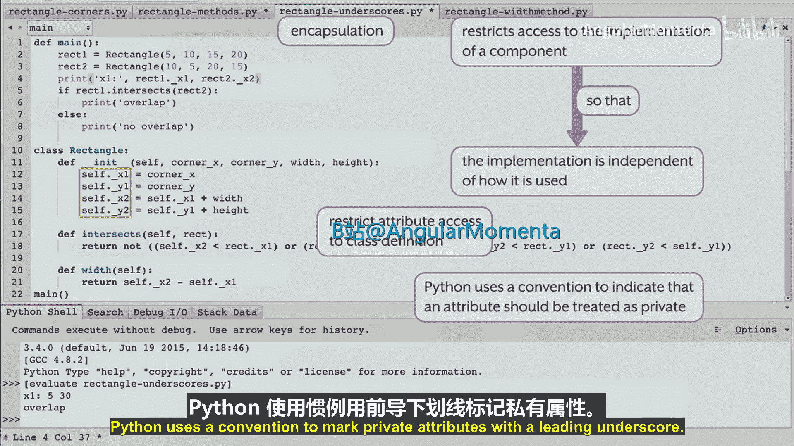

# 096：私有属性 🔒


在本节课中，我们将要学习面向对象编程中的一个重要概念：**私有属性**。我们将了解什么是封装，为什么需要私有属性，以及Python中如何通过约定来实现私有属性。

---

## 概述：封装与私有属性的重要性

上一节我们介绍了用户自定义方法。本节中我们来看看如何保护类的内部实现细节，这就是**封装**的核心思想。

**封装**是一种限制对组件实现细节访问的技术，目的是使组件的实现独立于其他组件如何使用它。私有属性是实现封装的关键手段之一。

---

## 一个示例：矩形类的问题

考虑在用户自定义方法课程中介绍的矩形类。

```python
class Rectangle:
    def __init__(self, x, y, width, height):
        self.x = x
        self.y = y
        self.width = width
        self.height = height
```

如果在定义该属性的类定义之外访问属性，那么当类的实现发生更改时，就可能出现问题。

例如，我更改程序以在矩形类外部访问`width`属性。

```python
rect = Rectangle(0, 0, 10, 20)
print(rect.width)  # 在类外部访问属性
```

运行程序，它工作正常。

---

## 改变实现导致的问题

然而，如果我更改矩形类的实现，使得`width`不再是一个属性。

```python
class Rectangle:
    def __init__(self, x1, y1, x2, y2):
        self._x1 = x1  # 左上角x坐标
        self._y1 = y1  # 左上角y坐标
        self._x2 = x2  # 右下角x坐标
        self._y2 = y2  # 右下角y坐标
```

由于程序在类外部使用了`width`属性，当`width`属性被不同的属性替换时，程序就会失败。

这违反了封装原则，因为矩形类的实现不再独立于其他组件如何使用它。

---

## 解决方案：使用方法提供访问

如果你想提供对矩形宽度的访问，可以在矩形类中创建一个`width`方法。

```python
class Rectangle:
    def __init__(self, x1, y1, x2, y2):
        self._x1 = x1
        self._y1 = y1
        self._x2 = x2
        self._y2 = y2

    def width(self):
        return self._x2 - self._x1

# 使用
rect = Rectangle(0, 0, 10, 20)
print(rect.width())  # 通过方法访问
```

现在，即使没有`width`属性，程序也能运行。

---

## 私有属性与封装

如果将属性的访问限制在定义它们的类内部，那么对象的使用就可以独立于对象类的实现。因此，就实现了封装。

许多编程语言都有可用于防止在定义属性的类之外访问属性的功能。

以下是其他语言的做法：
*   例如，Java和C++都使用关键字`private`，以便在类定义之外访问属性时生成错误。
*   实际上，在C++中，除非使用不同的关键字（如`public`）来指定属性不是私有的，否则所有属性默认都是私有的。

Java和C++中使用的确切语法并不重要；重要的是Java和C++中有语言特性允许你限制属性的作用域，以强制执行属性封装。

---

## Python的约定：单下划线前缀

Python没有可以防止在类定义之外访问属性的关键字，而是有一个**约定**。

任何以**单个下划线**开头的属性都应被视为私有属性。它不应该在定义它的类定义之外使用。

因此，我将更改矩形类中的属性名称，以表明它们应该是私有的。

```python
class Rectangle:
    def __init__(self, x1, y1, x2, y2):
        self._x1 = x1  # 私有属性
        self._y1 = y1  # 私有属性
        self._x2 = x2  # 私有属性
        self._y2 = y2  # 私有属性
```

然而，这只是一个约定，带有单个前导下划线的属性仍然可以在类定义之外访问。它主要依赖于程序员的自律。

Python还有另一种称为**属性（properties）** 的机制，可用于使在类定义之外访问属性变得更加困难，但我们不会在本课程中讨论属性。

---

## 总结

本节课中我们一起学习了**私有属性**的概念及其在实现封装中的重要性。

*   **封装**使类的实现独立于外部使用。
*   直接暴露属性在实现更改时会导致程序错误。
*   通过**方法**提供对数据的访问是更好的做法。
*   Python使用**单下划线前缀（`_attribute`）** 的**命名约定**来标记私有属性，这主要是一种编程规范，而非强制性的语言限制。



理解并遵守私有属性的约定，是编写健壮、可维护Python代码的重要一步。