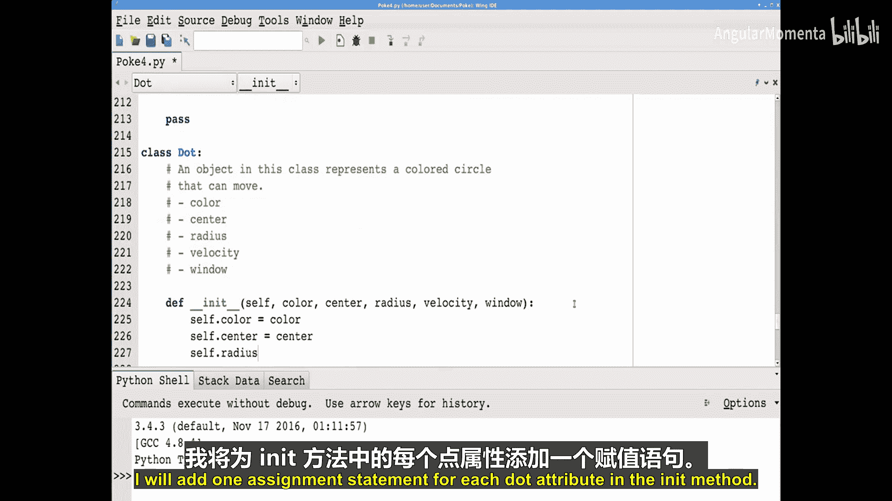
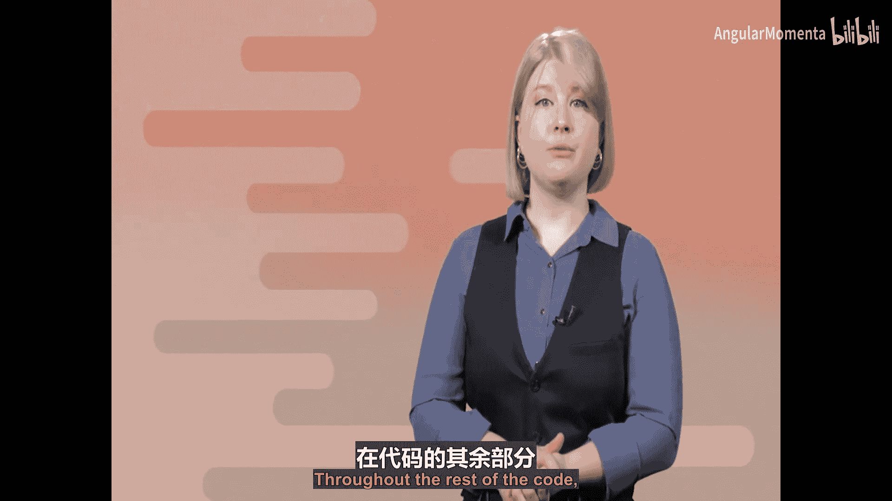

# 097：编程“戳点”游戏版本4 🎮


在本节课中，我们将学习如何将“戳点”游戏从版本3重构为版本4。核心任务是将现有的函数式代码转换为面向对象的类和方法结构。我们将创建`Dot`类和`Game`类，并将初始化、绘制等逻辑封装为类的方法。

## 概述

上一节我们完成了“戳点”游戏版本3，其中使用了多个函数来管理游戏状态。本节中，我们将重构代码，引入类和方法。这类似于之前为“黑客”游戏版本6添加函数定义的过程。我们将把算法构建器中的每个初始化面板转换为代码中的一个方法。

## 创建Dot类的初始化方法

首先，我将为`Dot`类创建`__init__`方法。以下是方法头：
```python
def __init__(self, color, center, radius, velocity, window):
```
由于`__init__`是一个方法，每个方法定义都需要一个参数来绑定调用方法时的特殊实参，因此我在其参数列表中添加了`self`。`self`必须始终是方法定义中的第一个参数，无论是否存在其他参数。`Dot`类创建圆点需要五个额外的参数对象，因此我也为这些参数添加了对应的形参：`color`、`center`、`radius`、`velocity`和`window`。

接下来，我将在`__init__`方法中初始化这些属性。

在版本3的`create_dot`函数中，我们将每个属性引用绑定到一个参数对象。`__init__`方法将取代`create_dot`函数，以便在创建圆点对象时立即执行初始化所需的所有步骤。

在`create_dot`函数中，局部标识符`dot`被绑定到一个`Dot`对象，然后其属性被绑定。在`__init__`方法中，`self`被绑定到新的`Dot`对象，其属性必须被绑定。因此，我将使用参数`self`而不是局部标识符`dot`。

我将在`__init__`方法中为每个圆点属性添加一个赋值语句。

## 更新游戏创建逻辑

在`create_game`函数中，我将把对`create_dot`函数的调用替换为对`Dot`类构造函数的调用，并使用相同的参数。

现在，我将删除`create_dot`函数定义并运行程序。程序仍然可以工作。



## 为Dot类添加绘制方法


接下来，我将为`Dot`类添加另一个方法。请注意，`draw_dot`函数只有一个参数`dot`。

我将复制`draw_dot`函数套件中的三条语句，并删除该函数定义。

现在，我将向`Dot`类添加方法头`def draw(self):`。

`draw_dot`函数需要一个`dot`作为参数。然而，`draw`是一个方法，因此它的特殊实参将是我想要绘制的圆点。所以，`self`是我唯一需要的参数。

接下来，我将把从`draw_dot`复制的三条语句粘贴到`draw`方法中，并将所有`dot`引用更改为`self`。

现在，我将把对`draw_dot`和`draw_game`的函数调用替换为对`draw`方法的方法调用。

我再次运行游戏，它运行良好。

## 创建Game类的初始化方法

现在，我将开始编写`Game`类中的`__init__`方法。首先，创建方法头。由于在此版本中窗口将在`Game`类内部创建，我不需要`window`参数。

我将通过修改旧的`create_window`函数中的代码来创建一个窗口。

`create_window`中的另外四条语句调整了窗口字体的类型、大小和颜色。我将创建一个方法来执行此操作。

首先，我创建方法头`def _adjust_window(self):`。现在，我将把`create_window`中的四条语句粘贴到`_adjust_window`方法中。

由于窗口现在是游戏对象的一个属性，我必须使用`self.window`而不是局部标识符`window`。

调整窗口是创建游戏对象时应采取的步骤之一，因此我将在`__init__`方法中添加对`_adjust_window`的调用。

由于`_adjust_window`是在`Game`类定义中调用的，它的特殊实参将是`self`。

现在，我将删除`create_window`函数及其在主程序中的调用。我将把对`create_game`的调用替换为对不使用`window`参数的`Game`类构造函数的调用。

最后，我运行程序，但它在`play_game`的第一行崩溃，因为没有`closed_selected`属性。我将把`create_game`中的所有属性绑定语句复制到`__init__`中，将对象引用从`game`更改为`self`，然后再次运行程序。

## 修复属性访问错误

它仍然无法工作。Python报告名称`window`未定义。为了解决这个问题，我必须在`__init__`方法中将`window`更改为`self.window`，然后再次运行。

这次，它在我尝试关闭窗口之前都能正常工作。要解决此问题，您必须在编写`play`方法后，将`window.close()`从主程序移动到`play`方法中。

## 遵循Python私有属性约定

现在，我将向您展示如何调整代码以遵循Python的私有属性约定。

在`Dot`类中，我将在`__init__`方法中为每个属性添加单下划线。同样，我将在`Game`类的`__init__`方法中为`_adjust_window`方法调用添加下划线，并在`_adjust_window`定义的开头添加下划线，因为它只应在`Game`类内部调用。

我希望这个方法像属性一样私有。以单下划线开头的方法应被视为私有的，就像属性一样。

当我这次运行游戏时，解释器在尝试访问圆点的`window`属性时报告属性错误，因为该属性已重命名为`_window`。

在代码的其余部分，`Dot`的属性是从类外部访问的；这是一个很好的例子，说明了为什么我们希望我们的类被封装。

通过更改`__init__`方法中的属性名称，我破坏了代码的功能。

## 你的任务



现在轮到你了。修改你的程序，使所有属性都使用前导下划线，并且不再从类定义外部访问属性。

你还必须用方法替换除`main`之外的所有函数，并更新`main`中的代码。

## 总结

本节课中，我们一起学习了如何将“戳点”游戏从过程式代码重构为面向对象的类结构。我们创建了`Dot`和`Game`类，定义了`__init__`初始化方法和`draw`等方法，并将游戏逻辑封装在类内部。我们还介绍了Python中用于表示“私有”属性的单下划线约定。通过这次重构，代码结构更清晰，更易于维护和扩展。