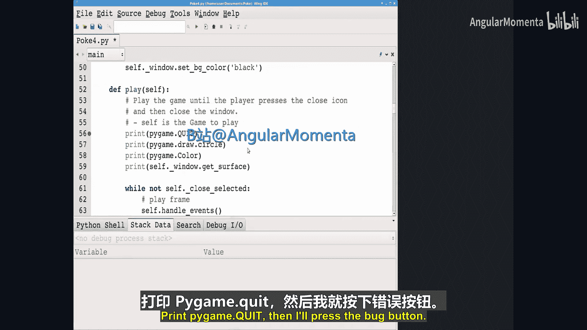
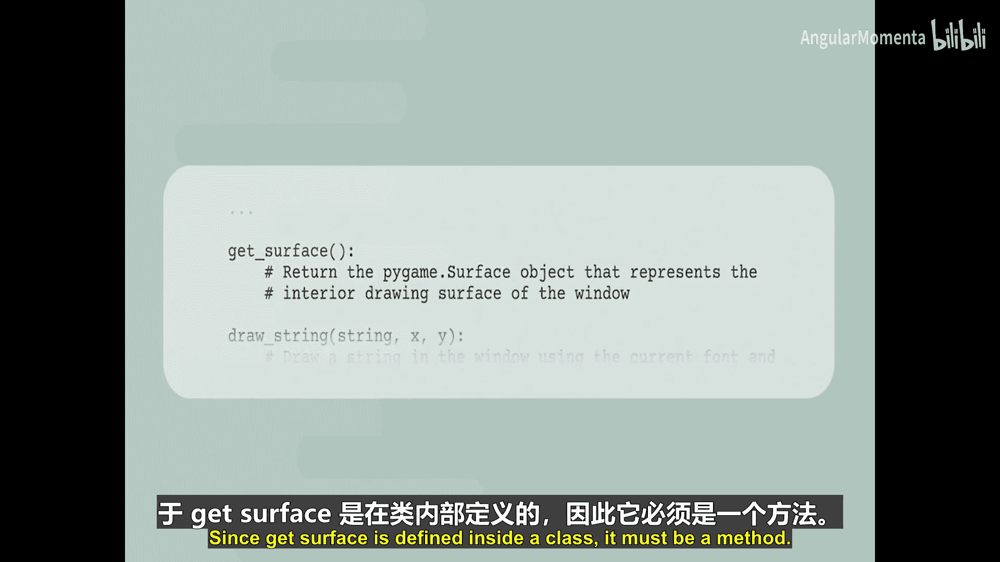
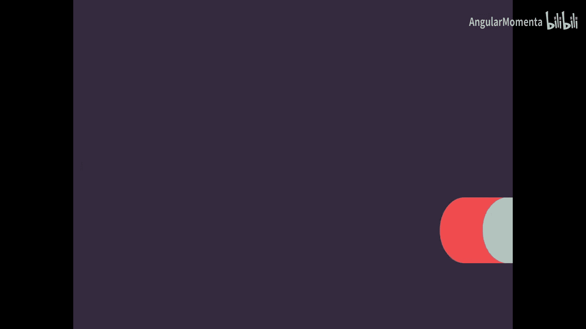
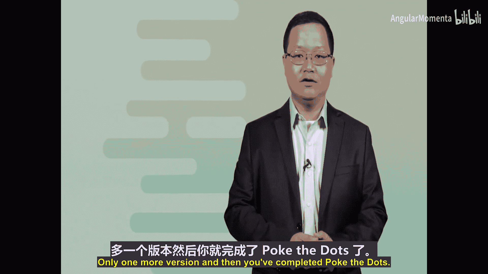

# 098：Poke the Dots 版本4代码回顾 🎮

在本节课中，我们将回顾 Poke the Dots 游戏版本4的代码，重点探讨用户自定义方法、函数与方法的区别，以及如何通过调试器和文档来理解代码。我们还将介绍本版本新增的软件质量测试要求。

## 调试器中的方法与函数

上一节我们介绍了用户自定义方法的概念。本节中，我们来看看如何利用调试器探索方法与函数之间的差异。

首先，我们在 `main` 函数中创建新游戏对象的赋值语句旁设置一个断点。

按下调试按钮后，调试器会在断点处停止，并高亮显示对 `Game` 类函数的调用。此时，局部变量中没有任何对象，且 `Game` 类函数没有参数。

由于 `Game` 类函数不是方法，因此在调用 `Game` 前没有表达式，不会有特殊参数被添加到参数列表中。

按下“步入”按钮，我们进入了 `Game` 类定义的 `__init__` 方法。

为什么活动函数是 `__init__` 而不是 `Game` 类函数？因为当调用一个类函数时，会立即创建该类的一个实例，并将该实例作为特殊参数传递给 `__init__` 方法。

因此，`Game` 的 `__init__` 方法有一个参数 `self`。`self` 被绑定到 `Game` 类刚创建的新对象上，它出现在栈数据中，并指向新创建的 `Game` 对象。

请记下 `self` 的内存地址。接着，我们步出 `__init__` 方法，返回到 `main` 函数。

标识符 `game` 已被添加到局部命名空间，并被绑定到传递给 `__init__` 的那个对象。记住这个 `game` 对象的地址。

`play` 方法调用没有常规参数，但有一个特殊参数，即 `game` 对象。当我按下“步入”按钮时，方法的命名空间中已经绑定了一个对象。

在方法定义中，`play` 有一个参数 `self`。与 `__init__` 一样，`self` 被绑定到调用方法时添加到参数列表中的那个特殊参数。你可以比较地址，会发现 `self` 与 `main` 函数中调用 `Game` 类函数时创建的 `game` 对象是同一个。

我将停止这次跟踪，以便探索普通函数调用、类函数调用和方法调用之间的区别。

## 语法与对象类型

仅通过观察语法，无法区分普通函数、类函数和方法。例如，我们仅凭经验知道 `time.sleep` 是一个函数，而 `window.set_font_name` 是一个方法，但它们的语法完全相同：都是一个标识符，后跟一个点，再跟一个标识符，然后是括号和参数。

一个函数是普通的、类的还是方法的，取决于括号前的标识符绑定的是普通函数对象、类函数对象还是方法对象。

以下是确定标识符所绑定函数对象确切类型的三种常见方法：

*   可以对该对象调用 `print` 函数。
*   如果有权限，可以查看定义该对象的代码。
*   可以查阅文档，这是通常的做法。

为了探讨这个问题，我将在 `play` 方法中添加几条语句。接下来，我会添加一个 `import` 语句，以便使用包含点的长名称来访问 `pygame.draw.circle`。

我将移除 `main` 中的断点，然后在 `play` 的第一个新语句旁设置一个新断点：`print(pygame.quit)`。然后按下调试按钮。

这些 `print` 调用让我可以检查表达式求值后的对象。我将在 Shell 中步过第一条打印 `pygame.quit` 的语句，显示 `quit` 的整数值。

第二条语句打印 `<built-in function circle>`。
第三条语句打印 `<class ‘pygame.color’>`。
第四条语句打印 `<bound method Window.get_surface of <UAGame.Window object at 某个内存地址>>`。

这四条语句都使用了属性引用语法，但各自求值得到不同类型的对象：`pygame.quit` 求值为一个整数，而其他三个分别求值为一个普通函数、一个类函数和一个方法函数。

当你阅读包含函数调用的代码时，不要依赖视觉检查来确定其含义，而应查阅文档来确定该函数调用是普通函数、类函数还是方法函数。

## 查阅文档

让我们查看 `pygame.color` 的文档。由于 `pygame` 绑定到一个模块，`pygame.color` 是该模块的一个属性。我点击 `pygame.color` 链接查看颜色文档。

Pygame 使用 Python 的标识符命名约定。由于 `Color` 以大写字母开头，它是一个类而不是模块。`Color(name)` 代表颜色类函数。我知道它是类函数，因为它首字母大写，并且文档说明“Pygame object for color representations”，下面写着“The Color class represents...”。

让我们查看 `pygame.draw.circle` 的文档。由于 `pygame` 绑定到一个模块，`pygame.draw` 是该模块的一个属性。我点击 `pygame.draw` 链接查看绘制模块的文档。

由于 `draw` 以小写字母开头，它是一个模块，而不是类。`pygame.draw.circle` 是一个普通函数，因为它直接出现在 `draw` 模块中，而不是在某个类内部。

让我们查看 `self.window.get_surface` 的文档。`self` 绑定到一个类型为 `Game` 的对象。`Game` 的 `window` 属性绑定到一个 `Window` 对象。因此，`get_surface` 是 `Window` 的一个属性，它定义在 `UAGame` 模块中。

所以我将在 `UAGame` 文档的 `Window` 类中查找 `get_surface`。由于 `get_surface` 定义在一个类内部，它必须是一个方法。

## 软件质量要求

现在到了本版本 Poke the Dots 的软件质量环节。我将在“类”部分添加三条新的软件质量测试。

要通过本版本的软件质量测试，在用户自定义类中定义的属性，不得在定义它们的类之外被访问。

此外，你新定义的用户方法必须满足针对用户自定义函数的软件质量测试。

请确保你的代码满足这三条新测试，以及之前所有版本的所有测试。

恭喜，你完成了版本4！只剩下一个版本，你就完成 Poke the Dots 了。

---

本节课中，我们一起学习了如何通过调试器观察方法与函数的执行差异，理解了仅凭语法无法区分函数类型，并掌握了通过打印对象、查看代码或查阅文档来确定其类型的方法。最后，我们明确了版本4新增的软件质量测试要求，即封装类属性并确保方法符合函数质量标准。