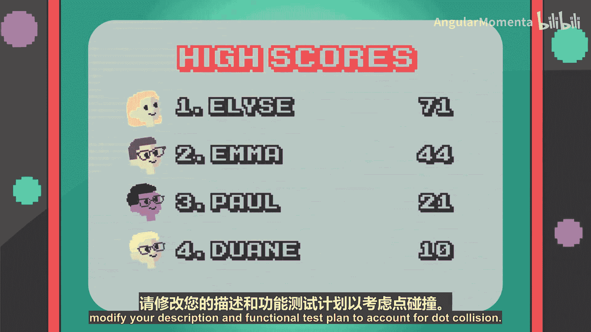

# 100：观察“戳点”游戏最终版 🎮

在本节课中，我们将观察“戳点”游戏的最终版本，并了解其与前一个版本相比新增的核心功能——圆点碰撞检测。

## 概述

“戳点”游戏版本5在视觉和基础玩法上与版本4保持一致。然而，它引入了一个决定性的新机制：当两个移动的圆点发生碰撞时，游戏会立即结束。本节课我们将详细观察这一变化，并理解其对游戏玩法的影响。

## 游戏启动与基础观察

启动游戏，初始界面与版本4没有明显区别。

*   屏幕上有一个红色圆点和一个蓝色圆点。
*   两个圆点以相同的速度移动。
*   当圆点碰到窗口边缘时，它们会反弹。
*   白色的计分板依然在记录游戏开始后的秒数。

## 交互与新增机制

接下来，我们通过点击鼠标进行交互，并观察新增的碰撞机制。

点击鼠标数次，圆点仍然会瞬间传送到窗口内的随机位置。

然而，当两个移动的圆点发生碰撞时，新的情况出现了：**圆点立即停止运动**，同时在屏幕一角显示“游戏结束”的消息。

请注意消息文本的颜色与**小圆点**的颜色相同，而消息背景的颜色与**大圆点**的颜色相同。

## 游戏玩法与挑战

这一碰撞机制最终为“戳点”游戏引入了真正的挑战。玩家的目标是尽可能避免两个圆点相撞，从而获得更高的分数。

点击窗口的关闭图标，可以正常关闭游戏窗口。

当你尝试游玩时，你能获得的最高分数是多少？我们的测试记录是71、44、21和10秒。

## 总结与后续任务

本节课我们一起观察了“戳点”游戏的最终版本。核心新增功能是**圆点碰撞检测**，它使得游戏在碰撞发生时立即结束，从而创造了游戏目标和挑战性。

为了巩固理解，你的下一个任务是：**修改你的游戏描述和功能测试计划，将圆点碰撞这一新机制纳入考虑。**