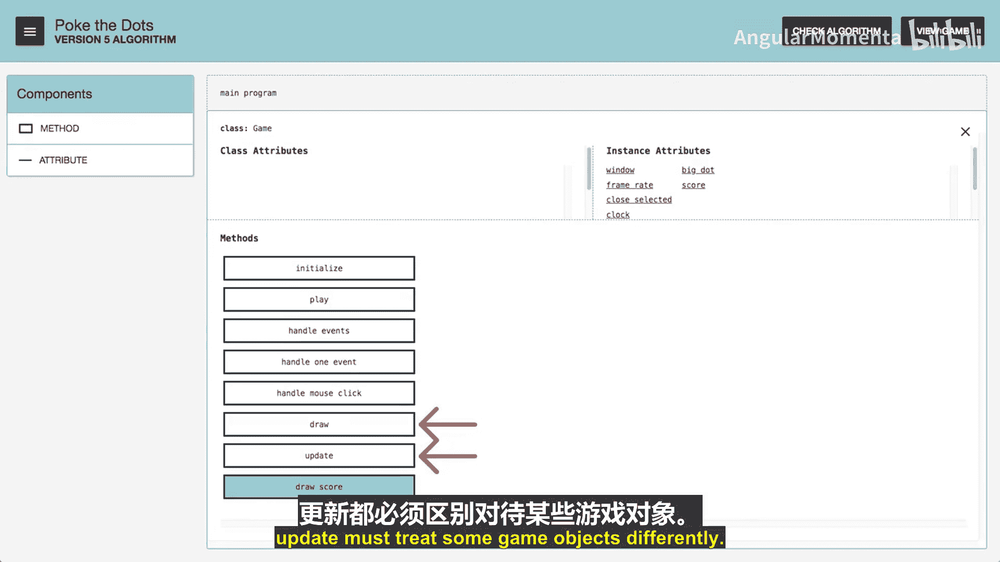

# 101：12_03_01 为第五版“戳点”游戏创建算法

在本节课中，我们将学习如何为“戳点”游戏的第五个版本创建算法。核心任务是添加最后一个游戏功能：处理圆点碰撞。我们将学习如何检测碰撞，并引入一个新的游戏状态属性来管理游戏结束后的行为。

---

上一节我们完成了游戏的基本循环和事件处理。本节中，我们来看看如何实现圆点碰撞检测，并据此控制游戏流程。


## 检测圆点碰撞

圆点碰撞不是由玩家事件触发的，而是游戏对象移动的结果。因此，必须在**每一帧**都检查两个圆点是否发生了碰撞。

以下是检测两个圆点是否碰撞的核心逻辑。我们假设每个圆点都有位置 `(x, y)` 和半径 `r`。当两个圆心的距离小于或等于它们半径之和时，即发生碰撞。

**碰撞检测公式：**
`distance = sqrt((x1 - x2)^2 + (y1 - y2)^2)`
如果 `distance <= (r1 + r2)`，则发生碰撞。

在代码中，我们可以这样实现：
```python
def dots_collide(dot1, dot2):
    distance = ((dot1.x - dot2.x)**2 + (dot1.y - dot2.y)**2)**0.5
    return distance <= (dot1.radius + dot2.radius)
```

## 管理游戏状态

当圆点发生碰撞时，游戏应该结束。我们需要在游戏类中添加一个新的属性来跟踪游戏是否应该继续。

**添加游戏状态属性：**
```python
class Game:
    def __init__(self):
        # ... 其他初始化代码 ...
        self.continue_play = True  # 新属性，True表示游戏继续，False表示游戏结束
```

这个 `continue_play` 属性将决定游戏在绘制和更新步骤中的行为。

## 更新游戏逻辑

有了游戏状态属性后，我们需要在游戏的 `update` 和 `draw` 方法中根据其值选择不同的行为。

以下是更新游戏逻辑的步骤：

1.  **在 `update` 方法中**：每一帧更新圆点位置后，立即检查它们是否碰撞。如果碰撞发生，则将 `continue_play` 属性设置为 `False`。
    ```python
    def update(self):
        if self.continue_play:
            # 更新圆点A和圆点B的位置
            self.dot_a.move()
            self.dot_b.move()
            # 检查碰撞
            if dots_collide(self.dot_a, self.dot_b):
                self.continue_play = False
        # 如果 continue_play 为 False，则不再更新圆点位置
    ```

2.  **在 `draw` 方法中**：根据游戏状态绘制不同的内容。游戏进行时正常绘制所有元素；游戏结束时，可以绘制“游戏结束”的提示信息。
    ```python
    def draw(self):
        # 绘制背景等不变元素
        if self.continue_play:
            # 游戏进行中，绘制移动的圆点
            self.dot_a.draw()
            self.dot_b.draw()
        else:
            # 游戏结束，绘制结束画面或文本
            draw_game_over_text()
    ```

通过这种方式，游戏逻辑变得清晰：只要圆点未碰撞，游戏就继续运行和绘制；一旦碰撞发生，游戏状态改变，画面和行为也随之改变。



---

本节课中我们一起学习了如何为“戳点”游戏第五版完成算法。我们引入了圆点碰撞检测机制，并通过添加一个 `continue_play` 状态属性来优雅地管理游戏的结束。这使得游戏在圆点碰撞后能停止更新逻辑并显示相应的结束状态，从而实现了完整的游戏流程。