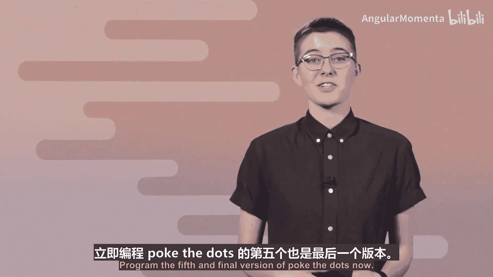

# 102：12_04_01 编程“戳点”游戏 - 第五版

在本节课中，我们将学习如何完成“戳点”游戏的最终版本。我们将重点实现两个核心功能：判断游戏是否结束（即两个点是否相交）以及在游戏结束时绘制包含点颜色的结束信息。


## 游戏结束判定：点相交检测

上一节我们介绍了游戏的基本框架，本节中我们来看看如何判断游戏是否结束。游戏结束的条件是两个移动的点发生碰撞或相交。

在之前用户自定义的“小于”方法中，我们看到了一个用于判断两个矩形对象是否相交的例子。然而，对于圆形的点，我们需要不同的计算方法。

一个实心圆的所有点到其圆心的距离都小于或等于一个固定值，这个固定值被称为**半径**。如果两个圆相交，那么它们圆心之间的距离必须小于它们半径之和。

我们可以使用**距离公式**来计算两点之间的距离。公式如下：

**距离 = √[(x₂ - x₁)² + (y₂ - y₁)²]**

在代码中，我们可以这样实现：

```python
import math

def distance(point1, point2):
    return math.sqrt((point2.x - point1.x)**2 + (point2.y - point1.y)**2)
```

以下是判断两个圆（点）是否相交的步骤：
1.  计算两个点圆心之间的距离。
2.  计算两个点半径之和。
3.  如果距离小于半径之和，则两点相交，游戏结束。

## 绘制游戏结束信息

当我们确定游戏结束后，需要绘制游戏结束的提示信息。这条信息需要使用两个点的颜色。

但你已经知道，不能直接访问点对象的颜色属性。为了获取颜色信息，你必须在`Dot`类中编写一个方法，用于返回其颜色属性。

例如，在`Dot`类中添加一个`get_color`方法：

```python
class Dot:
    def __init__(self, color, radius, center, velocity):
        self.color = color
        self.radius = radius
        self.center = center
        self.velocity = velocity

    def get_color(self):
        return self.color
```

这样，在游戏主循环中，当检测到游戏结束时，就可以调用`dot_a.get_color()`和`dot_b.get_color()`来获取颜色，并用这些颜色来渲染游戏结束的文字。

## 开始编程

现在，请根据以上思路，编程实现“戳点”游戏的第五个也是最终版本。确保整合游戏结束检测逻辑和游戏结束画面的绘制。

---



本节课中我们一起学习了如何为“戳点”游戏收尾。我们掌握了使用**距离公式**计算两点距离，并通过比较**圆心距**与**半径和**来判断圆形对象是否相交。同时，我们通过为`Dot`类添加**获取方法**来安全地访问其颜色属性，从而能够绘制个性化的游戏结束信息。这些是完成一个基础碰撞检测游戏的关键步骤。