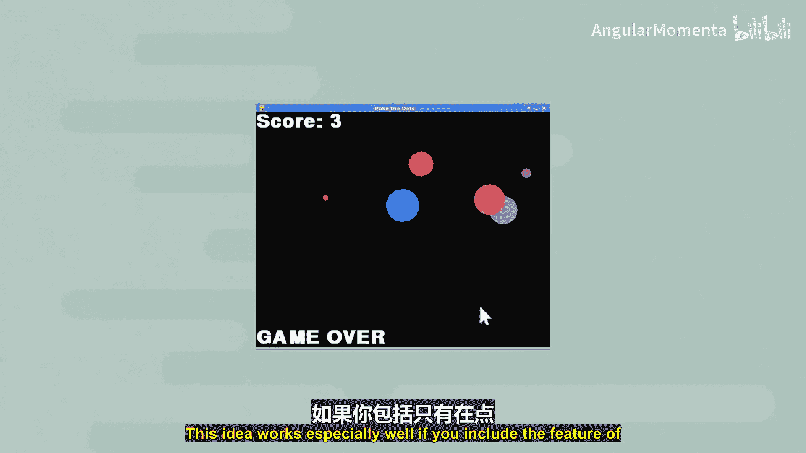
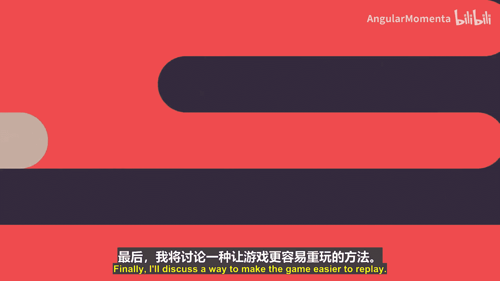
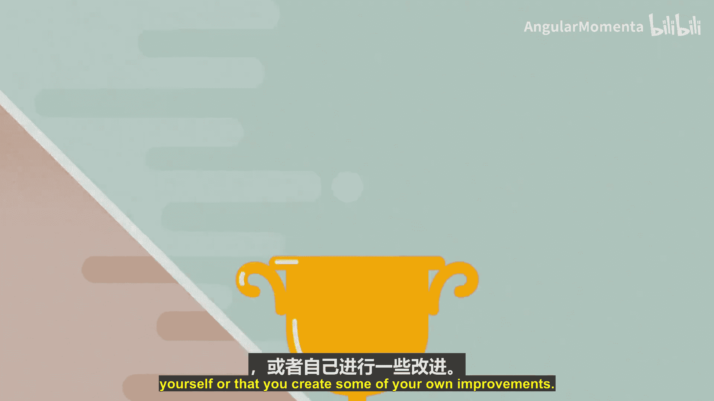

# 103：Poke the Dots 版本5的潜在改进方案

在本节课中，我们将对《Poke the Dots》游戏的最终版本（版本5）进行反思，并探讨一系列可以进一步提升游戏体验的潜在改进方案。虽然课程要求已经完成，但软件开发的魅力在于持续的迭代与优化。

上一节我们完成了《Poke the Dots》游戏的核心功能开发。本节中，我们将不再进行代码追踪或质量测试，而是专注于游戏创作流程图的最后一个环节：探索解决方案的潜在问题与改进空间。

## 🎨 提升视觉吸引力

当前版本的《Poke the Dots》在视觉上较为单调。一个简单的改进方法是增强游戏的动态视觉效果。

以下是提升视觉吸引力的一个具体方案：

*   **随机化圆点颜色**：修改鼠标按键释放（`mouse up`）事件处理器。每次玩家点击鼠标时，随机改变两个圆点的颜色。这可以通过在事件处理器中添加类似 `dot.color = random_color()` 的代码来实现。

## 🎯 增加游戏挑战性

《Poke the Dots》的游戏玩法可能略显简单，导致趣味性不足。我们可以通过增加难度来提升游戏的挑战性和可玩性。

以下是三种增加游戏难度的方法：

*   **点击加速**：每次按下鼠标按键时，增加圆点的移动速度。这迫使玩家必须谨慎选择点击时机，因为过于频繁的点击会使圆点速度变得极快。实现方式可能是在事件处理器中修改速度变量，例如 `dot.velocity_x *= 1.1`。
*   **精确点击传送**：当前游戏允许点击窗口内任意位置来传送圆点，这与游戏名称“戳圆点”并不完全相符。一个更准确且更具挑战性的改进是：修改鼠标事件处理器，**仅当**鼠标光标位于圆点内部时点击，才触发传送功能。这需要检测点击坐标是否在圆点范围内，可通过计算距离来判断：`if distance(mouse_pos, dot.center) < dot.radius:`。
*   **错误点击惩罚**：结合上一条“精确点击传送”的改进，如果玩家点击时未命中圆点，可以施加惩罚，而不是什么都不发生。例如，每次错误点击都会在屏幕上添加一个具有随机颜色和大小的新圆点。如果尝试此改进，可能需要将游戏窗口设置得更大一些。

## 🔄 优化游戏重玩体验

目前，玩家必须关闭游戏窗口并重新启动程序才能开始新一局游戏。我们可以让重玩变得更加便捷。

以下是一种优化重玩体验的方法：

*   **添加重玩按键**：增加一个事件处理器，用于检测游戏是否结束以及是否按下了特定的“重玩”按键（如‘R’键）。如果条件满足，可以通过将控制游戏循环的变量（如 `continue_game`）重新设置为 `True` 来重启游戏。
    😊 然而，你必须找到一种方法，在每次重启时将玩家得分重置为零。

以上只是众多可能改进方案中的一部分。我们鼓励你尝试自己实现其中一些改进，或者创造出属于你自己的独特优化方案。

## 🎉 课程总结

恭喜你完成了《Poke the Dots》游戏的开发！

本节课中我们一起学习了如何对已完成的软件项目进行反思并提出改进思路。我们探讨了从视觉表现、游戏难度到用户体验等多个维度的优化方案。

本课程至此已全部结束。我们希望你喜欢这门课程，并学到了如何运用计算机科学将计算应用于多种不同的信息形式。

计算机科学不仅仅是Python编程和电脑游戏。它依赖于精确的概念和表示法，例如本课程中使用的词法语法、语义规则和各种图表。计算机科学也运用许多流程，例如支持迭代式软件设计与开发的游戏创作流程。

编程远不止是写代码。你可以运用在本课程中获得的问题解决技能，在未来解决许多计算问题，无论是在电子游戏还是其他问题领域。我们相信，你在此课程中使用的游戏创作流程将直接适用于任何计算领域。

我们希望你享受编写Python程序的乐趣，同时我们也确信，通过仅仅应用新语言的规则，你将能够快速掌握其他编程语言。

我们祝愿你在未来的学习中一切顺利，并希望这些学习能包含更多的计算机科学知识。