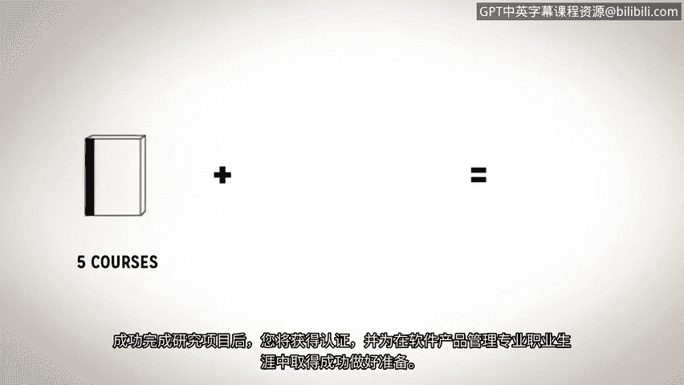

# 001：专项课程预告 🎬

在本节中，我们将简要介绍艾伯塔大学软件产品管理专项课程的整体框架与学习目标。

我是乔纳森·舍费尔，一名计算机科学家，现任艾伯塔大学理学院院长。

我很荣幸向您介绍由我校计算机科学系开发的软件产品管理专项课程。

这套系列课程将教会您如何成功地将一个软件产品从构思引导至交付。

艾伯塔大学被公认为世界领先的公立研究型与教学密集型大学之一。

作为加拿大顶尖大学之一，我们在科学、人文、创意艺术、商业、工程和健康科学等领域均以卓越著称。

我们的热情在于为学生成功提供起点。

我们的目标是激励、转变和提升我们的学生，并帮助他们实现目标。

强大的协作与沟通技能，对于复杂软件的开发至关重要，正如它们在我们生活的许多领域一样。

考虑到这一点，我们的计算专家团队将为您提供掌握敏捷软件开发所需的过程与实践。

我们对软件产品管理流程的实践经验，将为您提供直面挑战所需的一切。

我们将教您如何理解并优化客户的软件需求，以及如何将这些需求传达给开发团队。

您将学习从监控项目到确保其符合客户需求、遵循项目计划并达到预期质量水平的技术。

您将有机会加入一个软件产品管理社区，在那里您可以分享经验并从他人的见解中学习。

最后一门课程是一个为期六周的毕业项目，它将为您提供在真实模拟中应用这些管理技术的机会。

成功完成毕业项目后，您将获得认证，并为在软件产品管理职业生涯中脱颖而出做好准备。

很高兴您对我们的专项课程感兴趣。我们已经尽力使其成为一次有价值的教育体验。

现在轮到您了。祝您好运。

---

在本节课中，我们一起了解了艾伯塔大学软件产品管理专项课程的概览、目标以及它如何帮助您为成功的职业生涯做好准备。