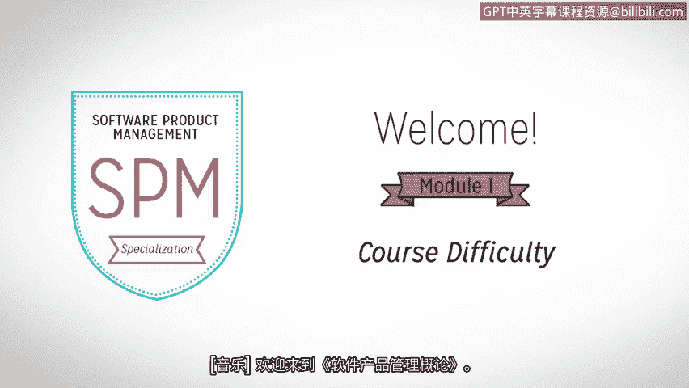

# 002：《软件产品管理简介》 🚀

在本课程中，我们将学习软件产品管理的基础知识。这是软件产品管理专项课程的第一门课，也是最短的一门。通过前两周的学习，我们将了解软件产品经理的角色、聆听行业专家的访谈、理解敏捷软件开发的核心，并对整个专项课程的内容有一个初步的认识。

## 课程概述与目标 🎯

本节将介绍本课程的基本信息和学习目标。

欢迎来到软件产品管理简介课程。

这是软件产品管理专项课程中的第一门课，也是课时最短的一门。

在前两周，我们将完成以下目标：描述软件产品经理的角色；展示对软件产品经理及其行业同事的访谈；解释敏捷软件开发的核心内容；并让你对专项课程后续涵盖的主题有一个整体了解。

在本入门课程结束时，你将能判断这个专项课程是否符合你的个人学习目标。

## 课程内容与受众定位 📖

上一节我们介绍了课程目标，本节中我们来看看课程的具体内容和适合的学习者。

如果你的背景是软件开发，你可能会觉得本入门课程中介绍的技术信息比较基础。

但对于软件领域之外的学习者，本课程将提供一些关键术语和概念，这些将是学习后续专项课程的基础。

如果你在学习本课程后感到意犹未尽，请继续学习我们专项课程中的下一门课。

## 核心技能：积极倾听与学习 💡

一个高效的软件产品经理需要具备核心技能。以下是关于这项技能的阐述。

一名高效的软件产品经理善于倾听，能够从可能无法完全表达或理解自身需求的用户那里，构想出有价值的产品。

善于倾听就像积极学习一样，当你对学习持开放态度时，即使只学到一件新事物，也可能极大地改变你对世界的理解。

我们希望你在深入钻研软件产品管理专项课程时能学到许多东西。

我们期待在论坛中听到你的观点。

## 总结 📝

本节课中我们一起学习了《软件产品管理简介》课程的基本框架和目标。我们明确了软件产品经理的角色描述、访谈学习、敏捷开发介绍是前三周的重点。课程兼顾了有技术背景和无技术背景的学习者，并强调了积极倾听与持续学习是产品经理的核心能力。我们鼓励你学完本课后，继续参与专项课程的后续学习与论坛讨论。