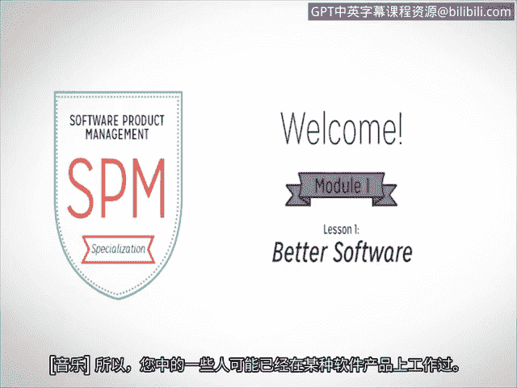
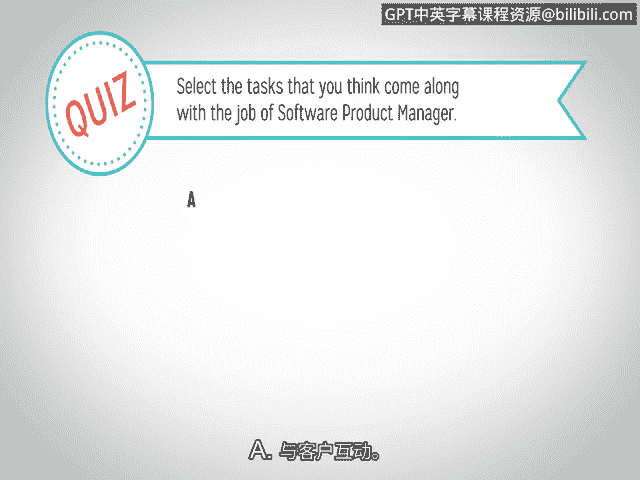

# 003：更好的软件

在本节课中，我们将要学习软件产品管理的基础概念，特别是如何从多个视角来理解和实现“更好的软件”。我们将探讨产品经理的角色、开发团队的构成，以及确保项目成功的三个核心视角。

---

大家好，欢迎来到Coursera的软件产品管理专项课程。我是Ken Wong，阿尔伯塔大学计算机科学系的副教授，我的专业领域是软件工程。

在本专项课程中，我的目标是让你成为一名自信且合格的软件产品经理。如果你已经是一名软件产品管理专家，那么我的目标是让你在这个领域变得更加出色。

---

回顾你过去参与过的软件项目，你是否思考过它是否成功？项目是否可以做得更好？我相信大多数人的答案是肯定的。本专项课程将向你展示如何与客户合作，并组织开发团队来打造更好的软件产品。

既然你已经知道项目可以做得更好，那么请花点时间思考一下，作为一名软件产品经理，你希望提升自己的哪些方面。当然，你可能需要精进许多技术技能，比如特定的平台、语言和工具。但除此之外，还有更多内容。让我们一起来探索。

---

前面提到，你将与一个开发团队合作。在整个专项课程中，我们会多次讨论这个话题。

请选择你认为通常构成软件开发团队的成员（可多选）：
A. 程序员、编码员或开发者
B. 客户
C. 用户界面专家和图形设计师
D. 质量保证专家或测试员

你将合作的每个开发团队都是独特且不同的。通常，一个开发团队由编码主力、创意设计师和测试人员组成。因此，最正确的答案是A、C和D。尽管你和你的开发团队会与客户紧密合作，但客户通常不被视为开发团队的一部分，所以排除答案B。

如今，打造出色的软件产品需要许多拥有不同技能的人持续协作。但他们应该如何组织？团队可以遵循哪些实践来让工作更有章可循，减少随意性？我们开始进入软件产品经理的领域了。

---

让我们思考一些其他你可能会感兴趣的问题。我们的目标不仅是更努力地工作，而且要更聪明地工作。这其中涉及各种问题：当需要协调许多团队成员时，当需要开发大量功能时，当项目预计持续数年时，我们该如何管理这一切？

同时，我们不能忘记我们真正要解决的问题是什么。即，客户在软件产品中真正想要什么？他们对质量有何期望？我们可以建立哪些流程和实践来确保这一点？

统筹这一切可能相当棘手，尤其是在资源有限的情况下。我们如何在时间有限时处理范围？我们如何应对变更或避免项目范围失控？对客户而言，他们的需求可能不确定并会随时间变化。对开发者而言，工作量可能随时间波动，不同开发者之间的生产力可能存在巨大差异，我们如何适应这种变化？这些问题始终萦绕在软件产品经理的脑海中。

在本专项课程中，我将教你有效的管理技术来处理这类问题。这些技术将帮助你协助团队生产出更好的软件。特别是，你将学习敏捷软件开发。

---

打造优秀产品的关键因素是参与其中的人和流程。你将听到更多关于敏捷实践与规划、需求、评审和回顾等主题。

作为开始，本介绍课包含两个模块。第一个模块强调了软件产品管理的重要性和角色，并概述了整个专项课程的目标、结构和期望。第二个模块则介绍了随着你深入专项课程，各门课程将涵盖的主题。

---

现在，想象你自己是一名出色的软件产品经理。你有一个靠窗的好位置。请选择你认为与此职位相关的工作任务：
A. 与客户互动
B. 管理和跟踪开发进度
C. 与开发团队协作
D. 在客户和开发团队之间传递信息
E. 确保产品质量

作为一名软件产品经理，你将与许多不同的人互动，包括客户和开发团队。你的任务还包括管理和跟踪开发进度。确保产品按预期工作，并验证产品满足客户需求也是你的职责。

然而，作为项目经理，你不需要充当客户和开发团队之间的信使；你应该鼓励他们直接、频繁地沟通。因此，正确答案是A、B、C和E。

---

好的，让我们开始讨论如何打造更好的软件。软件产品经理需要理解多个视角来实现更好的软件。

第一个视角旨在为客户提供正确的软件产品。“正确的产品”意味着什么？这可能意味着许多方面的结合：它满足客户需求、易于学习和使用、不浪费他们的时间，或许看起来也很美观。基本上，客户对它感到满意。如果属实，我们说软件项目得到了**验证**。

在本专项课程中，你将学习如何理解用户、如何获取他们的需求以及如何表达软件需求。

---

第二个视角旨在将软件产品**做对**。但“做对”意味着什么？这意味着软件符合特定设计，而该设计又满足了一组既定的需求。如果属实，我们说软件项目得到了**确认**。

开发者可以进行评审和测试，以确保需求、设计和实现保持一致。此类活动旨在尽早发现缺陷，提高质量。他们希望避免客户在发布的产品中看到任何缺陷。在本专项课程中，你将学习改进软件质量的流程。

---

第三个视角旨在将产品项目**管理对**。但“管理对”意味着什么？这意味着确保上述其他视角得到满足。其核心思想是采用恰当的流程和文明实践来组织所有相关人员的工作。如果属实，我们说软件项目得到了**管理**。

此类活动促进了沟通和反馈，使每个人都清楚下一步该做什么。在本专项课程中，你将学习敏捷实践、估算与规划以及监控。软件产品经理需要在这些活动中扮演核心角色。

---

总结一下，我刚刚解释了实现更好软件的三个视角：**正确的产品**、**做对**和**管理对**。随着你深入学习本专项课程，你将更有信心了解并运用这些技术来创建更好的软件项目。这些技术包括促进沟通与反馈的流程，以更好地理解客户需求并组织开发团队的工作。

接下来，让我们谈谈软件产品管理的重要性。

---

本节课中，我们一起学习了软件产品经理的角色、开发团队的典型构成，以及实现“更好的软件”所必需的三个核心视角：提供正确的产品、将产品做对、将项目管理对。理解这些基础概念是成为有效产品管理者的第一步。