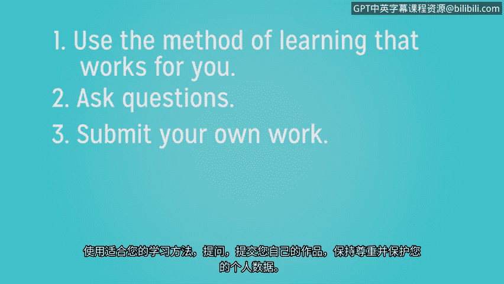

# 006：如何成为更高效的学习者 🧠

在本节课程中，我们将探讨一些能够帮助你在本专项课程中取得成功的具体方法。我们将介绍几种经过验证的、能够提升学习效果的习惯和策略。

上一节我们介绍了课程的整体结构，本节中我们来看看如何优化你的学习过程，以最大化学习成果。

我们希望为你提供一些在本课程中取得成功的建议。

以下是在我们的专项课程中已被证明能带来成功的、成为更好学习者的方法。

*   采用适合你的学习方法。
*   积极提问。
*   提交自己的作业。
*   保持尊重。
*   保护个人数据。

首先，我们建议你采用适合自己风格的学习方法。

我们为你提供了视频讲座和配套的课程笔记。两者共同提供了课程的完整视图，因此你可以选择对你最有效的方法。

*   如果你通过阅读材料学习效果更好，那么请使用我们的课程笔记。
*   如果你更偏向视觉或听觉学习，那么使用视频讲座可能会让你更成功。

视频讲座也配有字幕和文字稿可供阅读。因此，结合使用课程笔记和视频讲座或许对你效果最佳。

接下来，我们建议你积极提问。如果你对课程材料不确定，很可能其他人也有同样疑问。请将你的问题发布在论坛中。我们这里有一个强大的社区，其他学习者和课程助教都会非常乐意帮助你。

我们的第三条建议是提交自己的作业。我们的评估旨在帮助你练习课程中涉及的许多概念。然而，如果你不亲自完成作业，就无法获得评估所能提供的全部益处。你不仅错过了学习机会，而且抄袭他人的作业可能会导致负面后果。

根据Coursera荣誉准则，**抄袭**是指你在未给予适当署名的情况下，复制他人来源的文字、观点或任何其他材料。应通过正确的引用来给予署名。抄袭在学术环境中是不可接受的，并且严重违反了Coursera的荣誉准则。抄袭可能导致作业不及格、被移出课程，甚至被逐出Coursera社区。

接下来，我们鼓励你在课程中保持尊重。这是一个为来自世界各地众多学习者提供的学习环境。请尊重你的同学，并记住他们可能来自不同的文化、说不同的语言、背景与你不同。你也需要注意自己书写的语气。在书面文字中正确解读语气并不总是容易的，因此某些内容可能会被误解或曲解。任何煽动性言论都将不被容忍。

最后，为了成为更好的学习者，我们建议你保护个人数据。我们鼓励你与课程中的其他学习者建立联系，但建议你不要在讨论论坛中分享你的个人住址、电话号码或电子邮件地址。

本节课中我们一起学习了成为更高效学习者的五个核心要点：选择适合自己的学习方式、利用社区积极提问、独立完成作业以巩固知识、在交流中保持尊重与理解、以及时刻注意保护个人隐私与数据安全。遵循这些建议将帮助你在本课程及未来的学习中取得更好的成果。