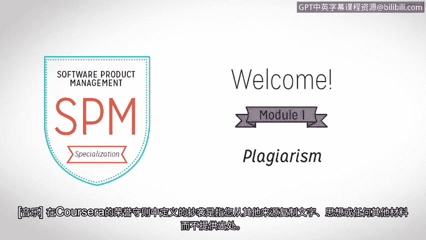

# 007：学术诚信与剽窃 🚫

在本节中，我们将学习学术诚信的核心概念，特别是剽窃的定义、表现形式及其严重后果。理解并遵守这些规则对于在学术和职业生涯中取得成功至关重要。

---

剽窃，根据课程荣誉守则的定义，是指**在未注明出处的情况下，复制他人文字、观点或任何其他材料的行为**。

剽窃在任何学术环境中都是不可接受的，是严重违反课程荣誉守则的行为。剽窃可能导致作业不及格、被取消课程资格，甚至被逐出课程学习社区。

那么，剽窃具体有哪些表现形式？什么行为会被视为剽窃呢？以下是几种常见情况：

**1. 直接复制粘贴他人文字**
如果你复制粘贴了他人撰写的文字，这将被视为剽窃，除非你正确地注明了出处。即使你改变了语序或替换了某些词语，你仍然必须为其原创工作署名。例如，在作业、测验或讨论区中复制粘贴其他学员或工作人员的答案，并将其作为自己的成果提交，这是被禁止的。

**2. 提交他人创作的文件**
在本专项课程的某些课程中，你可能会被要求提交图片或图表作为作业。提交由其他学员创作或提交的图片，并将其作为自己的作品，被视为剽窃，同样是被禁止的。

**3. 窃取创意观点**
某些作业可能需要一些创造性。窃取他人的创意观点，即使提交的文件是由你自己创建的，也被视为剽窃。在学术或商业环境中，两个人或更多人可能产生相同的想法。为了保护自己不被指控剽窃（不仅在本课程中，在你的职业生涯中也是如此），记录你的修改过程或以某种方式记录你的思考过程是一个好习惯。你可以考虑维护一个日志，记录每个想法或概念的起源时间。

---

请确保在整个专项课程的学习中，你提交的都是自己的原创工作。如果你在课程中发现剽窃行为，请标记该作业并提请课程工作人员注意。

---

在本节中，我们一起学习了剽窃的明确定义、几种具体表现形式及其带来的严重后果。遵守学术诚信是参与所有学习活动的基础，也是未来职业发展的必备素养。