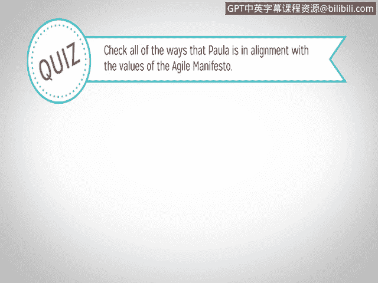

# 010：敏捷宣言 🚀

在本节中，我们将学习敏捷软件开发的核心思想——敏捷宣言。我们将了解它的起源、四大核心价值，并探讨如何在项目管理中应用这些理念。

上一节我们介绍了敏捷实践相较于随意管理方法的优势。本节中，我们来看看敏捷的具体定义和其核心价值。

敏捷宣言诞生于2001年，当时17位软件领域的专家聚集在一处滑雪胜地，共同探讨如何更好地管理软件开发过程，以创造出优秀的软件。这个重要的团体需要一个响亮的名字，于是他们被称为“敏捷联盟”。他们确立了关于软件开发中最重要事项的四大核心价值陈述。为了进一步阐述这些核心价值，联盟还一致同意了12条支持性原则。

以下是他们提出的四大核心价值：
1.  **个体和互动**高于流程和工具。
2.  **可工作的软件**高于详尽的文档。
3.  **客户合作**高于合同谈判。
4.  **响应变化**高于遵循计划。

这意味着，虽然右侧的项目仍有价值，但我们更重视左侧的项目。当敏捷联盟说他们更重视左侧的项目时，并不是建议你忽略流程和工具、详尽文档、合同谈判或遵循计划。他们是在建议，左侧的项目是更值得关注的重点。

---

为了帮助理解，让我们看一个案例。

保拉一直在为“真北航空航天系统”公司管理一个新数据库系统的开发。每两周，她都会邀请客户参加一个周五下午的会议，开发团队在会上演示最新的产品原型。本周的会议促使客户和开发团队讨论了一个新的用户界面功能，该功能将允许用户轻松地向数据库输入信息。保拉记录了新的需求，并提醒自己安排一次与法务团队及客户的会议。签署修订后的合同是必要的，以便团队获得新功能的书面规范。

请判断保拉在哪些方面符合敏捷宣言的价值观：
A. 定期演示新的原型。
B. 开发团队与客户有面对面交流的时间。
C. 随着新需求的识别，产品不断演进。
D. 更新合同以明确新功能。

**答案分析**：
*   选项A符合“交付可工作软件”的敏捷价值。
*   选项B符合“客户合作”和“个体与互动”的敏捷价值。
*   选项C符合“响应变化”的敏捷价值。
*   保拉的做法**不符合**“客户合作高于合同谈判”的敏捷价值。尽管她鼓励与客户频繁、开放的沟通，但她认为必须修订合同，开发团队才能知道已商定的功能规范。

---

现在，让我们详细解读宣言中的四大核心价值。

**价值一：个体和互动高于流程和工具。**
你的开发人员和客户在协作关系中会更高效、更有成效。作为产品经理，你不是一个传信员，你需要促进想要产品的人（客户）和制造产品的人（开发团队）之间的沟通。

**价值二：可工作的软件高于详尽的文档。**
请记住，宣言指出右侧项目仍有价值。因此，文档仍应在整个项目中持续创建。但当面临艰难抉择时，一个可工作的软件远比一份描述软件应该做什么的文档有价值得多。核心在于 **`可运行的代码 > 厚厚的需求文档`**。

**价值三：客户合作高于合同谈判。**
这意味着你需要与客户培养一种积极的关系，这种关系更关注他们想要什么，而不是过分拘泥于合同条款。客户是设计的中心，确保他们的愿景得以实现至关重要。

**价值四：响应变化高于遵循计划。**
软件是不断变化的，以易于响应变化的方式来开发软件非常重要。在你学习后续四门基础课程的过程中，你将学到许多使项目更易于应对变化的敏捷实践。

现在你可能会想，在你的项目中实施其中一项或多项价值可能不切实际。这没关系，敏捷是灵活的。重要的是，你去实施那些确实行之有效的价值。

---

本节课中，我们一起学习了敏捷宣言的起源和其四大核心价值：重视人与协作、重视可交付的成果、重视与客户的伙伴关系以及重视适应变化。理解这些价值观是实践敏捷软件产品管理的第一步。