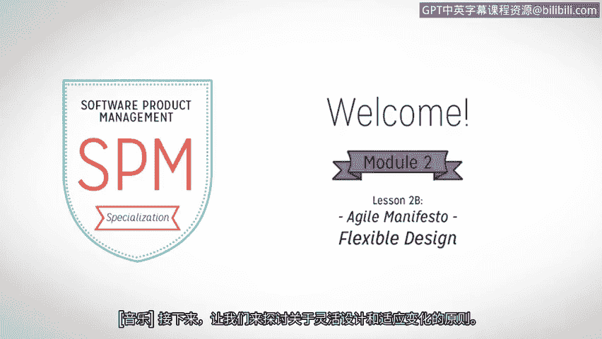
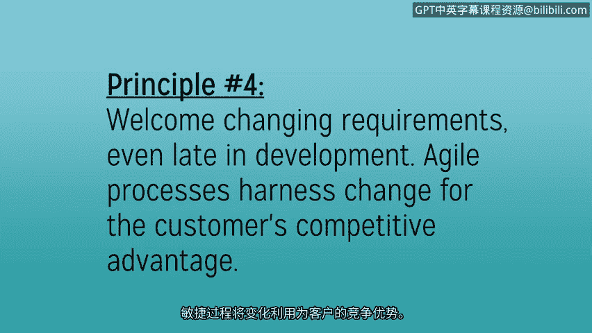
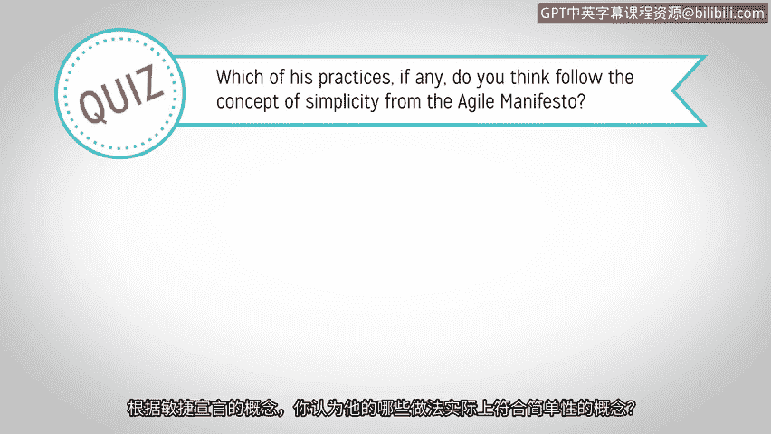

# 012：灵活的设计 🛠️

在本节中，我们将学习敏捷开发中关于灵活设计和适应变化的核心原则。我们将探讨如何通过拥抱变化、追求技术卓越、保持可持续的开发节奏以及崇尚简洁，来构建更具韧性和响应能力的软件产品。

---

上一节我们介绍了敏捷开发中以人为本的原则，本节中我们来看看另一组专注于灵活设计和适应变化的原则。

正如之前所述，变化在软件开发中是不可避免的。你需要以一种使变化不会造成损害的方式来规划项目。使产品更能响应变化的一个好方法是拥有灵活的设计和可适应的流程。

我将从第四个原则开始这一部分，它关乎需求的变化。这一原则将在后续的“客户需求与软件需求”课程中详细讨论。

该原则指出：**即使在开发后期也欢迎需求变更。敏捷过程利用变更为客户创造竞争优势。**

变化最终会创造出更好的产品，它能满足你的客户，并为你的产品带来竞争优势。

---

接下来这个原则谈到了良好的开发实践。它指出：**持续关注技术卓越和良好设计能增强敏捷性。**

拥有可读性强、简洁的代码和更灵活的设计，将使变更更容易实施。良好的设计可以让你了解哪些组件是相互依赖的。

---

下面我们将要审视的原则是关于可持续发展的。它指出：**敏捷过程倡导可持续发展。发起者、开发者和用户应该能够长期维持稳定的开发节奏。**

如果你曾在软件开发领域工作过，可能对在截止日期前赶工的糟糕情况并不陌生。这种不稳定的节奏会导致开发团队精疲力竭，并对项目成功产生负面影响。

---

我们已经进行到一半了，让我们继续前进，谈谈第七个原则，它关乎简洁性。

该原则指出：**简洁——即最大化未完成工作量的艺术——是根本的。** 这并不意味着敏捷就是交付得更少，而是意味着敏捷专注于交付本质内容，减少不必要的工作。

这意味着编写更少的代码和文档，专注于交付一个尽可能简单的高影响力产品。

---

以下是关于“简洁”原则的一个案例分析：

山姆是你开发团队中的一名开发人员。他痴迷于敏捷的简洁概念。他编写的软件代码非常精简，只完成它应该做的工作，没有任何不必要或复杂的代码。他也不添加注释来记录他的代码。山姆认为团队应该只开发使产品运行所必需的功能，而不应该把时间浪费在客户认为能为产品增加价值、但他认为无用的花哨功能上。他拒绝参与编写详尽的文档，但会写下他如何开发该功能的笔记、任何关键要点以及给最终用户的简短培训文档。

你认为他的哪些做法（如果有的话）真正遵循了敏捷宣言中的简洁概念？

A. 满足所需功能的最精简代码。
B. 代码中没有注释。
C. 只开发基本功能。
D. 必要的文档而非详尽的文档。

山姆对简洁的看法并不完全符合宣言的建议。但他在某些方面是正确的。

*   最精简的代码是专注于简洁的好方法。
*   代码中的注释有助于解释特定解决方案的原理。使用注释可以使代码更容易与其他开发人员共享，这是为项目添加少量但有效文档的简单方法。
*   此外，团队开发功能不应基于自己对重要性的判断标准，而应基于什么能满足客户。如果功能能为产品增加价值并且是客户需要的，那么就应该实施。作为产品经理，你可能需要解释某些功能为何能增加价值。
*   然而，他的文档风格是将必要信息传递给正确人员的好方法。可能不需要全面的文档，简短简洁的文档反而可能鼓励人们真正去阅读它。

因此，**A和D是正确答案**。

---

在本节课中，我们一起学习了敏捷宣言中关于灵活设计的核心原则：拥抱变化以获取竞争优势、通过技术卓越和良好设计提升敏捷性、保持可持续的开发节奏，以及崇尚简洁的艺术。理解并应用这些原则，有助于我们构建更能适应变化、更高效且更可持续的软件产品。