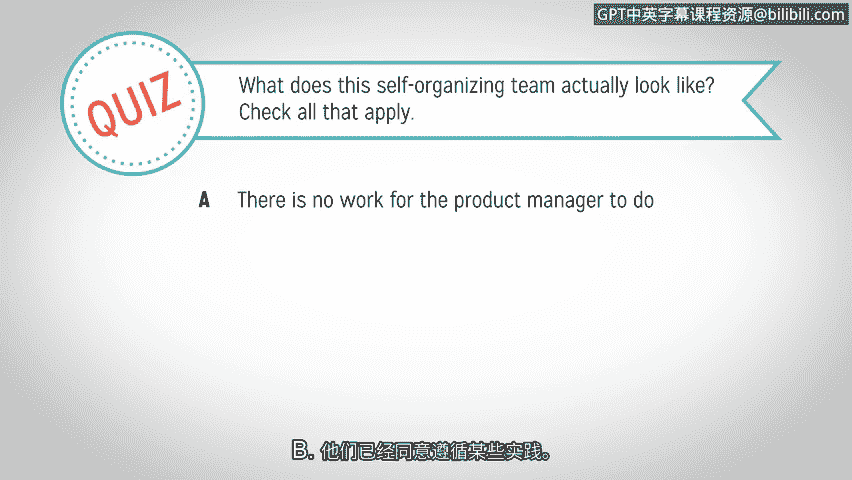

# 013：协作式沟通 🗣️

在本节中，我们将学习敏捷开发中关于协作式沟通与团队组织的核心原则。这些原则旨在促进团队内部及团队与客户之间的有效沟通，从而推动卓越的软件开发。

上一节我们探讨了敏捷的核心价值观，本节中我们来看看支撑这些价值观的具体原则，特别是关于沟通与协作的部分。

## 原则八：信任与赋能

第八条原则强调了信任的重要性。其表述如下：

> **围绕积极主动的个体构建项目。为他们提供所需的环境和支持，并信任他们能够完成工作。**

这意味着，作为产品经理，有时需要退后一步。这或许不易做到，但重要的是更多地扮演团队**促进者**的角色，而非控制者。乔治·S·巴顿将军曾说过：“**告诉人们目标，而非方法，你会对结果感到惊讶。**”

## 原则九：自组织团队

下一条原则是关于自组织。其表述如下：

> **最好的架构、需求和设计出自自组织团队。**

敏捷鼓励团队进行自组织。这意味着团队作为一个整体，自行决定如何组织项目，包括诸如**分配任务**和**选择使用工具**等事项。

## 原则十：紧密的客户-开发者协作

我们已接近尾声，第十条原则关注客户与开发者的沟通：

> **业务人员和开发者必须在整个项目期间每天一起工作。**

😊 再次强调，作为产品经理，你将扮演促进者的角色，但绝不应成为双方之间的**传话筒**。

## 原则十一：面对面沟通

倒数第二条原则是关于沟通方式：

> **向开发团队传递信息以及团队内部沟通，最有效且高效的方法是面对面交谈。**

😊 能够直接与项目团队成员交谈，可以减少误解的机会，并提高工作推进的速度。

以下是关于实施此原则的建议：

*   如果团队具备**同地办公**的条件，应充分利用这一点，进行频繁而简短的面对面会议。
*   当团队分布在全球时，应使用**视频会议**等沟通工具。虽然效果不及面对面交流，但尽力而为至关重要。😊

## 原则十二：定期回顾与调整

最后但同样重要的一条原则是关于回顾已完成的工作：

> **团队定期反思如何能变得更高效，并相应地调整其行为。**

你的**流程**与你正在创造的产品非常相似：你需要测试你的流程、回顾它们并进行改进。敏捷培训师兼作者亨德里克·克努伯格曾说：“**重要的不是你的流程，重要的是你改进流程的流程。**”

流程与编写代码非常相似。一个首次就完美的流程，等同于一个首次编译就毫无缺陷的程序——这是不可能的。

---

## 知识应用：自组织团队实践

假设你在一家为航空公司开发应用程序的全球性企业工作。你最新的项目是管理一个取代飞机上电视屏幕的娱乐应用的开发。你的开发团队在开发和敏捷实践方面都经验丰富，他们实行自组织。

那么，这个自组织团队实际上是什么样子的？请选出所有适用的选项。

A. 产品经理无事可做。
B. 他们已商定要遵循的某些实践。
C. 他们决定在完成任务时自行分配新任务。
D. 他们任命了一位负责团队的领导者。

**B**和**C**是团队实现自组织的绝佳方式，也是正确答案。自组织团队旨在鼓励沟通、团队合作、高效开发、积极性和相互尊重。

任命一位领导者并不能让每个人都处于同等的尊重水平，也无法鼓励平等的责任感。一个自组织团队也并不意味着你无事可做；你的职责是**管理并指导他们实践自己选择的工作方式**。

---

## 总结与前瞻

现在你已经了解了敏捷宣言及其原则，你可能会想，我给出了所有这些原则，但还没有提供应用它们的具体方法。

在本专项课程中，你将学习的大多数概念和实践都将与一条或多条敏捷原则相关。到本专项课程结束时，你将掌握工具和知识，能够自信地将这些原则应用到你的项目中。

为了从本课程中获得最大收益，建议你重温敏捷宣言，并将后续课程中学到的内容与本课介绍的原则及核心价值观联系起来。如果你有兴趣了解更多关于敏捷宣言的信息，可以访问 `agilemanifesto.org`。

**本节课中，我们一起学习了敏捷开发中关于协作沟通与团队组织的核心原则，包括信任、自组织、紧密协作、面对面沟通以及持续改进。** 这些原则共同构成了高效敏捷团队的基础。

既然你已了解这些敏捷原则，接下来就需要将它们应用到具体事务中。每一个优秀的项目都离不开流程。在我们的下一课中，你将学习为什么流程对产品管理和开发如此重要。我们下节课见。