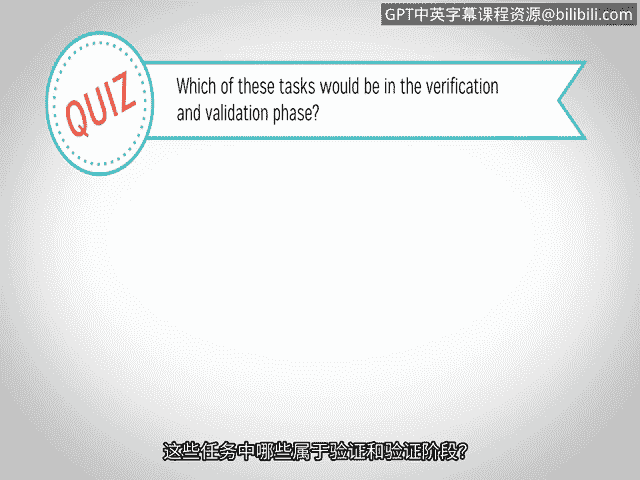

# 014：为什么需要流程

在本节课中，我们将要学习为什么在软件开发中需要一个明确的流程。我们将探讨流程的定义、其包含的阶段，以及一个良好流程如何帮助团队避免混乱、提高效率并最终交付成功的产品。

---

上一节我们介绍了敏捷宣言的价值观和原则，本节中我们来看看如何将这些原则以实际的方式应用到项目中。

一个流程是应用这些原则的良好基础。流程将人们的工作组织成不同的阶段或步骤，以开发一个软件产品。

以下是你在思考软件开发时可能会想到的一些阶段：
*   规划项目。
*   编写代码。
*   测试软件。
*   维护产品。

这些是一些例子，但你可以用许多方式来构建开发流程。在后续的“软件流程与敏捷实践”课程中，你将探索几种组织软件开发流程的模型。

为了理解什么是阶段，让我们思考一个简单的问题：如果你要创建一个制作披萨的流程，你认为阶段可能是什么？
A. 饼皮、酱料、奶酪、意大利辣香肠。
B. 规划、准备、组装、烹饪。
C. 拨打、订购、吃、剩菜。
D. 制作、烘烤、吃、吃剩菜。

A不正确，因为这些更像是原料而非可执行的阶段。C可能是正确的，但前提是我们创建的是订购披萨的流程，而不是制作披萨的流程。D不正确，因为它包含的是低层次的动作，而非阶段。因此，B是正确答案，因为它包含了规划、准备、组装和烹饪这些高层次阶段。

尽管在产品生命周期中组织工作的流程多种多样，但它们通常共享“阶段”这个高层次概念。阶段的例子包括：**需求规格说明**、**设计与实现**，以及**验证与确认**。

*   **需求规格说明**是构思产品创意的阶段。当你能够明确软件将要做什么时，你就知道需求规格说明阶段已经完成。
*   **设计与实现**是找出构建软件最佳方式的阶段，这允许有效的设计和编码工作开始。
*   **验证与确认**是你测试软件缺陷并确保系统交付了客户所需功能的阶段。

流程对于组织你的开发工作并确保你以逻辑顺序完成任务是必要的。它们还能确保步骤不被遗漏或忽视。当你不知道从何开始时，软件开发是相当艰巨的，流程也为你应该从项目的何处开始提供了清晰性。

---

让我们通过一个练习来巩固对阶段的理解。假设你是一个开发新视频游戏项目的产品经理，你的团队负责角色选择界面。

你的团队需要完成的一些任务包括：
*   为选择角色编写测试。
*   规划角色的外观。
*   为多人选择编写源代码。
*   为更改角色颜色执行测试。

那么，哪些任务属于验证与确认阶段？
A. 为选择角色编写测试。
B. 规划角色的外观。
C. 为多人选择编写源代码。
D. 为更改角色颜色执行测试。

**为选择角色编写测试**和**为更改角色颜色执行测试**都有助于评估产品是否按预期方式工作。因此，答案A和D是验证与确认阶段的一部分。

---

现在，让我们思考一下没有流程的软件开发会是什么样子。想象你有一个很棒的应用创意，如果你仅仅凭想象就开始直接编码，这就像坐在键盘前，期望一部伟大的小说能从你的指尖自动打出来。这通常被称为**临时性开发**。

你按时生产出好产品的机会非常渺茫，事实上，甚至可能是不可能的。临时性开发会带来许多不同的问题，一个主要的担忧是**糟糕的设计**。如果你的编程是随着想法在脑海中闪现而进行的，你将会花费大量时间开发构思不佳的功能，结果却在开发中途改变主意。时间是宝贵的，而重新开始是昂贵的。

通过一个设计良好且每个人都遵循的流程，你将能够监控项目的所有方面。这种可见性将帮助你有效地设定工作预期、管理风险、避免浪费资源，并交付一个经过深思熟虑的产品。当开发者理解流程时，他们也能够在开发早期更好地剔除缺陷或糟糕的设计。朝着共同目标共同努力将节省时间和金钱。

一个定义明确的软件流程也为开发团队中的每个人规定了角色和职责。采用软件流程似乎是产品开发的一个自然步骤，甚至流程会自然出现这一点可能看起来很直观，但遵循一个定义好的流程模型能让每个人都知道该期待什么。随着你在专业课程中的深入，你将熟悉许多行业标准的软件流程模型。

一个稳健的软件开发流程是你构建优秀软件的发射台。所有开发流程的第一步都是理解你要创造什么，也就是我们下一课的主题：初始软件需求。

---

本节课中我们一起学习了软件开发流程的重要性。我们定义了流程及其核心阶段（需求、设计、验证），并通过例子说明了流程如何帮助团队避免临时开发的陷阱，确保工作有序、高效地进行，从而为交付成功的软件产品奠定坚实基础。