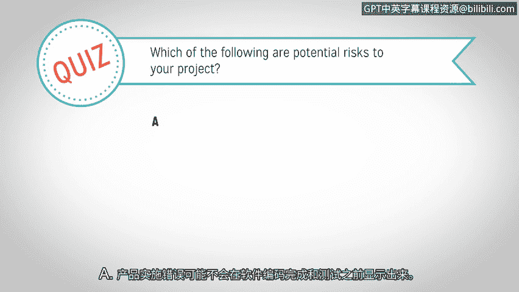

软件产品管理课程1：1.2.4：为什么需要需求

🎯

我是布拉德利·普莱特。我曾在多个软件项目中担任项目经理，并在阿尔伯塔大学广泛学习了该领域的相关技术。我对软件产品管理充满热情，并很高兴能与您分享这份热情。

在本节课中，我们将探讨为什么需求在软件项目中至关重要。我将首先概述我们需要需求的主要原因，并举例说明当您忽视这些需求时会发生什么。

那么，让我们从为什么需要需求开始。

需求是对客户需求的一组具体描述。我将在后续的“客户需求与软件需求”课程中更详细地介绍这一点。目前，您只需知道客户是最初希望构建软件产品的人或群体。

需求与流程相结合，是任何成功软件项目的支柱。那么，是什么让它们如此重要呢？

以下是一个优秀社交网络应用的需求列表示例：
*   用户可以在其数据中存储用户档案。
*   向其他用户发送消息。
*   查看其他用户的档案。
*   创建状态更新。
*   查看其他用户的状态更新。

这是一个相当简单的例子，但您应该明白了：**需求决定了软件产品的功能**。

那么，如果您收到一个看似简单的请求，比如“用户可以通过应用相互交谈”，会发生什么？这如何转化为需求？用户是否应该能够相互发送语音便笺、文本消息，还是脑电波？还有“可以”这个词，用户是否只能在一天中的特定时间相互交谈？

这种模糊性会给开发人员带来巨大的困惑，特别是如果大多数用户需求都同样不明确。您需要获取更多细节才能真正确定下来。

在软件开发中，避免混淆极其重要。这始于知道如何正确地获取和表达需求。

通过花时间细化需求，您还可以在产品构建之前就发现潜在的错误。通过澄清想法，开发变得专注且高效。

这里有一个例子。您的一位开发人员已开始开发这个社交网络应用，并遇到了这个需求：“用户必须能够以访客身份发送消息。”

开发人员可能会根据这个需求设计一个系统，让用户可以选择登录自己的账户或使用访客账户。一个单一的访客账户满足了需求，但是当许多不同的用户都可以访问同一个访客账户时，是否会产生意想不到的后果？

由于开发人员对需求的理解，这个访客账户变成了一个大账户，任何人都可以在其中给任何人发消息并查看对话。这个不幸的设计错误是需求定义不清的结果。

想象一下，构建一个考虑不周的功能会投入多少时间和精力。实现它会很昂贵，而修复它则更加昂贵。

让我们看看您是否能找出需求在软件开发中如此重要的关键原因。

在下面的测验中，请选择您认为最能说明为什么需要需求的选项。

您正在与客户合作，为软件产品获取一组需求。客户拿出一张餐巾纸，在上面勾勒了一个具有几个概要功能的应用草图。他说：“这就是我们想要的产品。”如果您接受这份文件作为最终需求集，而不是与客户一起细化它们，您的项目可能面临以下哪些潜在风险？

A. 产品实现错误可能直到软件编码完成并测试后才会显现。
B. 产品可能无法满足最终用户的需求。
C. 客户对产品的外观和感觉有过多意见。
D. 相关人员缺乏协作，士气下降。

答案是 A、B 和 D。

客户对产品的外观和感觉有过多意见并不是产品风险。客户在流程中的参与度越高，事情往往进展得越顺利。这并不是说您应该让客户完全控制开发，而是应该协作以创造最佳产品。协作也有助于提高士气，一个快乐的团队往往能更快地完成任务。

要了解更多关于如何确保充分利用需求的信息，我鼓励您学习 Coursera 上本专项课程中的“客户需求与软件需求”课程。

在下一节课中，摩根将讨论为什么需要花时间规划项目。感谢观看。

---

**本节课总结**

在本节课中，我们一起学习了需求在软件项目管理中的核心重要性。我们明确了需求是客户需求的具体描述，是决定产品功能的基石。通过具体示例，我们看到了模糊需求如何导致开发混乱、设计错误以及巨大的时间和成本浪费。最后，我们通过测验巩固了认识：清晰、细化的需求有助于**避免实现错误**、**确保产品满足用户**，并**促进团队协作与士气**。忽视需求提炼将直接带来这些项目风险。