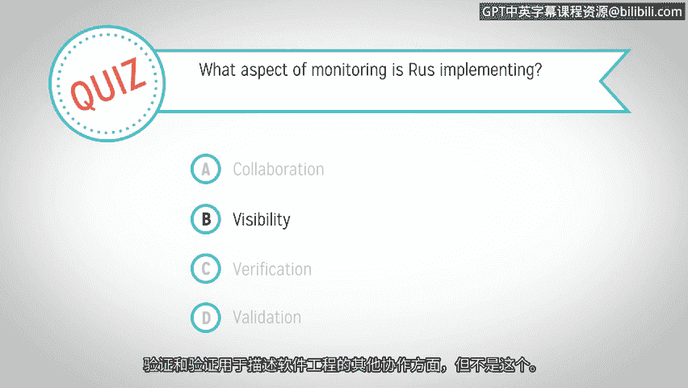

**软件产品管理课程1：1.2.6：为什么要监控** 🎯

在本节课中，我们将要学习在软件开发项目中，为什么在计划制定后，持续监控项目进展是至关重要的。我们将探讨监控的目的、好处以及它如何帮助团队避免常见陷阱。

---

上一节我们介绍了制定开发计划的重要性。本节中，我们来看看当计划开始执行后，产品经理需要做什么。

仅仅制定计划并让开发团队开始工作是不够的。为了确保项目按计划进行，产品经理必须**主动监控、分析和评审**项目进展。

考虑以下场景：你正在为客户做一个项目。你已经建立了开发流程，明确了需求，并完成了所有计划。开发团队正愉快地进行编码，一切似乎都按计划进行。几周、几个月过去了，现在距离截止日期只有两周。你看了看项目结束时仍需完成的工作，感到恐慌——至少还有一个月的任务量。你将不得不告诉客户无法按时交付。突然间，开发团队开始加班加点，办公室一片狼藉，开发人员疲惫不堪，产品质量急剧下降。客户因你未能遵守约定的截止日期而指责你。当一切似乎都很顺利时，你是如何陷入这种境地的？

遗憾的是，这种情况在软件开发中非常普遍。个人的忙碌并不足以确保有效的进展。仅凭“感觉良好”来衡量项目真实进度是不可靠的。如果你有过软件开发经验，很可能对“项目截止日期意外临近时出现的赶工现象”再熟悉不过了，这通常伴随着大量未完成的工作。如果你从一开始就监控项目进展，或许就能完全避免这种情况。

但不必担心，几十年来，软件开发社区已经建立了成熟的实践来避免上述问题。

既然你了解了监控进展的重要性，让我们看看你是否还记得一些原因。

以下是关于监控目的的一个思考题：

斯科特是一名软件产品经理。由于客户不断改变对产品功能的要求，并且他的开发团队工作速度不够快，他将错过一个主要截止日期。他对客户在项目中的“多管闲事”感到沮丧，并认为跟踪开发人员的个人工作将使他能够在他们表现不佳时采取纠正措施。

请选择斯科特通过监控能解决的问题：
A. 适应不断变化的产品需求。
B. 避免解雇效率最低的开发人员。
C. 不受客户干扰地工作。
D. 满足项目计划截止日期。

**监控帮助我们适应变化并满足截止日期。** 虽然监控进度允许你跟踪开发人员的工作效率，但它不应被视为评估其职业发展的方式。同时，它也不能替代与客户的良好沟通。因此，正确答案是 **A 和 D**。

监控进度只是我们确保项目健康的一种方式。它能让你轻松识别何时出现问题，并做出适当的调整来解决问题。你也能识别项目中进展顺利的部分，并庆祝这些小的胜利。这不仅能让项目保持在正轨上，提高交付给客户时的产品质量，还能**提升团队士气**，并在项目内部提供高度的**透明度**。

需要明确的是，透明度并不意味着跟踪开发团队的进度却对他们保密。透明度意味着团队中的每个人（而不仅仅是管理层）都知道项目的状态。当开发团队和产品经理以积极、目标驱动和基于团队的心态共同监控进展时，监控可以成为凝聚团队的一种方式。没有人喜欢赶工，而监控是团队可以用来互相帮助、避免熬夜和长时间加班的一种方法。

现在你已经了解了监控如何影响团队，让我们测试一下你的理解。

罗斯是一名产品经理，正与他的开发团队进行一个项目。他选择在整个项目中分享他所跟踪的细节，以便让整个团队都了解情况。

他正在实施监控的哪个方面？
A. 协作
B. 可见性
C. 验证
D. 确认

**可见性**是我们用来描述团队中每个人都知道项目状态的词语。这使得 **B** 成为正确答案。虽然监控通常会因更多的讨论而促进开发团队内部的协作，但罗斯在这里并非专门实施这一点。验证和确认用于描述软件工程的其他协作方面，而非此处的场景。

---

因此，监控进度的核心在于**按时并按规格交付产品**的理念。这当然有助于开发出更好的软件，并最终让客户更满意。

但监控的意义远不止于在紧张的时间表下创造出色的产品。如果做得好，监控可以成为一种极佳的方式，来**建立共同的目标感**，并让你的开发人员感受到自己是紧密团结的团队的一部分。

如果你想了解更多，我鼓励你加入本专业课程的最后一门课，在那里我将深入探讨你可以用来监控和评审项目的具体方法。

---

**总结**

在本节课中，我们一起学习了为什么监控是软件产品管理的关键环节。我们了解到，仅靠计划和感觉无法保证项目成功，主动监控可以帮助我们：
*   **适应需求变化**。
*   **确保按时交付**。
*   **提前发现问题并调整**。
*   **提升团队士气与透明度**。
*   **避免有害的“赶工”现象**。

有效的监控不仅是管理工具，更是促进团队协作、实现共同目标的重要手段。