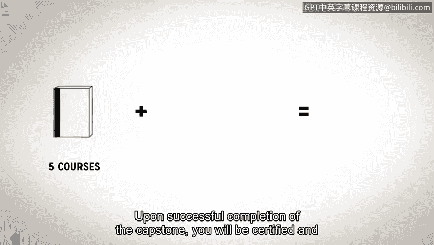

# 018：《软件产品管理简介》｜课程概览

在本节课中，我们将要学习艾伯塔大学软件产品管理专项课程的总体介绍，了解课程的目标、内容结构以及学习完成后你将获得的技能。

---

大家好，我是乔纳森·舍费尔，一名计算机科学家，现任艾伯塔大学理学院院长。

我很荣幸地向大家介绍艾伯塔大学计算机科学系开发的软件产品管理专项课程。

这套系列课程将教你如何成功地引导一个软件产品从构思到交付的整个开发过程。

艾伯塔大学被公认为世界领先的公立研究型与教学密集型大学之一。作为加拿大顶尖大学，我们在科学、人文、创意艺术、商业、工程和健康科学等领域均以卓越著称。我们的热情在于为学生成功提供起点，目标是激励、转变和提升我们的学生，并帮助他们实现目标。

强大的协作与沟通技能，对于复杂软件的开发至关重要，正如它们在我们生活的许多领域一样。考虑到这一点，我们的计算专家团队将为你提供掌握敏捷软件开发所需的过程与实践方法。

我们对软件产品管理流程的实战理解，将为你提供直面挑战所需的一切。我们将教你如何理解并优化客户的软件需求，以及如何将这些需求传达给开发团队。

以下是本专项课程的核心学习内容：
*   你将学习从监控项目到确保其符合客户需求、遵循项目计划并达到预期质量水平的技术。
*   你将有机会加入一个软件产品管理社区，在那里你可以分享经验并从他人的见解中学习。

最后一个课程是一个为期六周的毕业项目，它将为你提供在真实模拟环境中应用这些管理技术的机会。成功完成毕业项目后，你将获得认证，并为在软件产品管理职业生涯中脱颖而出做好准备。

我们很高兴你对学习我们的专项课程感兴趣。我们已经尽力使这成为一个有价值的教学体验。

现在轮到你了。祝你好运。

---

本节课中，我们一起学习了艾伯塔大学软件产品管理专项课程的总体框架。我们了解到，该课程旨在通过一系列理论与实践相结合的教学，培养学员从需求分析到产品交付的全流程管理能力，并最终通过一个实战毕业项目来巩固所学技能，为职业发展做好准备。